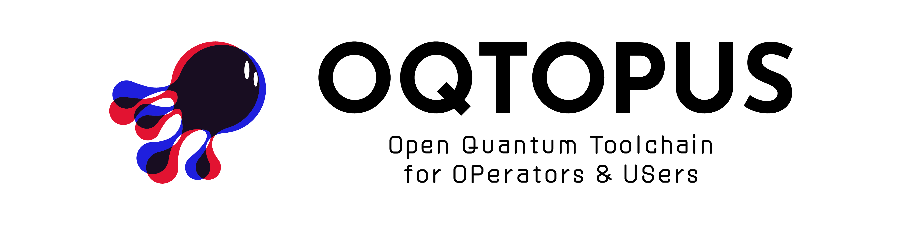
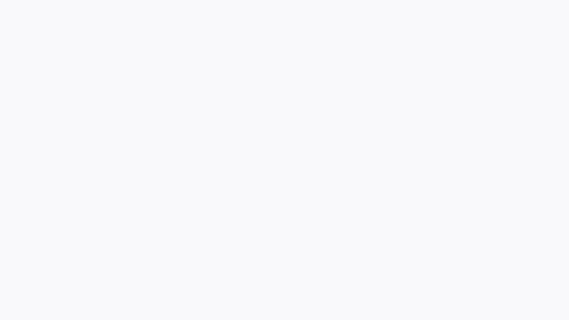

# QDash

QDash is a web platform for running qubit calibration workflows, reviewing measurement results,
and tracking calibration parameters and their history.

[Watch the demo with sound](https://oqtopus-team.github.io/qdash/user-guide/what-is-qdash#demo)

## Start Here

- [Try QDash](https://oqtopus-team.github.io/qdash/user-guide/setup) with the Fake backend, then
  [run your first calibration](https://oqtopus-team.github.io/qdash/user-guide/first-calibration).
- [Connect hardware](https://oqtopus-team.github.io/qdash/user-guide/setup/qubex-backend) with the Qubex backend.
- [Use QDash](https://oqtopus-team.github.io/qdash/user-guide/) to run workflows, review results, and share findings.
- [Develop QDash](https://oqtopus-team.github.io/qdash/developer-guide/) to change and test the code.

Read [System Updates](https://oqtopus-team.github.io/qdash/user-guide/system-updates) before upgrading.

## Citation

Use [CITATION.cff](./CITATION.cff) to cite QDash.

## Contact and License

Open a [GitHub issue](https://github.com/oqtopus-team/qdash/issues) or email
[oqtopus-team@googlegroups.com](mailto:oqtopus-team@googlegroups.com).
QDash is licensed under [Apache 2.0](./LICENSE).
