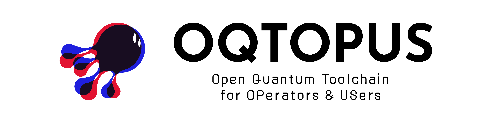

# QDash

QDash is a web platform for running qubit calibration workflows, reviewing measurement results,
and tracking calibration parameters and their history.

[Watch the demo with sound](https://oqtopus-team.github.io/qdash/user-guide/what-is-qdash#demo)

To try QDash in your browser without installing anything, select **Launch QDash Demo**: it
creates a private codespace, billed to your GitHub account, that runs QDash on sample data; see
[QDash Demo in Codespaces](https://oqtopus-team.github.io/qdash/user-guide/setup/codespaces-demo).
To install QDash without quantum hardware, follow
[Setup](https://oqtopus-team.github.io/qdash/user-guide/setup) with the
[Fake backend](https://oqtopus-team.github.io/qdash/user-guide/setup/fake-backend), then
[Run Your First Calibration](https://oqtopus-team.github.io/qdash/user-guide/first-calibration);
to connect a lab system, start with
[Setup](https://oqtopus-team.github.io/qdash/user-guide/setup) and choose the
[Qubex backend](https://oqtopus-team.github.io/qdash/user-guide/setup/qubex-backend). Read
the release notes and [System Updates](https://oqtopus-team.github.io/qdash/user-guide/system-updates)
before upgrading an existing deployment.

## Features

- **Run calibrations**: Create, schedule, and monitor calibration workflows, or run an individual
  task from the workbench.
- **Inspect results**: Compare chip metrics, task results, artifacts, parameter history, and
  provenance.
- **Collaborate**: Connect results to notes, forum threads, task knowledge, AI evaluations, and
  notifications, scoped to a project.

## Documentation

- [What is QDash?](https://oqtopus-team.github.io/qdash/user-guide/what-is-qdash): the
  calibration loop and what QDash manages.
- [Setup](https://oqtopus-team.github.io/qdash/user-guide/setup): choose a backend, deploy
  QDash, and sign in.
- [Run Your First Calibration](https://oqtopus-team.github.io/qdash/user-guide/first-calibration):
  create a chip, run a workflow, and inspect its first result.
- [Operations](https://oqtopus-team.github.io/qdash/user-guide/operations) and
  [System Updates](https://oqtopus-team.github.io/qdash/user-guide/system-updates): run and
  upgrade a deployment.
- [Developer Guide](https://oqtopus-team.github.io/qdash/developer-guide/): architecture,
  development setup, and contribution flow.

## Citation

You can use the DOI to cite QDash in your research.

Citation information is also available in the [CITATION](https://github.com/oqtopus-team/qdash/blob/main/CITATION.cff) file.

## Contact

You can contact us by creating an issue in this repository,
or you can contact us by email:

- [oqtopus-team[at]googlegroups.com](mailto:oqtopus-team@googlegroups.com)

or you can join our Slack workspace:

## License

QDash is released under the [Apache License 2.0](https://github.com/oqtopus-team/qdash/blob/main/LICENSE).
