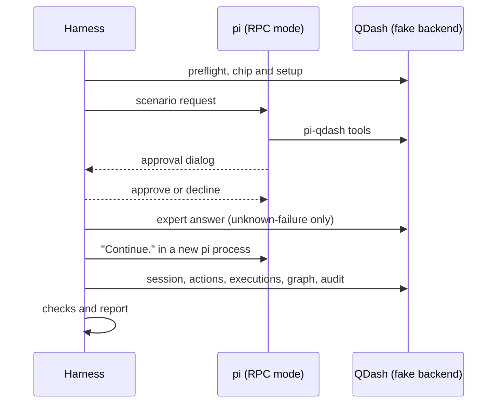

# Agent Loop Validation

The agent loop validation runs the [model-driven loop](./agentic-calibration.md#the-model-driven-loop)
with the configured chat model, the production pi-qdash tools and skills, and a real local QDash
on the [fake backend](../../user-guide/setup/fake-backend.md), then judges each scenario from
QDash's records. It complements `agent-runtime/test/agent-loop-parity.test.mjs`, where a scripted
model calls the tools against an API fake: the parity tests prove the tools and hosts, and this
run shows what a real model does with them. It is opt-in and never runs in CI, because it needs
a model endpoint and a running deployment.

The harness (`agent-runtime/validation/fake-loop/`) plays the user and the expert and nothing
else. It sends a natural-language request to pi, answers pi's approval dialogs, answers the
intervention, and reads the records; the model makes every calibration decision.



## Scenarios

`scenarios.ts` holds one fixture per scenario: the request, the approvals the harness gives, and
the records QDash must show. Every scenario targets the one qubit given with `--qid`.

Because the scenarios share that qubit, a session an earlier scenario or run left active can
cover a later goal, and reusing it would make the scenario judge a session it did not create.
Each measuring request therefore ends with "Start a new agent session for this request."
(`FRESH_SESSION`), and the non-gating `open_sessions_at_start` check lists the signed-in user's
active and waiting sessions on the chip before the scenario starts. No scenario validates
resuming an existing session, and the harness cancels nothing.

| Scenario | Request | QDash must show |
| --- | --- | --- |
| `stored-t1` | What is the T1 of the qubit | No session, no measurement, no commit |
| `t1-rerun` | Measure T1 again; the rest is calibrated | One session limited to `CheckT1`, exactly one `CheckT1` measurement, no commit |
| `dependent-commit` | Recalibrate the frequency with CheckChevron, update it without asking again if the result is good, then check CheckRabi | One session approval that grants `parameter_updates` for `qubit_frequency` from `CheckChevron`; `CheckChevron`, a `qubit_frequency` commit with `authority: session_policy` and no commit dialog, then `CheckRabi` proposed after the commit; at most three measurements |
| `purpose-pipeline` | Keep a T1 re-check under one objective, run it as a pipeline that measures only `CheckT1`, then say which executions belong to it and how each was started | One calibration session on the chip by the signed-in user; exactly one pipeline run in it, dispatched and completed, with the reported origin `agent_tool`/`qdash_run_pipeline`/`pi-qdash`; every step execution's list row and detail link to that session `via: pipeline_run` with that origin, no agent session, the signed-in user, and only `CheckT1` on the qubit; no other execution on the chip; the session read back with `qdash_get_calibration_session` after the run started; the harness's manual baseline pipeline with no session, origin, or agent session; no agent session, measurement, or commit |
| `unknown-failure` | Measure T1 again, with the validation fault armed for `CheckT1` | The first `CheckT1` failed by its action, execution, and graph records and names the fault; an intervention cites it and pauses the session; nothing proposed or dispatched until the answer; then exactly one completed `CheckT1`, proposed and started after the continue prompt, whose graph node cites the failed action as `repeat_of_action_id`, and no second session |

A measurement counts as completed only when every record agrees: the action's execution status,
the chip's execution record and its link to the action, the graph node's execution and task
result for the action's task and qubit with no missing facts, and the `server_record` audit event
naming the same execution and task result. A failed, cancelled, still running, or mismatched
measurement fails `measurement_completed:<action>` and the scenario's `measured:<task>` check.
The one exception is the failure `unknown-failure` arms on purpose, which the fault checks judge
instead.

In `unknown-failure` the harness hides `qdash_wait_agent_intervention`, so the first turn ends at
the pause. Before answering, it reads the session status, checks that the failed execution names
the fault id, and removes the fault file. It then answers as the signed-in project editor with
`decision: resume` and guidance that asks for one repeat of `CheckT1`, and sends the continuation
request, which ends in "Continue.", to a new pi process; the model must find the session from
QDash's records (see [Continuing](./agentic-calibration.md#continuing)). The repeat's proposal
time, graph dispatch time, and execution start times must all follow the moment the continue
prompt was sent, so a repeat dispatched between the answer and the prompt fails
`repeat_after_continue`; a repeat without a recorded execution start fails it too.

In `purpose-pipeline` the request states the objective and what the user wants to learn and
names no tool; whether to create a calibration session, how to write the spec, and how to read
the result back are the model's choices, and the checks judge the records. Before the prompt
the harness starts its baseline itself with `POST /calibration-pipelines/execute`, without
`calibration_session_id` or `reported_origin`, as a person using the API would, and waits for
it to finish; its executions start before the scenario, so they are judged only by
`baseline_unassociated`. The scenario is blocked when the OpenAPI document lacks the calibration
session routes, `ExecutePipelineRequest.reported_origin`, or the execution
`calibration_session` and `reported_origin` fields. Whether the answer names the step
executions and says the tool, not an agent session, launched them is `reported` and never
gates.

## What keeps a run bounded

The preflight in `qdash-api.ts` must pass every check before anything is written; a failed or
unanswered check blocks the run.

| Check | Passes when |
| --- | --- |
| `loopback_url` | `QDASH_BASE_URL` is `127.0.0.1`, `localhost`, or `::1` |
| `validation_chip_id` | `--chip-id` matches `agentval-<name>`, so no existing chip can be the target |
| `qid_format` | `--qid` is a qubit number below 64; the chip's qubit record must also exist |
| `signed_in` | `GET /auth/me` answers for the token |
| `api_capabilities` | The OpenAPI document has the intervention respond, audit export, graph, chip configuration, and task-file routes |
| `deployment_backend_fake` | `GET /chips/config-sources` reports `deployment_backend: fake` |
| `dispatch_backend_fake` | `GET /task-files/backend-config` reports `fake` as `default_backend` |
| `fake_tasks_enabled` | The same response lists every fake task among the `fake` backend's tasks in `backend.yaml` |
| `fake_task_catalog` | `GET /task-files/tasks?backend=fake&enabled_only=true` lists every fake task as an enabled task definition |

The last three checks read what agent dispatch reads. `resolve_catalog_task`
(`src/qdash/api/services/catalog_task_run.py`) runs an agent's measurement on
`get_default_backend()`, which `DEFAULT_BACKEND` overrides, and requires the task to be enabled in
`backend.yaml` and listed in the enabled task-file catalog. `GET /config/all` reports the UI's
`settings.yaml` value instead, and the legacy `GET /tasks` collection is not used by dispatch, so
the preflight reads neither.

`--create-chip` creates a missing chip with the `fake` preset, which QDash accepts only on a fake
deployment. `--setup` then runs FakeBringUp, CheckChevron, CheckRabi, CreateHPIPulse,
CreatePIPulse, and CheckT1 once on the qubit through `POST /tasks/{name}/execute` with
`backend_name: fake`, so the stored values the scenarios rely on exist. Without them the run
stops and asks for `--setup`.

pi starts through `prepareLocalCli` (`agent-runtime/src/local-cli.ts`), the same model selection
as `task pi-local`, in RPC mode with `--no-session` and `bash`, `edit`, and `write` excluded. The
harness loads `guard-extension.ts` before pi-qdash. Because pi runs `tool_call` hooks in load
order, the guard sees each call first and refuses a `profile`, `configPath`, or `useEnv: false`,
and calls beyond `--max-tool-calls` (default 40). It does not handle write approval: pi-qdash
asks the dialog for every reviewed write and ignores any `confirmWrite` the model sets, so the
run exercises the production gate.

`approval.ts` answers each dialog as the user. It approves a session only when it names the
validation chip, exactly the selected qubit, tasks within the scenario's list, at most four
actions, no reconfiguration, and an explicit `expiresInSeconds` that is a whole number from 60 to
3600. A session without one would get QDash's 6-hour default, so the harness declines it. The
model sees only that the user declined, not why. A session that proposes `parameter_updates` is
approved only in `dependent-commit`, only when the grant names exactly `qubit_frequency`, takes
it only from `CheckChevron`, adds no bounds or quality gates for it (the scenario's user states
none, so a number would be one the model authored), keeps `evaluation` off, and includes no
backend apply. The harness approves
no commit per call: updates are approved once, with the session. Only in `purpose-pipeline` does
it approve one `qdash_create_calibration_session` that names the validation chip explicitly
with an objective, and one `qdash_run_pipeline` on the validation chip and the default (fake)
backend, recorded in the calibration session the scenario created (read from QDash when the
dialog opens), whose targets are exactly the selected qubit with no MUX or exclusions, and
whose every step names its tasks explicitly, only `CheckT1`, at most two calls in all. A step
that relies on default tasks is declined, because the spec alone does not say what it would
run. It declines backend applies, flows, other pipelines, reviewed actions, forum posts, and
every other write.
A dialog that cannot be matched to exactly one pending reviewed write is declined.

Each prompt stops at `--turn-timeout` seconds (default 900): the driver sends `abort`, then closes
pi. The `unknown-failure` fault expires 15 minutes after the harness writes it.

The harness creates `<chip>/validation/fake-fault.json` only under an existing, real chip
directory, with `O_EXCL` and `O_NOFOLLOW`. When a file or symbolic link is already at the path, or
the chip or `validation` directory is a link, the scenario is blocked and nothing is written or
changed. Cleanup removes the file only when it is still the one the harness created, judged by
its inode, and leaves a file that replaced it; the scenario then reports that the path is still
occupied, and `fault_disarmed_before_answer` fails.

## Run it

The run needs a local deployment of this revision on the fake backend, with the worker's
`calibration-pipeline` deployment registered for `purpose-pipeline`, and with the worker started
with `QDASH_FAKE_FAULT_INJECTION=1` for `unknown-failure` and `SLACK_AGENT_NOTIFICATION` unset or
false so that no intervention message reaches Slack. It needs a token of a project editor and
the chat model configured as in [Model Configuration](./model-configuration.md). `--config-path`
is the host path of the deployment's `CONFIG_PATH`, where the harness writes the fault file;
`--env-file` names the `.env` with the model endpoint variables when it is not the checkout's.

```bash
export QDASH_BASE_URL=http://127.0.0.1:5715
export QDASH_API_TOKEN=<editor token> QDASH_PROJECT_ID=<project id>
task validate-agent-fake-loop -- --chip-id agentval-loop --qid 4 --create-chip --setup \
  --config-path ./config/qubex-config
```

`--scenario t1-rerun,unknown-failure` runs a subset in the fixed order; `--scenario
purpose-pipeline` runs only the calibration session scenario, which needs no fault file. `--model provider/id`
selects another configured chat model. The command exits 0 when every scenario passed, 1 when one
failed, and 2 when the run was blocked or not run, for example when the model cannot be resolved.

## The report

Each run writes `.tmp/agent-fake-loop/<run id>/` (or `--out`): `report.json`, `report.md`, and per
scenario the audit export and graph of each session. The report records the git commit and
whether the worktree was modified, the pi-qdash, pi, and QDash API versions, the model id and
profile, the target, the limits, the preflight, the setup executions, and per scenario the
prompts, session, calibration session, execution, intervention, commit, and fault ids, the tool calls with their
arguments and outcomes, the approvals with their reasons, and the checks.

Every check records its expected and actual value and a basis:

| Basis | Source | Gates the verdict |
| --- | --- | --- |
| `server` | QDash's records: sessions, actions, execution links, graph nodes, `server_record` audit events, commits, interventions | Yes |
| `harness` | What the harness did: approvals, the armed fault, the answer, the run's own completion | Yes |
| `reported` | The model's final answer and `agent_reported` audit events, such as whether the answer quotes the stored T1 | No |

The model's final answer is kept as `reported_answer` and no tool result text is stored. Error
details carry the method, route, and status only. Before writing `report.json`, `report.md`, and
each audit export and graph, the harness replaces bearer and key-shaped strings and every
secret value of the run (`effectiveSecrets` in `report.ts`): environment variables whose names
contain `TOKEN`, `SECRET`, `PASSWORD`, `API_KEY`, `CLIENT_ID`, or `ACCESS` or end in `_KEY`, in the
shell and in pi's environment, and every value `prepareLocalCli` loaded from the env file, such as
the model key and the Access credentials, whatever its name. pi's `models.json` in the output
directory holds variable references, not values.

A passed run shows the loop's mechanics and boundaries on the fake backend for these five
requests. It does not show hardware behaviour, the scientific accuracy of any value the simulator
returns, delivery of the Slack message, the QDash web Agent host and web Execution pages, or a
verified pipeline origin (the origin is client reported, and the run checks only that it is
recorded and labeled so); the report lists these under `not_validated`.

## Change and test it

Add a scenario to `SCENARIOS` in `scenarios.ts` with its approvals and expectations, and add the
checks it needs to `evaluateScenario` in `evaluate.ts`; keep a scenario's tasks to the fake task
set. `agent-runtime/test/fake-loop-validation.test.mjs` runs in `task ci-agent-runtime` without a
model or deployment. It covers the approval policy, the guard inside a pi session loaded before
pi-qdash, the RPC driver against `test/helpers/fake-pi-rpc.mjs`, passing and failing evidence for
every scenario, including failed, cancelled, in-flight, missing, and mismatched measurement
records and a repeat dispatched before the continue prompt, the preflight against local HTTP
fakes with an empty legacy task collection, the blocked entrypoint, fault file ownership with
existing files and links, and redaction of every artifact with env-file credentials.
`agent-runtime/test/fake-loop-calibration.test.mjs` covers `purpose-pipeline`: the calibration
session and pipeline approvals and their refusals in every other scenario, passing evidence,
each step link, origin, attribution, scope, and read-back failure, stray executions, the
baseline's checks, the capability check, and the baseline request.

## Implementation Files

- `agent-runtime/validation/fake-loop/run.ts`: options, preflight, setup, scenario runs, report
- `agent-runtime/validation/fake-loop/scenarios.ts`: scenario fixtures and the setup chain
- `agent-runtime/validation/fake-loop/approval.ts`: the harness's dialog answers
- `agent-runtime/validation/fake-loop/guard-extension.ts`: the pi extension loaded before pi-qdash
- `agent-runtime/validation/fake-loop/rpc-driver.ts`: pi RPC framing, dialogs, transcript
- `agent-runtime/validation/fake-loop/qdash-api.ts`: preflight, setup, evidence, expert answer
- `agent-runtime/validation/fake-loop/evaluate.ts`, `report.ts`: checks, report, redaction
- `src/qdash/workflow/engine/backend/fake_faults.py`: the fake backend's validation fault; see
  [Keep the fake backend in step with qubex](../workflow/engine-architecture.md#keep-the-fake-backend-in-step-with-qubex)
