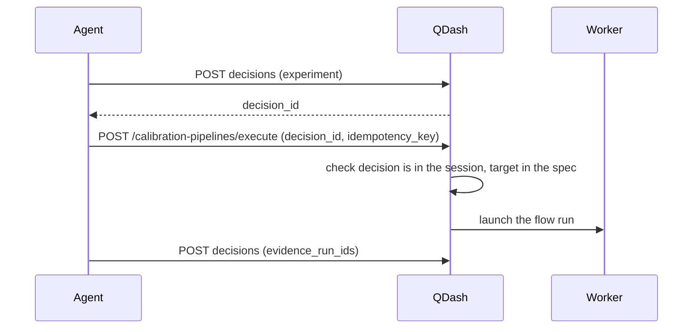

# Calibration Session Audit

A calibration session keeps the same audit an agent session keeps: a chronological timeline
read from QDash's records, plus append-only decisions with a frozen snapshot of their evidence.
It lets an agent run a search through ordinary pipelines, such as a ZX90 gate search on a
coupling, and leave a history that a person can review and the agent can resume from QDash
instead of from its memory.

History and execution control stay separate. A decision grants nothing: each pipeline run is
still the exact request the user approves, with the execution lock and the session's admission
rules described in [Calibration Sessions](./calibration-sessions.md), and an agent session keeps
its policy, gates, expiry, and pause from [Agentic Calibration](./agentic-calibration.md). A
calibration session never gains autonomous execution rights from its audit.

## One audit mechanism

Both audits use `src/qdash/api/services/audit_timeline.py` and the `AgentAuditEvent` schema, so
an event, a snapshot, a cursor, and a decision mean the same thing in both:

| Mechanism | Shared symbol | Behavior |
| --- | --- | --- |
| Event ordering | `number_events`, `event_sort_key` | Time, state version, cause before effect, then `event_id` |
| Snapshot | `read_snapshot`, `fingerprint` | Two matching projected reads; 503 when the records keep changing |
| Paging | `read_page`, `encode_cursor`, `decode_cursor` | A cursor names the audited record and its snapshot; a changed snapshot is 409, a foreign cursor 400 |
| Export | `read_export` | The whole snapshot, refused with 413 rather than cut short |
| Decisions | `DecisionLedger`, `decision_request_hash` | One record per idempotency key, at most 2000 per session in unique quota slots, no transaction |
| Parameters | `scalar_parameters`, `bounded_text` | Scalar values with unit and error; arrays and objects are left out and counted |

The agent session audit keeps its API, schema version (`qdash.agent-session-audit.v1`), and
stored data unchanged. Its events gain two optional fields, `pipeline_run_id` and
`agent_session_id`, which are always null in an agent session's own audit, and `provenance`
gains `client_reported`.

A calibration session stores its decisions in their own collection,
`CalibrationDecisionDocument` (`calibration_decisions`), with the fields of
`AgentDecisionDocument` that do not depend on agent actions. An agent decision cites actions
and state versions of one agent session; a calibration decision cites the session's pipeline
runs, task results on its chip, and its earlier decisions. Mixing them in one collection would
let one session's identifiers reach the other's queries.

## Decisions

`POST /calibration-sessions/{id}/decisions` (`RecordCalibrationDecisionRequest`) appends a
decision. Like an agent decision, only the session's creator records one, through an editor
request, in every session status including a closed one, and the record changes no state.

| Field | Meaning |
| --- | --- |
| `assessment`, `interpretation`, `next_action`, `next_detail` | The recorder's reading and next step, with the agent decision's enums |
| `evidence_run_ids` | Pipeline runs of this session |
| `evidence_task_ids` | Task results in the project on the session's chip, and on the experiment's target when one is given |
| `evidence_decision_ids`, `supersedes_decision_id` | Earlier decisions of this session |
| `experiment` | The run the decision proposes: `candidate_id`, `stage` (`baseline`, `screening`, `confirmation`), `target` (`0` or `0-1`), and `requested_changes` (task, optional `call_id`, parameter, value, previous); only with `next_task`, `repeat`, or `adjust_and_retry` |
| `conclusion` | `recommend_candidate`, `keep_baseline`, or `inconclusive` with `recommended_candidate_id`; only with `complete` or `stop`, and it must cite evidence |
| `model` | The model the client host reported; excluded from the request hash, so a retry keeps the first record's |

A foreign reference is 409, as for an agent decision. A conclusion is checked against the
records: `recommend_candidate` needs a cited run that carries out a `confirmation` experiment of
that candidate and is refused for a baseline candidate, and `keep_baseline` needs a baseline
candidate with cited evidence of it (422 otherwise). QDash freezes what its records say about
the cited runs, tasks, and decisions in `evidence_snapshot`, including each target task's
executed run parameters and outputs.

## Intent before execution

The audit links intent to execution with an identifier the request writes, never with a time or
a name:

`ExecutePipelineRequest.decision_id` needs `calibration_session_id`. `check_run_decision` refuses
a decision of another session, one without an experiment, or an experiment whose target is
outside the validated targets, with 422 before anything is recorded or launched. A directed
coupling target (`0-1`, control then target) also needs a two-qubit step; when every two-qubit
step lists its pairs (`execution_mode: manual`), the pair must appear in that direction, so a
decision about `1-0` never links to a run of `0-1`. A step that selects its pairs at run time
(`automatic`) is checked by its qubits only. The response echoes `decision_id`, and the Python
and TypeScript clients raise when it is missing, since an API that dropped the field would
record the run without its intent. The run stores
`decision_id` and `spec`, the normalized spec QDash validated, so the requested run parameters
are exact. `decision_id` enters the idempotency hash only when given, so a request without one
hashes as before.

## Timeline

`CalibrationSessionAuditService.timeline` (`src/qdash/api/services/calibration_session_audit.py`)
builds the events on every read:

| Event `kind` | Source record | What it adds |
| --- | --- | --- |
| `session_created`, `session_closed` | `calibration_sessions` | Objective and chip; the closing note and acknowledged unknown runs. Closing records no verdict |
| `decision` | `calibration_decisions` | The decision with its snapshot; `agent_reported` with a model, otherwise `client_reported` |
| `pipeline_requested` | `calibration_pipeline_runs` | Requesting user, `requested_task_calls` from the stored spec, the decision it carries out, the reported origin |
| `pipeline_dispatch` | `calibration_pipeline_runs` | `dispatched`, `rejected`, `unknown`, or `dispatching`, with the flow run |
| `measurement` | `execution_history`, `task_result_history` | Each step execution of the flow run and its tasks' executed run parameters and outputs |
| `agent_session_linked` | `agent_sessions` | An agent session created in the session and its admission |

An admitted agent session's own events follow its `agent_session_linked` event with
`agent_session_id` set and the `event_id` prefixed by `agent_session:<id>:`, so one audit shows
the whole objective. A pending or rejected agent session never operated and contributes only
the linked event.

`missing` names what the records do not hold, never filled in:

| Missing fact | When |
| --- | --- |
| `requested_spec` | A run recorded before the spec was stored |
| `host_approval` | A run whose origin an agent tool reported; the approval card or dialog is outside QDash |
| `decision` | On `pipeline_requested`, an agent tool run that names no decision; on `pipeline_dispatch`, a finished run no decision cites |
| `execution`, `task_result` | A dispatched run without executions, or a finished execution without task results |
| `model`, `assessment` | A decision recorded without them |

A declined approval never reaches QDash. It shows only as an experiment decision that no run
carries out; the skill records a further decision that says why.

## Projections

The detail read (`GET /calibration-sessions/{id}`) adds a view built from the same records by
`CalibrationSessionAuditService.search`:

- `experiments`: one `CalibrationExperimentRow` per experiment decision and run that names it
  (or one without a run). `measured` reads `zx90_gate_time`, `cr_duration`, `cr_amplitude`, and
  `zx90_gate_fidelity` from the latest completed target task that published them, with task and
  execution durations; `evidence_status` never says whether the experiment succeeded.
  `parameter_checks` compares each requested change with the stored spec and the task's executed
  run parameter.
- `recommendation`: the latest decision with a conclusion that no later decision supersedes.
- `latest_requested_run`: the session's last run by `requested_at`, with its `dispatch_status`,
  its candidate, and an `execution_outcome` read from the dispatch and execution records:
  `refused` (no flow run), `unknown` (launch not reported or uncertain), `no_execution` (flow
  run without an execution record), `running`, `failed` (none completed), `partial` (some
  completed), or `completed`. `candidate_is_recommended` compares the requested candidate with
  the recommendation's record, not with the hardware. Runs outside the session are not
  considered.

  `latest_requested_run` never states the current or last written hardware state. QDash keeps
  no authoritative record of hardware writes, and a run requested earlier can finish later, so
  neither request order nor a completed execution shows which run wrote last. Its `missing`
  field always names that record. The recommendation is the recorder's conclusion and stays
  separate from this observed record.

The grouped Execution list is a projection too: `resolve_chip_calibration_groups`
(`src/qdash/api/services/calibration_session_groups.py`) reads a chip's calibration sessions,
runs, and step executions in three queries, and `ExecutionGroupService.list_groups` groups them
before paging. A calibration session row holds the step executions of its runs and its admitted
agent sessions, each nested with its own executions; an execution an agent session holds stays
with it, so no execution is listed twice. A flow run that two runs claim groups nothing. The row
counts runs, agent sessions, executions, running and failed executions, unknown dispatches, and
decisions, and names its targets from the resolved run targets, agent session policies, and
experiment targets. A pending agent session stays its own row, and executions started without
the session's ID stay ordinary rows.

## Endpoints

| Endpoint | Permission | Purpose |
| --- | --- | --- |
| `POST /calibration-sessions/{id}/decisions` | editor, creator only | Append a decision |
| `GET /calibration-sessions/{id}/decisions` | viewer | Decisions, oldest first, with `carried_out_by_run_ids` |
| `GET /calibration-sessions/{id}/audit` | viewer | One page of a snapshot (`qdash.calibration-session-audit.v1`), 100 events by default and at most 500 |
| `GET /calibration-sessions/{id}/audit/export` | viewer | The whole snapshot as a JSON attachment |

pi-qdash records with `qdash_record_calibration_decision`, a session-granted write like
`qdash_record_agent_decision`, and reads with `qdash_get_calibration_session_audit`;
`qdash_run_pipeline` passes `decisionId`. See the [pi-qdash reference](../../reference/pi-qdash.md).
The UI shows the timeline with the agent session's `AuditTimeline` component
(`ui/src/components/features/agent-session/AuditTimeline.tsx`).

## Testing

`tests/qdash/api/routers/test_calibration_session_audit.py` covers grouping before paging with
nested agent sessions and no duplicate executions, pending agent sessions and ambiguous flow
runs, the day filter, the flat list, intent and dispatch correlation, requested and executed
parameters, conclusions with and without confirmation evidence, a recommendation that differs
from the latest requested run, a run requested first that completes last, each execution
outcome, declined and unrecorded paths, legacy runs without a spec, refused
dispatches, evidence and authorization checks, idempotent replay, recording after close,
paging, every page size against the export, cursor and limit bounds, and inlined agent session
events. `tests/qdash/api/routers/test_calibration_session_two_qubit.py` runs the ZX90 skill's own
`CustomTwoQubit` spec and decision through the API with Prefect patched: validation, decision
linkage, directed-pair and one-qubit-spec refusals, and the audit projection of inserted task
results. No flow runs and no hardware is touched. The unchanged agent session audit is covered by
`tests/qdash/api/services/test_agent_session_audit.py`. The tools are tested in
`packages/pi-qdash/tests/calibration-session-tool.test.mjs` and the UI in
`ui/src/components/features/calibration-session/__tests__/` and
`ui/src/components/features/execution/__tests__/ExecutionPageContent.test.tsx`.

## Implementation Files

- `src/qdash/api/services/audit_timeline.py`: mechanisms both audits share
- `src/qdash/api/services/calibration_session_audit.py`: decisions, timeline, and projections
- `src/qdash/api/services/calibration_session_groups.py`: the grouped list's membership
- `src/qdash/dbmodel/calibration_session.py`: `CalibrationDecisionDocument`
- `packages/pi-qdash/extensions/tools/calibration-session.ts`: decision and audit tools
- `ui/src/components/features/calibration-session/CalibrationSearchProgress.tsx`: the comparison
- `ui/src/components/features/execution/CalibrationSessionGroupRow.tsx`: the list row
