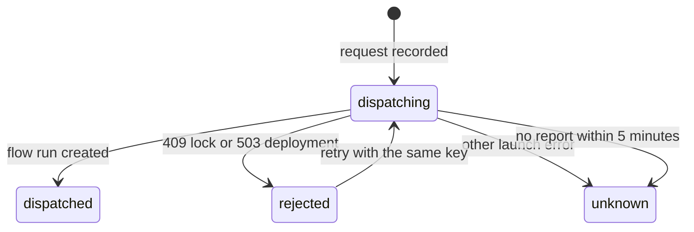

# Calibration Sessions

A calibration session records one calibration objective on one chip and groups the pipeline
runs and agent sessions started for it. It is a record of purpose, not an authority: it grants
no operation, holds no hardware, and stops nothing. An agent session keeps its own policy,
gates, expiry, and pause (see [Agentic Calibration](./agentic-calibration.md)); a pipeline run
keeps the approval of its exact request and the execution lock (see
[Calibration Pipeline Spec](../workflow/calibration-pipeline.md)).

The UI calls the record a **Calibration session** and keeps **Agent session** for one bounded
session inside it. An `auto` agent session is shown as **Autonomous calibration**. The API
names stay `calibration-sessions` and `agent-sessions`.

## Relations are explicit records

A child belongs to a calibration session only when it was started with the session's ID.
Nothing is grouped by chip, time, tag, chat, or assistant text, and nothing is moved into a
session later. Records created before calibration sessions existed carry no ID and keep their
behavior; there is no backfill.

| Child | Record of the relation | Written by |
| --- | --- | --- |
| Agent session | `AgentSessionDocument.calibration_session_id`, set at creation and never changed | `POST /agent-sessions` with `calibration_session_id` |
| Pipeline run | One `CalibrationPipelineRunDocument` per run | `POST /calibration-pipelines/execute` with `calibration_session_id` and `idempotency_key` |

Every relation is checked on the server in the request's project: the calibration session
exists there, is `open`, is on the child's chip, and was created by the signed-in user (403
otherwise). Another project member can read the session but not start work in it.

A child is started in three steps, each one conditional update of one document:

1. `reserve_child` pushes a reservation (`pending_children`: its kind, the child's future ID,
   and the time) and raises `child_count`, on the condition that the session is still open. A
   session closed meanwhile refuses the child.
2. The request writes the child's own record with that ID. A pipeline run also stores the
   reservation in `reservation_id`.
3. `finalize_child` removes the reservation. A pipeline run is launched only after this
   removal succeeded.

A failure known to have written nothing (an invalid record, a duplicate key, a refused claim)
releases the reservation at once. Any other failure leaves it pending, so a close sees it.

The successful removal in step 3 is the child's admission, and it is irrevocable. A close
that runs later never revokes it.

## Agent session admission

An agent session created with `calibration_session_id` cannot operate until its start is
finalized. Without this rule, a request that stalled past a close could write an active
session after the close, crash before undoing it, and leave a session that the list returns and
that could start new hardware work although its start was never accepted.

`AgentSessionDocument.calibration_admission` records the decision, and
`calibration_reservation_id` names the reservation it rests on:

| Admission | Meaning | Operations |
| --- | --- | --- |
| `pending` | Written; the reservation was neither finalized nor cleared when last read | All refused with 409 |
| `admitted` | `finalize_child` removed the reservation | Governed by the session's policy and gates as before |
| `rejected` | A close cleared the reservation before it was finalized; the session is set to `cancelled` with its end message | All refused with 409; never changes again |
| none | Created without a calibration session, or before admission existed | Never checked; unchanged behavior |

The session is inserted as `pending`. For an agent session, `finalize_child(admit=True)` pulls
the reservation from `pending_children` and adds its ID to
`CalibrationSessionDocument.admitted_reservation_ids` in the same update. A close clears the
reservation without adding it. Every reservation is therefore in exactly one state in the
parent: still pending, admitted, or cleared. A cleared one can never be finalized, because
`finalize_child` matches only a reservation that is still pending.

`settle_calibration_admission` in `src/qdash/api/services/agent_session_gate.py` reads that
state. `load_agent_session` and `GET /agent-sessions` run it before anything else. It admits a
session whose reservation is listed, rejects one whose reservation is gone and unlisted, and
leaves the rest `pending`. A crash between the winning finalize and the session's own
admission write is recovered by the next load. A crash before the finalize leaves the session
`pending` until a close clears the reservation, which rejects it. A calibration session that
cannot be read leaves the admission `pending`, which refuses every operation.

Every operation that can cause a side effect checks the admission with `admission_refusal`,
next to its `status: active` check. Its compare-and-set update also carries
`ADMITTED_FILTER`, so the check and the update are one decision:

- action submission (`submit_action`), including `request_human`;
- measurement dispatch and backend apply (`pass_execution_gate`);
- candidate and candidate-set commits (`_reserve_commit`);
- interventions and the resume claim (`AgentInterventionService`), so an unadmitted session
  can neither pause nor be resumed;
- the candidate gate evaluation, which writes nothing but serves only an operating session.

Stopping a session is not refused. Reading it is not refused either: the response and the
calibration session's agent session list carry `calibration_admission`.

## One pipeline run, every step execution

A pipeline creates one execution per calibration step, and they share `note.flow_run_id` (see
[Following a run](../workflow/calibration-pipeline.md#following-a-run)). The run record stores
the flow run ID that `FlowService.execute_calibration_pipeline` returned, and the detail read
lists every execution of the project and chip with that `note.flow_run_id`. It does not use the
earliest-execution shortcut that links one agent action to one execution. The whole run's
`pipeline` progress comes from `ExecutionService.pipeline_progress_of`, the same plan view that
`GET /executions/{id}` returns.

Agent session children list the executions their actions dispatched through
`resolve_chip_links`, the resolution the Execution page uses.

## The Execution list links back

Every execution row and detail carries `calibration_session` (`ExecutionCalibrationSessionLink`)
when QDash's records relate it to a calibration session, and `null` otherwise.
`resolve_execution_relations` in `src/qdash/api/services/calibration_session_links.py` reads
only two records:

| `via` | Record | Match |
| --- | --- | --- |
| `pipeline_run` | `CalibrationPipelineRunDocument` | Same project, same chip, and `flow_run_id` equal to the execution's `note.flow_run_id` |
| `agent_session` | The agent session whose action dispatched the execution, as `resolve_chip_links` or `link_for_execution` resolves it | The agent session's `calibration_admission` is `admitted` and its chip is the execution's |

The calibration session itself must exist in the request's project on the execution's chip.
When two pipeline runs claim one flow run, or the records name different sessions, the
execution belongs to none: a reader sees an ordinary execution instead of a guess. A tag, a
name, the chip, or the time never relates one. Membership says what the work was for; it never
marks the execution as run by an agent.

The resolver batches its reads over a page: at most four queries (pipeline runs, launch
origins, agent sessions, calibration sessions) whatever the number of rows, shared by
`GET /executions`, `GET /executions/groups`, and `GET /executions/{id}`. No Prefect state is
read for it. A grouped agent session row carries `calibration_session` (`CalibrationSessionRef`)
for an admitted session through `agent_session_parents`.

The UI shows the objective as a plain badge on list cards, which are buttons themselves, and a
link back in the details panel, the execution page, and the agent session row
(`ExecutionCalibrationContext.tsx`). Links carry `?project=` so a project switch never opens the
session in another project. `/calibration-sessions` lists the project's sessions with
`status`, `mine`, and `chip` filters; the **Execution** page links to it for the selected chip.

## Reported launch origin

QDash authenticates the user behind a request, not the program that sent it: an agent host
calls the API with the signed-in user's own token, so the API cannot prove that a pipeline came
from an agent tool. `POST /calibration-pipelines/execute` therefore accepts an optional
`reported_origin` (`ReportedLaunchOrigin`: `source` `agent_tool`, `tool`, and `client`), and
QDash stores it as given:

- in `CalibrationPipelineRunDocument.reported_origin` before launch, for a run in a session;
- in a `PipelineLaunchDocument` after the flow run is created, for any run, keyed by
  `(project_id, flow_run_id)` (`record_pipeline_launch`, best effort).

Every step execution of that flow run returns it as `reported_origin`. It is labeled client
reported in the API and **Agent tool, reported** in the UI, never as the verified **Agent** of
an agent session action, and it grants nothing. `requested_by` and the execution's user stay the
authenticated user. A run without a report, including every run started before this field
existed and every manual run in a calibration session, shows no origin. pi-qdash's
`qdash_run_pipeline` sends its own constant (`PIPELINE_TOOL_ORIGIN`); no tool argument sets it.

## Dispatch is recorded before launch

`CalibrationSessionService.execute_pipeline` inserts the run as `dispatching` before the flow
run exists. The unique index on `(project_id, calibration_session_id, idempotency_key)` makes a
concurrent duplicate fail instead of launching. Each state change is one conditional update of
the run record, guarded by the attempt's `dispatch_token`; Mongo runs standalone, so there is
no multi-document transaction.

| State | Retry with the same key and request |
| --- | --- |
| `dispatching` | 409; nothing is launched |
| `dispatched` | The recorded response, with `replayed: true` |
| `rejected` | Launched again as a new attempt (`attempts` grows) |
| `unknown` | 409; never launched again with this key |

A retry with the same key and a different request (chip, spec, or backend) is a 409.
`rejected` covers only refusals raised before any flow run exists: the execution lock is held
(409) or the worker deployment is missing (503). Any other launch error may have created a flow
run, so the run becomes `unknown` and the API answers with the original status and a detail that
says the run may have started. A record still `dispatching` after `DISPATCH_STALE_AFTER`
(5 minutes) reads as `unknown`. QDash does not reconcile an `unknown` run with Prefect; a person
checks the Execution list.

A spec with problems is refused with 422 before anything is recorded. A request without
`calibration_session_id` follows the unchanged pipeline path and records nothing.
`idempotency_key` without `calibration_session_id`, or the reverse, is a 422.

## Closing

`POST /calibration-sessions/{id}/close` sets `status: closed`, after which the session accepts
no new child. It cancels nothing already admitted, stops nothing, and records no verdict on the
objective. A calibration session is purpose and history, not a global cancellation: each child
keeps its own lifecycle. Only the creator can close it. The
close reads the session first and then every child, never the page that the detail read lists,
and is refused with 409 while `close_blockers` is not empty:

| Child | Blocks the close while |
| --- | --- |
| Reservation | It is younger than `RESERVATION_STALE_AFTER` (5 minutes): the child is being started |
| Pipeline run | It is `dispatching`, or dispatched and still running, or dispatched moments ago with no execution recorded yet |
| Agent session | It is admitted (or has no admission) and active or waiting for a person, with expiry applied as `load_agent_session` applies it everywhere; a `pending` or `rejected` one never blocks |
| Ended or expired agent session | `in_flight_operations` lists an operation it passed the gate for that has not settled: a measurement still `dispatching` or `queued` without an execution, a running execution, a candidate commit, or a backend apply |

Two outcomes are unknown rather than blocking; the close passes them only when the request sets
`acknowledge_unknown_runs`:

- a pipeline run whose dispatch is `unknown`, stored in `closed_with_unknown_runs`. It was
  admitted. It may be running, or its request may have stalled after the finalize and may
  still launch after the close. The acknowledgment covers both cases, and the close does not
  cancel the run;
- an agent session reservation older than 5 minutes whose session was never written
  (`unknown_starts`), stored in `closed_with_unknown_starts`. It was never admitted, so a
  session that its request writes later is rejected and never operates.

An agent session that was written while its reservation is older than 5 minutes is neither a
blocker nor unknown. It is still `pending`, and the close rejects it without an acknowledgment.

An older pipeline reservation is never unknown. Its run was not launched, because a launch
follows only a successful removal of the reservation. Every read and every launch in the
session first removes such a reservation and marks its run `rejected`, so the same key can
launch it again.

The close update matches the `child_count` and the number of `pending_children` it read, so a
child reserved or written between the check and the update makes the close fail with 409. The
update clears the remaining reservations. A request whose reservation was cleared does not
start its child: a pipeline run is marked `rejected` without a launch, and an agent session
written late is rejected and cancelled (409). If that request stops before rejecting it, the
session stays `pending` and refuses every operation, and the next load rejects it. QDash does
not reconcile an `unknown` run with Prefect, and a still-`dispatching` run whose post-close
rejection failed reads as `unknown` once stale.

## Chats are entry points

A chat stores no calibration session, and a calibration session stores no chat. The chat shows
the sessions its own tool calls found (`linkedCalibrationSessions` in
`ui/src/lib/chatCalibrationSession.ts`), each read from QDash under the project open now; an ID
QDash does not find there shows nothing. A session comes from one of two kinds of call:

- A completed `qdash_create_calibration_session` call. The tool writes the ID QDash returned in
  its result details. The agent runtime forwards it as `calibrationSession` on `tool_end`
  (`createdCalibrationSessionFromDetails` in `agent-runtime/src/events.ts`), the API relays it
  as `calibration_session` (`_created_calibration_session_for_chat` in
  `src/qdash/api/services/pi_chat_service.py`), and the UI stores it on the trace step
  (`endTool` in `ui/src/lib/agentChatStream.ts`), so a reopened chat finds it in the saved
  trace. A failed, refused, or cancelled call carries none, and neither the model's arguments
  nor its text are read.
- A call that names a session in its `calibrationSessionId` argument
  (`qdash_get_calibration_session`, `qdash_run_pipeline`, `qdash_create_agent_session`).
 One chat can name
several sessions, another chat can continue a session by its ID, and deleting or branching a
chat changes no record. `created_by` and `requested_by` come from the request's authentication,
never from tool arguments.

The agent's procedure is in the `qdash` skill (`packages/pi-qdash/skills/qdash/SKILL.md`,
Calibration sessions). `qdash_run_pipeline` derives the idempotency key from its tool call ID
(`pipelineRunKey`), so a replayed or retried call returns the run it started. The tools are
listed in the [pi-qdash reference](../../reference/pi-qdash.md).

## Endpoints

| Endpoint | Permission | Purpose |
| --- | --- | --- |
| `POST /calibration-sessions` | editor | Create a session for `chip_id` and `objective` |
| `GET /calibration-sessions` | viewer | List the project's sessions, newest first; filters `chip_id`, `status`, `mine`; pages with `limit`, `skip`, and `has_more` |
| `GET /calibration-sessions/{id}` | viewer | The session with its latest 100 pipeline runs and agent sessions, `pipeline_run_total`, `agent_session_total`, `close_blockers`, `unknown_runs`, and `unknown_starts` |
| `POST /calibration-sessions/{id}/close` | editor, creator only | Close the session |

## Testing

`tests/qdash/api/routers/test_calibration_sessions.py` covers the unchanged pipeline path, step
grouping by flow run, access and scope failures, retries, refusals, unknown dispatch, the close
guards, a close interleaved with each start step, crashes before a child is written, agent
session admission (a session written after an acknowledged close followed by a crash, a crash
after the winning finalize, a finalize racing a close, and every operation refused while
unadmitted), children beyond the listed page, and ended or expired agent sessions with unsettled operations.
`tests/qdash/api/routers/test_execution_calibration_links.py` covers the links back and the
reported origin: manual executions unchanged, every step of a session pipeline linked and not
attributed to an agent, reported origins with and without a session, refused origins, scope by
chip, project, and flow run, ambiguous runs, admitted and unadmitted agent sessions, tags, and
list paging. The trace
contract is covered in `agent-runtime/test/events.test.mjs`,
`tests/qdash/agent/test_pi_chat_service.py`, and `ui/src/lib/__tests__/agentChatStream.test.ts`.
The tool behavior is in `packages/pi-qdash/tests/calibration-session-tool.test.mjs`
and `calibration-pipeline-tool.test.mjs`; the UI in
`ui/src/components/features/calibration-session/__tests__/`,
`ui/src/components/features/execution/__tests__/ExecutionCalibrationContext.test.tsx`,
`ui/src/components/features/chat/__tests__/ChatCalibrationSessions.test.tsx`, and
`ui/src/lib/__tests__/chatCalibrationSession.test.ts`.

## Implementation Files

- `src/qdash/datamodel/calibration_session.py`: session and run statuses
- `src/qdash/dbmodel/calibration_session.py`: `CalibrationSessionDocument`,
  `CalibrationPipelineRunDocument`
- `src/qdash/api/services/calibration_session_service.py`: relation checks, dispatch recording,
  detail read, and closing
- `src/qdash/api/services/calibration_session_links.py`: the Execution list's links back
- `src/qdash/datamodel/launch_origin.py`, `src/qdash/dbmodel/pipeline_launch.py`,
  `src/qdash/api/services/pipeline_launch.py`: the reported launch origin
- `src/qdash/api/routers/calibration_session.py`, `src/qdash/api/routers/calibration_pipeline.py`:
  the routes
- `packages/pi-qdash/extensions/tools/calibration-session.ts`: create, get, and list tools
- `ui/src/components/features/calibration-session/`: the session list, session page, and close
  dialog
- `ui/src/components/features/execution/ExecutionCalibrationContext.tsx`: badges and notices on
  the Execution page
- `ui/src/components/features/chat/ChatCalibrationSessions.tsx`: the chat card

## Deployment compatibility

Upgrade the API atomically before publishing or deploying the associated SDKs and tools.
Do not serve associated traffic through a mixed fleet of old and new API processes:
an old process can ignore association fields and dispatch without recording idempotency.
A successful parent preflight does not make a mixed fleet safe.

The TypeScript client's bound API and the Python client read the requested calibration
session before dispatching an associated pipeline or creating an associated agent session.
An unsupported endpoint or a mismatched parent ID or chip stops the call before the write.
The pipeline preflight also accepts a closed parent so the API can replay an earlier request
with its original idempotency key. Only the server decides whether new work may start.

After the write, the clients require the requested association in the response, plus a
pipeline run ID or an admitted agent session. A missing or mismatched association is an
unknown result: the write may have taken effect. The client does not retry it, and the caller
must reconcile the recorded work before trying again. These checks do not add authority or
change unassociated requests. Direct HTTP callers must implement the same checks; generated
standalone HTTP functions do not replace the guarded client.

Before rollback, quiesce admission and dispatch traffic. Drain and reconcile pending agent
admissions and in-flight pipeline operations, including operations with unknown outcomes,
before starting an older API. Retain the new collections; no backfill is required. Do not
delete association records to make an older deployment appear compatible.

Quiescence must cover every API instance, external client, scheduler, and agent runtime that
can start work; a one-time query while new requests continue is not a rollback barrier.
Check `agent_sessions.calibration_admission` for `pending`, the parents' `pending_children`,
and `calibration_pipeline_runs` for `dispatching` or `unknown` outcomes. Use the new API's
admission settlement and in-flight operation checks before stopping it. A terminal session
status alone does not establish that its measurements, commits, or applies have finished.
Resolve the actual Prefect run before treating an unknown dispatch as not started. Do not
clear reservations, change admissions, or delete run records to pass this check. If a state
cannot be reconciled, rollback remains blocked.

Older APIs ignore the new admission field on an otherwise active agent session. Retaining
the field in MongoDB therefore preserves data but does not enforce its authority during a
rollback. Follow the [upgrade procedure](../../user-guide/operations.md#upgrade-calibration-session-support)
to keep old instances from accepting this work.

The execution repository now honors `MONGO_HOST` and `MONGO_PORT`, consistent with the
configured Mongo connection. Deployments that relied on the previous implicit host or port
must set these variables to the intended database before upgrading.
