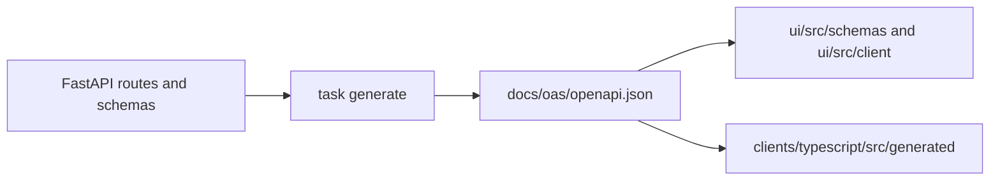

# API Contracts

A QDash API contract consists of the route decorator, typed parameters, Pydantic request and
response models, documented errors, and the generated OpenAPI operation.

## Model Request and Response Bodies

Put reusable HTTP models in `src/qdash/api/schemas/` and name the file for the domain router. Use
`<Action><Resource>Request` for request bodies and a descriptive `<Resource>Response` or
`<Action><Resource>Response` for responses.

Set `response_model` on JSON routes and return the declared type. This makes runtime serialization,
OpenAPI, and generated clients agree. A collection can use either a domain wrapper or a raw list;
preserve the established shape for that endpoint family. Prefer a wrapper when the contract needs
metadata such as `total`, pagination, or warnings:

```python
class ListChipsResponse(BaseModel):
    chips: list[ChipResponse]
    total: int
```

Do not change an existing raw list to a wrapper without treating it as a breaking response change.

## Type Path and Query Parameters

Use snake_case Python names for query parameters. Describe and constrain a value with
`Annotated` and FastAPI's `Query` when its bounds or meaning are not evident from the type:

```python
force: Annotated[
    bool,
    Query(
        description="If true, also delete the chip's qubits and couplings.",
    ),
] = False
```

Use Python domain types such as `datetime`, `date`, enums, and constrained numbers instead of
accepting a string and parsing it in the router. Keep pagination names and defaults consistent
within the endpoint family. QDash currently has both `skip`/`limit` and `offset`/`limit` contracts;
do not silently translate one family to the other.

FastAPI returns `422 Unprocessable Entity` when a typed path, query, or body fails schema
validation. Domain validation performed after parsing uses the status that describes that domain
failure.

## Preserve Project Boundaries

Project-scoped routes resolve identity and permissions through dependencies in
`src/qdash/api/lib/project.py`:

| Dependency | Required access |
| --- | --- |
| `get_project_context` | Active project membership with read access |
| `get_project_context_editor` | Editor or owner write access |
| `get_project_context_owner` | Owner-level administration |
| `get_project_context_from_path` and variants | Same checks for a `project_id` path parameter |

Project resolution uses the path parameter first, then `X-Project-Id`, then the user's default
project. Services and repositories receive the resolved `project_id`; they must not trust a project
identifier supplied inside an ordinary request body.

A lookup for a resource in another project generally returns `404` so the response does not reveal
that the resource exists. Permission failures for a known project return `403`.

## Return Stable Errors

FastAPI exceptions and QDash error response classes use a JSON `detail` field. Choose status codes
by failure meaning:

| Status | Use |
| --- | --- |
| `400 Bad Request` | Parsed request violates a domain rule or field combination |
| `401 Unauthorized` | Bearer credentials are missing or invalid |
| `403 Forbidden` | Authenticated user lacks the required role or permission |
| `404 Not Found` | Resource is absent in the resolved scope |
| `409 Conflict` | Current resource or reservation state prevents the operation |
| `422 Unprocessable Entity` | FastAPI request validation fails |
| `502 Bad Gateway` | A required upstream service returned an invalid failure |
| `503 Service Unavailable` | A required service is temporarily unavailable |

Do not return exception text that exposes credentials, paths, or upstream internals. If an error is
part of the public contract, add it to the route's `responses` metadata and test both its status and
`detail` payload.

## Keep OpenAPI and Clients Synchronized

The route and schema source generate `docs/oas/openapi.json`, the UI schemas and API functions, and
the TypeScript client. These generated files are one contract chain:



Do not edit generated outputs manually. After a route, parameter, schema, status, or
`operation_id` changes, run:

```bash
task generate
task test-api
task test-client-ts
```

Review the generated diff. A changed path, method, operation ID, required field, enum value,
success status, or response shape can break callers. Adding an optional response field is usually
compatible, but verify both generated TypeScript surfaces rather than assuming it.

`src/qdash/api/app/factory.py` adds global bearer-auth metadata and normalizes binary response
formats after FastAPI builds the schema. Tests for those transformations live in
`tests/qdash/api/test_app_factory.py`.
