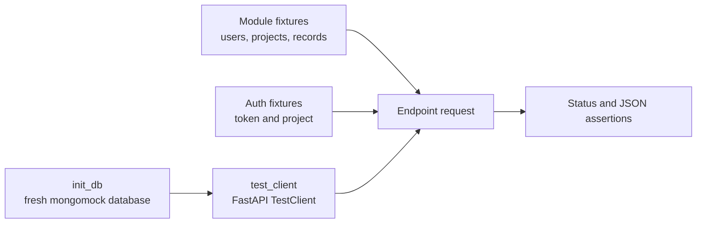

# API Endpoint Testing

Endpoint tests send requests through the FastAPI application and verify the HTTP contract together
with authentication, project selection, authorization, persistence, and response serialization.

## Use the Shared Test Application

`tests/conftest.py` creates a new in-memory `mongomock` database for each test through `init_db`.
The `test_client` fixture depends on that database and wraps `qdash.api.main.app` with FastAPI's
`TestClient`.



The root fixture also replaces Prefect modules before QDash imports them. Endpoint tests that need
specific Prefect behavior must patch the QDash call site rather than importing a real Prefect
server.

Keep `init_db` or `test_client` in a fixture's dependency list when that fixture inserts Bunnet
documents. This ensures the in-memory database is initialized before the insert.

## Create Authentication and Project Context

Most project-scoped routes require both a valid bearer token and an active project membership.
Create the user, project, and membership together, then send the token and project ID:

```python
@pytest.fixture
def auth_headers(test_project):
    return {
        "Authorization": "Bearer test_token",
        "X-Project-Id": "test_project",
    }
```

The `test_project` fixture must insert a `UserDocument` whose `access_token` matches the bearer
token, a `ProjectDocument`, and an active `ProjectMembershipDocument`. Use the role required by the
route: viewer for reads, editor for operational writes, or owner for project administration.

Test each applicable boundary independently:

| Scenario | Expected contract |
| --- | --- |
| Missing bearer token | `401 Unauthorized` |
| Unknown token | `401 Unauthorized` |
| Disabled user | `403 Forbidden` |
| Missing project context with no usable default | `400 Bad Request` |
| User is not a project member | `403 Forbidden` |
| Role lacks the route permission | `403 Forbidden` |
| Resource belongs to another project | `404 Not Found` for project-scoped lookup |

Project lookup prioritizes a path parameter, then `X-Project-Id`, then the user's default project.
When that precedence matters to a route, create conflicting values and assert which project the
response uses.

## Exercise the HTTP Contract

Use the route path exactly as it is mounted in the application. QDash routes do not use an
additional `/api` prefix in `TestClient` calls.

```python
class TestChipRouter:
    def test_list_chips_empty(self, test_client, test_project, auth_headers):
        response = test_client.get("/chips", headers=auth_headers)

        assert response.status_code == 200
        assert response.json() == {"chips": [], "total": 0}

    def test_get_chip_wrong_project(self, test_client, test_project, auth_headers):
        ChipDocument(
            chip_id="other_project_chip",
            username="test_user",
            project_id="other_project",
            size=64,
            system_info=SystemInfoModel(),
        ).insert()

        response = test_client.get("/chips/other_project_chip", headers=auth_headers)

        assert response.status_code == 404
```

For write routes, assert both the response and the stored record. A successful JSON response does
not prove that project IDs, audit fields, or related documents were persisted correctly. For list
routes, insert a record in another project and prove that it is excluded.

## Replace External Boundaries

Patch network clients, file operations, notification senders, and orchestration calls where the
router or service imports them. Use `AsyncMock` for awaited collaborators and configure the return
shape expected by the production code.

Assert cleanup behavior on failure paths. For example, a dispatch test must verify that a claimed
hardware resource is released when Prefect run creation fails. Temporary file tests should use
pytest's `tmp_path` and patch the configured root rather than write into repository directories.

FastAPI dependency overrides are appropriate when the dependency itself is outside the test's
scope. Restore `app.dependency_overrides` after the test, preferably with a yielding fixture, so
one test cannot change another test's application.

## Test Validation at the Boundary

Send JSON rather than constructing a Pydantic model directly when the behavior belongs to the HTTP
boundary. Cover required fields, invalid enum values, malformed identifiers, and mutually
exclusive fields that the route exposes. Assert FastAPI's `422` response for schema validation and
the route's documented status for domain validation.

Use direct schema tests under `tests/qdash/api/schemas/` for exhaustive field combinations. Keep
the router test to the combinations needed to prove that the endpoint applies that schema.

## Find Representative Tests

| Concern | Example |
| --- | --- |
| Authentication and project isolation | `tests/qdash/api/routers/test_chip.py` |
| Role-specific flow operations and external orchestration | `tests/qdash/api/routers/test_flow.py` |
| Administrative permissions | `tests/qdash/api/routers/test_admin.py` |
| Dependency-provider caching | `tests/qdash/api/test_dependencies.py` |
| Direct async service behavior | `tests/qdash/api/services/test_flow_service.py` |

Run one endpoint module with `uv run pytest <path> -v`. Run `task test-api` before handing off a
change that affects shared authentication, project context, application construction, or multiple
routers. General test placement and suite selection are in [API Testing](./testing.md).
