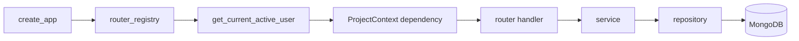

# API Code Structure

The API package separates application assembly, HTTP adaptation, business operations, dependency
wiring, and persistence so each layer can change and be tested at its own boundary.

## Follow the Request Path

A project-scoped request passes through the application and dependency layers before a service
uses repositories:



`create_app()` in `src/qdash/api/app/factory.py` owns middleware, router registration, OpenAPI
customization, and the application lifespan. The deployed API uses `root_path="/api"` for proxy
metadata; router declarations and `TestClient` requests use paths such as `/chips` without an
additional `/api` prefix.

## Put Code in the Owning Layer

| Location | Responsibility |
| --- | --- |
| `app/factory.py` | Construct the FastAPI application and customize OpenAPI |
| `app/router_registry.py` | Mount routers, tags, prefixes, and default authentication |
| `routers/` | Parse HTTP input, select dependencies, call services, and shape HTTP output |
| `schemas/` | Define request and response models |
| `services/` | Enforce domain rules and coordinate repositories or external systems |
| `dependencies/` | Construct and cache repositories, services, and runtimes |
| `lib/auth.py` and `lib/project.py` | Resolve identity, project context, and permissions |
| `middleware/` | Apply request-wide HTTP behavior |
| `db/session.py` | Own the database connection lifecycle |
| `src/qdash/repository/` | Persist and query domain records |

New router handlers should stay thin. They may translate a known domain failure into an HTTP
response, but data access, multi-step mutation, and integration orchestration belong in a service.
Prefer schema or domain values at the service boundary. Existing services can raise
`HTTPException`, and file services return `FileResponse`; keep such FastAPI coupling within the
domain that already owns it instead of spreading it to unrelated services.

Match domain filenames across layers when one domain owns the code, for example
`routers/flow.py`, `schemas/flow.py`, and `services/flow_service/`. A large service can become a
package, as `services/chip/` and `services/flow_service/` do, without changing the router's public
contract. A service package keeps `FlowService` in `service.py` and gives each external side effect
(file storage, validation, deployment HTTP, Prefect dispatch, templates) its own module behind a
constructor-injected collaborator.

## Wire Dependencies Through Providers

`src/qdash/api/dependencies/__init__.py` exposes provider functions for repositories and services.
`@cached_dependency_provider` wraps long-lived providers with a one-entry `lru_cache` and registers
their cache-clear hook.

```python
@cached_dependency_provider
def get_chip_service() -> ChipService:
    return ChipService(
        chip_repository=get_chip_repository(),
        execution_counter_repository=get_execution_counter_repository(),
        task_result_repository=get_task_result_repository(),
    )
```

Inject providers with `Annotated[..., Depends(...)]` rather than constructing a repository or
service in a route. Constructor injection makes service tests replace collaborators without
starting the application.

Tests that inspect provider identity or change provider configuration call
`clear_dependency_caches()`. FastAPI `app.dependency_overrides` is for replacing a provider at the
HTTP boundary; remove an override after the test.

## Register a Router Once

`RouterRegistration` entries in `src/qdash/api/app/router_registry.py` classify routers as public or
protected and assign their tag and optional prefix. Protected routers receive the active-user
dependency automatically.

A domain can expose separate public and protected `APIRouter` objects, as Copilot and Forum do.
Register each object with the intended policy instead of making an entire domain public for one
unauthenticated endpoint.

Router-local prefixes are useful when every route shares the same domain root, while registry
prefixes support mounting a router under a shared application path. Keep one owner for each prefix
so the final path is apparent from the router and registry together.

## Add or Change an Endpoint

An endpoint change normally touches these artifacts in order:

1. Define or update request and response models in `schemas/`.
2. Add the domain behavior to a service and its focused tests.
3. Add the dependency provider when the service or repository is new.
4. Add the route with its project dependency, `response_model`, summary, and explicit
   `operation_id`.
5. Register a new router in `router_registry.py`.
6. Add router tests for serialization, authentication, authorization, and errors.
7. Run `task generate` when the HTTP contract changes.

Use [API Design](./design.md) for paths, methods, operation IDs, and tags. Use
[API Contracts](./contracts.md) for models, errors, and compatibility. [API Testing](./testing.md)
explains which test layer proves each part.

## Source and Tests

| Concern | Source | Focused tests |
| --- | --- | --- |
| Application construction and OpenAPI | `src/qdash/api/app/` | `tests/qdash/api/test_app_factory.py` |
| Dependency providers | `src/qdash/api/dependencies/` | `tests/qdash/api/test_dependencies.py` |
| Identity and project permissions | `src/qdash/api/lib/auth.py`, `src/qdash/api/lib/project.py` | `tests/qdash/api/lib/test_project_permissions.py` |
| Domain HTTP contract | `src/qdash/api/routers/<domain>.py` | `tests/qdash/api/routers/test_<domain>.py` |
| Domain behavior | `src/qdash/api/services/<domain>_service.py` | `tests/qdash/api/services/test_<domain>_service.py` |
