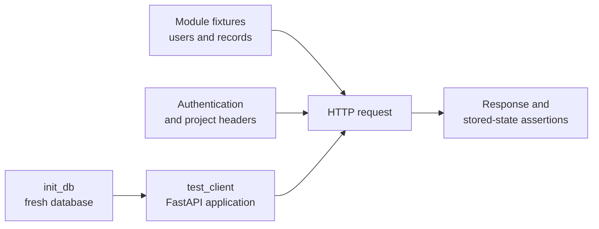

# API Testing

API tests protect HTTP behavior, business rules, and dependency wiring at separate layers so a
failure points to the boundary that changed.

## Choose the Narrowest Test Layer

| Behavior | Test location | Exercise |
| --- | --- | --- |
| Route, request, response, authentication, or authorization | `tests/qdash/api/routers/` | FastAPI application through `test_client` |
| Service rule or integration adapter | `tests/qdash/api/services/` | Service class with external collaborators replaced as needed |
| Request or response schema | `tests/qdash/api/schemas/` | Pydantic validation and serialization |
| Shared API helper | `tests/qdash/api/lib/` | Helper directly |
| Dependency provider or application construction | `tests/qdash/api/test_dependencies.py` or `test_app_factory.py` | Provider identity, cache reset, or router registration |

Put a behavior at the lowest layer that proves it. Add a router test when the HTTP contract or a
FastAPI dependency is part of the behavior; a service test cannot prove status codes, headers, or
response serialization.

Test paths mirror source paths:

```text
src/qdash/api/                      tests/qdash/api/
├── lib/project.py                  ├── lib/test_project_permissions.py
├── routers/chip.py                 ├── routers/test_chip.py
├── schemas/task_result.py          ├── schemas/test_task_result.py
├── services/flow_service.py        ├── services/test_flow_service.py
└── dependencies.py                 └── test_dependencies.py
```

Name a test for the action and observable result, such as `test_get_chip_wrong_project`. Classes
can group scenarios for one router or service, but they are not required.

## Test an Endpoint

The root `tests/conftest.py` creates a fresh in-memory `mongomock` database through `init_db` and
provides `test_client` for requests through the FastAPI application.



Keep `init_db` or `test_client` in a fixture's dependency list when the fixture inserts Bunnet
documents. This guarantees that Bunnet uses the in-memory database before the insert. Define a
fixture beside the tests that use it; move it to a higher `conftest.py` only when multiple modules
share the setup.

The root fixture replaces Prefect modules before QDash imports them. Tests that need particular
Prefect behavior patch the symbol where QDash uses it instead of connecting to a Prefect server.

### Create Authentication and Project Context

Project-scoped routes require a bearer token and an active project membership. A router fixture
creates the user, project, and membership, then supplies matching request headers:

```python
@pytest.fixture
def auth_headers():
    return {
        "Authorization": "Bearer test_token",
        "X-Project-Id": "test_project",
    }
```

The associated user must have `test_token` as its access token and an active membership in
`test_project`. Use the minimum role accepted by the dependency under test: viewer for reads,
editor for writes, and owner for administration.

Cover each applicable boundary independently:

| Scenario | Expected contract |
| --- | --- |
| Missing or unknown bearer token | `401 Unauthorized` |
| Disabled user | `403 Forbidden` |
| No path, header, default, or owned project | `400 Bad Request` |
| Project does not exist | `404 Not Found` |
| User is not a member or lacks permission | `403 Forbidden` |
| Project-scoped resource belongs to another project | `404 Not Found` |

`src/qdash/api/lib/project.py` resolves project context from a path parameter first, then
`X-Project-Id`, the user's default project, and finally a project owned by the user. Test
conflicting values when this precedence affects the route.

### Exercise the HTTP Contract

Use the route as mounted in the application; `TestClient` requests do not add an `/api` prefix.
Assert the complete stable response when it is compact:

```python
response = test_client.get("/chips", headers=auth_headers)

assert response.status_code == 200
assert response.json() == {"chips": [], "total": 0}
```

For a failure, assert the status and the structured error field on which callers rely. For a write,
assert both the response and the stored record so the test proves that project IDs, audit fields,
and related documents were persisted. For a list, insert a record from another project and prove
that the response excludes it.

Send JSON instead of constructing a Pydantic model when testing request validation. Keep exhaustive
field combinations in `tests/qdash/api/schemas/`; router tests only need the combinations that prove
the endpoint applies the schema.

## Replace External Boundaries

Use `monkeypatch`, `MagicMock`, or `AsyncMock` where QDash calls a network client, filesystem,
notification sender, or orchestrator. Assert the important request made to the collaborator as well
as the service result. Do not mock the function whose behavior the test proves.

FastAPI dependency overrides fit dependencies outside the test's scope. Restore
`app.dependency_overrides` after the test, preferably in a yielding fixture, so one test cannot
change another test's application. Use `tmp_path` and patch the configured root for temporary file
tests instead of writing into the repository.

Failure paths must prove cleanup. For example, a dispatch test verifies that QDash releases a
claimed hardware resource when Prefect run creation fails.

## Test Async Services Directly

Mark direct async service calls with `@pytest.mark.asyncio`. Router tests remain synchronous because
FastAPI's `TestClient` runs the async application. Use an async HTTP client only when the behavior
depends on the client's lifecycle.

Structure each test around one result: create only the records and collaborators needed, perform
one action, and assert its externally visible effect. Arrange, Act, and Assert comments are useful
only when those phases are not apparent from the code.

## Run Focused Tests First

Run the changed module while iterating, then the API suite for changes that affect shared
authentication, project context, application construction, or multiple modules:

```bash
uv run pytest tests/qdash/api/routers/test_chip.py -v
task test-api
```

Run `task test` when a change also affects shared repositories, data models, workflow code, or the
Python client. When a route or schema changes the public contract, run `task generate` and verify
the generated clients as described in [API Contracts](./contracts.md).
