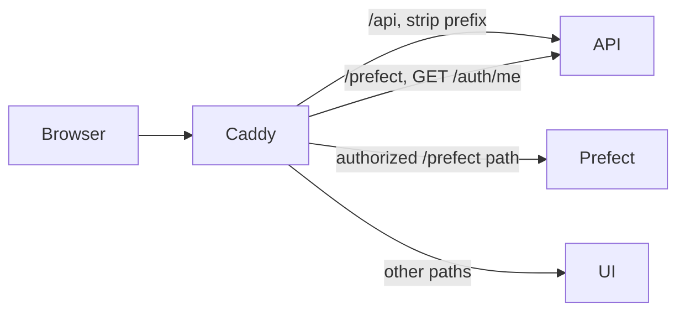

# Architecture

QDash consists of three major components.

- UI
  - Next.js frontend for workflow operation, monitoring, and analysis
- API
  - FastAPI backend that handles user requests, authentication, project access, and database access
- Workflow
  - Prefect-based calibration workflow runtime, deployment service, and user flow worker

<Diagram name="platform-architecture" caption="QDash runtime services and the requests between them." />

## Browser Gateway

Caddy is the browser entry point for both the normal Compose deployment and host-side development.
The normal Compose file publishes only Caddy's HTTP port; Caddy routes API and Prefect paths to
their internal services and sends other requests to the UI.

Caddy checks Prefect requests against the QDash API using the `access_token` cookie as a bearer
token, then forwards authorized requests to Prefect without removing the `/prefect` prefix. The
same-origin browser API path is `/api`; the UI's `INTERNAL_API_URL` setting supports Next.js
rewrites and the Copilot stream handler when the UI server is used directly during development.
`CLIENT_URL` is the public origin used in links generated by QDash. Prefect requires a valid QDash
user but does not apply QDash project-level permissions, so signed-in users can view orchestration
state across projects. Compose enables Prefect's API CSRF protection for cookie-authenticated
browser requests; internal QDash clients use `http://prefect-server:4200/prefect/api`.

## Components

### QDash UI

The UI is the frontend for users, developed with Next.js and React. It provides pages for
dashboarding, chip/task inspection, workflow editing and execution, metrics, provenance, issue
tracking, file management, and Copilot-assisted analysis.

The UI client and standalone TypeScript client are generated with Orval from the API's OpenAPI
schema. API contract changes therefore require client regeneration with `task generate`.
[UI Architecture](./ui/architecture.md) maps the routes, component boundaries, and state flow.

### QDash API

The API receives user requests, enforces authentication and project access, communicates with
MongoDB and Prefect, and exposes the OpenAPI schema used to generate the UI and standalone TypeScript clients.
[API Code Structure](./api/structure.md) maps routers, schemas, services, and dependencies.

### QDash Workflow

The workflow component manages qubit calibration workflows. Prefect is the workflow engine, while
QDash stores user flow files, registers Prefect deployments through the deployment service, and
executes user flows with the user flow worker.

Calibration task implementations call the laboratory libraries they need, while QDash supplies
execution context, parameter resolution, persistence, scheduling, and status tracking.
[Workflow Engine Architecture](./workflow/engine-architecture.md) maps the runtime responsibilities
and extension points.

### Calibration Flow

Calibration follows this flow.

1. The user selects a project, chip, targets, and workflow or task in the UI or client.
2. When the user saves a flow, the API asks the deployment service to register its Prefect deployment. Running the flow reuses that deployment.
3. On execution, the API claims the execution lock for the hardware the run needs and mints the execution ID in the same step. It returns 409 if another run holds the lock. The execution ID links the run, task results, logs, and artifacts.
4. The API creates a Prefect flow run from the deployment and records a `scheduled` execution. The user flow worker picks up the run and adopts that execution.
5. The worker runs each task through preprocess, run, postprocess, validation, and save. Task implementations can call experimental libraries such as qubex.
6. Task results and accepted calibration changes are stored in their project and chip context.
7. Parameter resolution can use the current accepted state as input to later tasks.
8. If a user cancels a running execution, the API sends a cancel request to Prefect, which terminates the worker process via SIGTERM. The `on_cancellation` hook then updates the execution and task statuses to `cancelled` and releases the execution lock.

<Diagram name="calibration-flow" caption="How a calibration run is dispatched, executed task by task, and closed or cancelled." />

The [Workflow Engine Architecture](./workflow/engine-architecture.md) describes the
runtime components in detail. [Projects and Data Sharing](../user-guide/projects-and-data-sharing.md)
explains the user-visible boundary for project-scoped state and artifacts.
