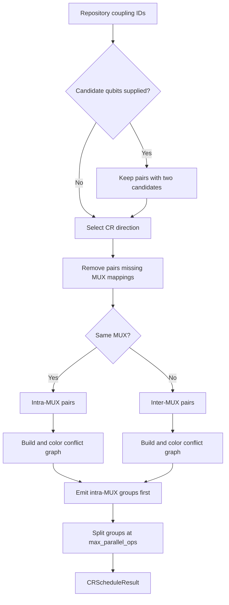

# CR Gate Scheduler

`CRScheduler` converts valid chip couplings into sequential groups of CR operations that are safe
to run in parallel within each group.

## Inputs and Output

The scheduler reads coupling IDs and qubit calibration data from `ChipRepository` and module
assignments from the chip's `wiring.yaml`. Passing `project_id` selects the chip explicitly;
without it, the scheduler uses the current chip for `username`.

```python
from qdash.workflow.engine import CRScheduler

scheduler = CRScheduler(
    username="alice",
    project_id="project-1",
    chip_id="64Qv3",
)
schedule = scheduler.generate(
    candidate_qubits=["0", "1", "2", "3"],
    max_parallel_ops=10,
)

for parallel_group in schedule.parallel_groups:
    # Groups run sequentially; pairs in one group may run in parallel.
    run_group(parallel_group)
```

`CRScheduleResult.parallel_groups` has type `list[list[tuple[str, str]]]`.
`metadata` records the selected direction method, group counts, and fast/slow pair counts;
`filtering_stats` records how many pairs survived each filtering stage. These fields describe a
schedule and are not execution results.

## Scheduling Pipeline

`generate()` applies the following deterministic stages, except when a nondeterministic NetworkX
coloring strategy is selected:



Direction selection uses this priority:

1. A topology whose `direction_convention` is `checkerboard_cr`.
2. The checkerboard design rule when no measured qubit frequencies exist.
3. Measured frequency, retaining control-to-target pairs where the control frequency is lower.

`inverse=True` reverses the topology direction or the applicable frequency comparison. If no pair
survives direction or MUX filtering, `generate()` raises `ValueError` instead of returning an empty
schedule.

## Conflict Invariants

Two CR pairs receive different colors when they:

- share a qubit;
- use any of the same MUXes; or
- use MUXes whose wiring entries share a control, read-in, read-out, or pump module.

The final chunking step can reduce parallelism but cannot introduce a conflict. Execution code must
preserve group order: the scheduler deliberately places all intra-MUX groups before inter-MUX
groups.

## Configurable Pipeline

`generate_with_plugins()` exposes filtering and grouping as interfaces:

- `CRPairFilter.filter()` receives pair strings and `FilterContext`.
- `CRSchedulingStrategy.schedule()` receives filtered pairs and `ScheduleContext`.
- Each implementation reports structured statistics through `get_stats()` or `get_metadata()`.

The built-in filters are `CandidateQubitFilter`, `MuxMembershipFilter`,
`FrequencyDirectionalityFilter`, and `FidelityFilter`. The built-in schedulers are
`MuxConflictScheduler` and `IntraThenInterMuxScheduler`.

When no plugins are supplied, `generate_with_plugins()` uses only the directionality filter and an
intra-then-inter MUX conflict scheduler capped at 10 operations per group. Unlike `generate()`, its
default filter pipeline does not add candidate or explicit MUX-membership filters. Callers that
need those policies must supply them.

Custom filters must preserve the `control-target` string format. Custom schedulers must not place
conflicting pairs together and should return enough metadata to identify their policy in stored
diagnostics.

## Workflow Integration

`GenerateCRSchedule` reads `StepContext.candidate_qids`, stores `parallel_groups` in
`StepContext.metadata["cr_schedule"]`, and publishes the flattened coupling IDs in
`candidate_couplings`. `SetCRSchedule` supplies an explicit schedule through the same metadata key.
`MuxTargets` and `QubitTargets` also use `CRScheduler` to resolve eligible coupling IDs.

`CustomTwoQubit` and `TwoQubitCalibration` reuse the stored schedule when present; otherwise they
generate one internally. When reusing a schedule, their own `max_parallel_ops` does not regroup
it. Set direction and parallelism on `GenerateCRSchedule` before execution. Changing candidate
qubits or calibration values after generation does not refresh the stored groups: place filters
before schedule generation, or regenerate the schedule after a change.

The execution steps run groups sequentially and submit coupling pairs within a group to isolated
worker processes. Each worker runs its pair's tasks sequentially; there is no barrier between
the same task on different pairs. See [State Between Steps](../workflow/quickstart.md#state-between-steps)
for context, calibration inputs, and worker settings. For the application procedure, see
[Schedule Two-Qubit Calibration](../../user-guide/creating-workflows.md#schedule-two-qubit-calibration).

Scheduling therefore stays separate from execution: do not add Prefect tasks or backend calls to
the scheduler.

## Source and Tests

- `workflow/engine/scheduler/cr_scheduler.py` owns data loading and pipeline composition.
- `workflow/engine/scheduler/cr_utils.py` owns coordinate, wiring, conflict-graph, and conversion
  helpers.
- `workflow/engine/scheduler/plugins/` owns the filter and scheduling interfaces.
- `tests/qdash/workflow/engine/scheduler/test_cr_scheduler.py` covers the standard pipeline.
- `tests/qdash/workflow/engine/scheduler/test_plugins.py` covers configurable pipelines.

Run the two scheduler test modules after changing this design. Wiring resource semantics are shared
with [Square Lattice Topology](./square-lattice-topology.md).
