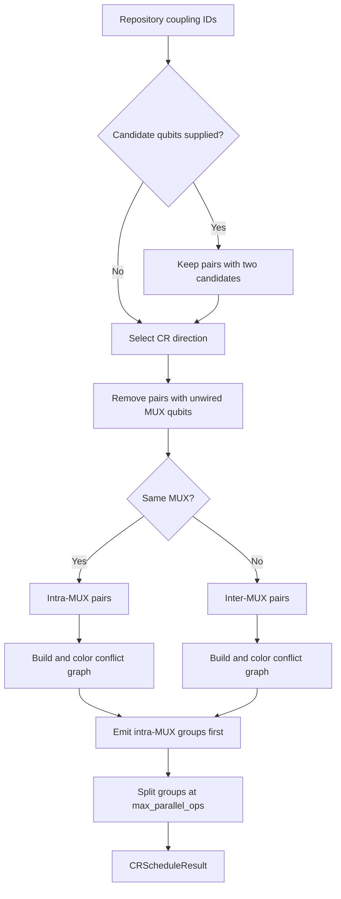

# CR Gate Scheduler

`CRScheduler` converts valid chip couplings into sequential groups of CR operations that are safe
to run in parallel within each group.

## Inputs and Output

The scheduler reads coupling IDs and qubit calibration data from `ChipRepository` and module
assignments from the chip's `wiring.yaml`. Passing `project_id` selects the chip explicitly;
without it, the scheduler uses the current chip for `username`.

```python
from qdash.workflow.engine import CRScheduler

scheduler = CRScheduler(
    username="alice",
    project_id="project-1",
    chip_id="64Qv3",
)
schedule = scheduler.generate(
    candidate_qubits=["0", "1", "2", "3"],
    max_parallel_ops=10,
)

for parallel_group in schedule.parallel_groups:
    # Groups run sequentially; pairs in one group may run in parallel.
    run_group(parallel_group)
```

`CRScheduleResult.parallel_groups` has type `list[list[tuple[str, str]]]`.
`metadata` records the selected direction method, group counts, and fast/slow pair counts;
`filtering_stats` records how many pairs survived each filtering stage. These fields describe a
schedule and are not execution results.

## Scheduling Pipeline

`generate()` applies the following deterministic stages, except when a nondeterministic NetworkX
coloring strategy is selected:



Direction selection uses this priority:

1. A topology whose `direction_convention` is `checkerboard_cr`.
2. The checkerboard design rule when no measured qubit frequencies exist.
3. Measured frequency, retaining control-to-target pairs where the control frequency is lower.

`inverse=True` reverses the topology direction or the applicable frequency comparison. If no pair
survives direction or MUX filtering, `generate()` raises `ValueError` instead of returning an empty
schedule.

## Explicit Pairs

`schedule_pairs(pairs, max_parallel_ops=10, coloring_strategy="largest_first")` groups a caller's
directed `(control, target)` pairs without the candidate, direction, or MUX-membership filters.
It never adds, drops, or reverses a pair, so a run calibrates exactly the selection. It raises
`ValueError` when the list is empty or repeats a pair, when a pair's exact `control-target` ID is
not a repository coupling, or when either qubit is neither a member of a wired topology MUX nor a
standalone qubit. MUX membership comes from the chip topology, as in `generate()`, and a chip whose
topology declares no MUX needs no `wiring.yaml`. Valid pairs then go through the same
intra/inter-MUX split, conflict coloring, and chunking as `generate()`.
`metadata["direction_method"]` and `filtering_stats["direction_method"]` are `explicit`.

## Manual Rounds

`CustomTwoQubit` and `TwoQubitCalibration` take `execution_mode` (`TwoQubitExecutionMode` in
`datamodel/two_qubit_execution_mode.py`): `automatic`, the default, keeps the behavior in
[Workflow Integration](#workflow-integration), and `manual` runs the step's `rounds` of directed
pairs without `CRScheduler`, without an earlier `cr_schedule`, and without chunking.
`max_parallel_ops` now defaults to `None`, meaning 10 for automatic steps, so a manual step that
sets it is rejected instead of silently ignoring or applying it; a spec rejects it only when the
field is explicitly set. `pair_round_issues()` in `common/manual_rounds.py` applies the
`schedule_pairs()` membership checks (exact `control-target` coupling ID, qubits that are wired
MUX members or standalone qubits of the chip topology, with membership from the same
`MuxMapping`) and the
conflict rules of `group_cr_pairs_by_conflict()` (shared MUX, MUXes in `mux_conflicts()`, which
`build_mux_conflict_map()` now delegates to) to each written round; shared qubits and repeated
pairs fail in `parse_pair_rounds()`. Unlike automatic grouping, manual rounds may mix intra- and
inter-MUX pairs. A pair with a standalone qubit must be alone in its round, as
`schedule_pairs()` never groups it. `pair_candidate_issues()` requires both qubits of each pair among the current
candidates. `SetCRSchedule` remains the unchecked path. The user procedure is
[Write Two-Qubit Rounds](../../user-guide/manual-execution-rounds.md#write-two-qubit-rounds).

## Conflict Graph and Groups

`group_cr_pairs_by_conflict()` builds a conflict graph whose nodes are directed pairs, not qubits,
colors it greedily, and turns each color into one or more groups. An edge means the two pairs
must not share a group; it is not a coupling. The checks run in this order, and the first match
adds the edge:

1. The pairs share a qubit.
2. Any MUX of one pair equals any MUX of the other, even with four different qubits.
3. A MUX of one pair conflicts with a MUX of the other in the MUX conflict map.

<Diagram name="cr-schedule-conflict-graph" caption="Example fixture with max_parallel_ops = 4: selected pairs on a schematic wiring, their conflict graph with the graph color of each pair, and the execution groups G1 to G4. Colors mark execution groups, not graph colors." />

`build_qubit_to_mux_map()` takes MUX membership from the chip topology's MUX mapping and joins
it to the wiring by MUX ID, so a wired MUX the topology does not define has no qubits. A chip
without a topology keeps the legacy convention: qubits `4N` to `4N + 3` belong to MUX `N`.
`CRScheduler` resolves that mapping from the chip's `topology_id` only when the caller passes no
`mux_mapping`. Workflow callers (`CustomTwoQubit`, `GenerateCRSchedule`, `TwoQubitCalibration`
and the coupling target override) pass the session's mapping, which the reservation and workers
already use, so a topology edited during the run does not change MUX membership in the schedule.
Coupling direction and `checkerboard_cr` geometry still load the current topology; this is not
a snapshot of the full topology.
`build_mux_conflict_map()` makes two MUXes conflict when their entries claim a common module
through `mux_module_resources()` in `src/qdash/common/wiring_resources.py`. That function reads
only `read_out` and `ctrl`; other wiring fields, such as read-in or pump channels, do not create
conflicts. A module is the part of a channel ID before the first `:`, or before the first `-`
when the ID has no `:`, so `C1:0` and `C1:2` share module `C1`. Readout and control modules are
compared separately: a readout module and a control module with the same name do not conflict.
These rules cover the shared resources the scheduler models, not every hardware constraint.
With `<box ID>:<port>` wiring from the `quel1` or `quel3` template, the module is the whole box ID,
so `quel3-02-a01:4` and `quel3-02-a01:2` share module `quel3-02-a01`, and two MUXes with `ctrl`
ports on the same box conflict. The rules do not model finer QuEL-3 port independence, read-in or
pump ports, or a collision between a control port and a readout port of the same box; see
[Check Parallel Execution on QuEL-3](../../user-guide/setup/qubex-backend.md#check-parallel-execution-on-quel-3).
The same function feeds hardware reservations between executions, which are separate from the
grouping inside one execution; see
[Hardware Reservations](../workflow/engine-architecture.md#hardware-reservations).

A standalone qubit (one the topology lists in no MUX) has no wiring row, so the scheduler does
not know which resources it shares. Its pairs are kept but always run alone in their group. A pair
is intra-MUX only when both qubits are in the same declared MUX; two standalone qubits are not.
`MuxMembershipFilter` keeps standalone pairs through `FilterContext.standalone_qids`.

`split_fast_slow_pairs()` puts pairs whose two qubits share a MUX in the intra-MUX list and the
rest in the inter-MUX list. Each list gets its own graph and coloring, and every intra-MUX group
precedes every inter-MUX group. Pairs from different lists are never compared because they can
never share a group. Execution code must preserve this group order.

`nx.coloring.greedy_color()` uses `coloring_strategy`, `largest_first` by default. Greedy coloring
does not guarantee the minimum number of colors, and another strategy can produce different
groups for the same pairs. Colors become groups in color order, and pairs keep the order in
which the coloring visited them. `max_parallel_ops` then cuts each color into consecutive chunks
of at most that many pairs. Chunking only splits a conflict-free color, so it cannot introduce a
conflict; the remainder becomes its own group even when its pairs conflict with nothing.

In the diagram, MUX1 and MUX2 share control module `C1`, so `4-5` and `8-9` conflict under rule 3
without sharing a qubit or a MUX. Color 1 holds `0-1`, `4-5`, `12-13`, and `16-17`; with
`max_parallel_ops=4` it stays one group, G1, whose four pairs run at once. `3-2` conflicts with
`0-1` under rule 2 and with `3-1` under rule 1, so it needs a third color. The inter-MUX pair
`7-10` is colored alone in its own graph and runs last. The four groups therefore come from three
intra-MUX colors and one inter-MUX color. The diagram and the execution GIF give each group its
own color and tag, and write graph colors as text:

```text
[[("0", "1"), ("4", "5"), ("12", "13"), ("16", "17")], [("3", "1"), ("8", "9")], [("3", "2")], [("7", "10")]]
```

With `max_parallel_ops=2` the same pairs give five groups: chunking cuts color 1 into
`[("0", "1"), ("4", "5")]` and `[("12", "13"), ("16", "17")]`, and the other groups stay the same.

`tests/qdash/workflow/engine/scheduler/test_cr_schedule_docs_example.py` recomputes these groups,
the groups at a cap of 2, the colors, and the edges with `schedule_pairs()`, the plugin
schedulers, and the helpers. The fixture lives in `docs/demos/two_qubit_cr_schedule.py`, which
also draws the execution GIF in
[Schedule Two-Qubit Calibration](../../user-guide/creating-workflows.md#schedule-two-qubit-calibration)
and its copy in the workflow editor's **Execution help**. Update the diagram, the script, and the
test together.

## Configurable Pipeline

`generate_with_plugins()` exposes filtering and grouping as interfaces:

- `CRPairFilter.filter()` receives pair strings and `FilterContext`.
- `CRSchedulingStrategy.schedule()` receives filtered pairs and `ScheduleContext`.
- Each implementation reports structured statistics through `get_stats()` or `get_metadata()`.

The built-in filters are `CandidateQubitFilter`, `MuxMembershipFilter`,
`FrequencyDirectionalityFilter`, and `FidelityFilter`. The built-in schedulers are
`MuxConflictScheduler` and `IntraThenInterMuxScheduler`.

When no plugins are supplied, `generate_with_plugins()` uses only the directionality filter and an
intra-then-inter MUX conflict scheduler capped at 10 operations per group. Its default filter
pipeline does not add a candidate filter; callers that need one must supply it. Whatever the
filters, `generate_with_plugins()` then drops any pair with a qubit that is neither a wired MUX
member nor a standalone qubit of the topology, as `generate()` does, and reports the count as
`mux_filtered_out` in `filtering_stats`.

Custom filters must preserve the `control-target` string format. Custom schedulers must not place
conflicting pairs together and should return enough metadata to identify their policy in stored
diagnostics.

## Workflow Integration

`GenerateCRSchedule` reads `StepContext.candidate_qids`, stores `parallel_groups` in
`StepContext.metadata["cr_schedule"]`, and publishes the flattened coupling IDs in
`candidate_couplings`. `SetCRSchedule` supplies an explicit schedule through the same metadata key
as written: it neither checks the groups for conflicts nor colors or chunks them.
`MuxTargets` and `QubitTargets` also use `CRScheduler` to resolve eligible coupling IDs. A
per-run coupling pair override replaces each `SetCRSchedule` schedule with the result of
`schedule_pairs()` with its default `max_parallel_ops=10` before the pipeline starts; see
[Per-run Target Overrides](../workflow/services.md#per-run-target-overrides).

`CustomTwoQubit` and `TwoQubitCalibration` reuse the stored schedule when present; otherwise they
generate one internally. When reusing a schedule, their own `max_parallel_ops` does not regroup
it. Set direction and parallelism on `GenerateCRSchedule` before execution. Changing candidate
qubits or calibration values after generation does not refresh the stored groups: place filters
before schedule generation, or regenerate the schedule after a change.

The execution steps run groups sequentially through `_run_coupling_groups()` and submit the
coupling pairs of a group to isolated worker processes with
`run_coupling_calibrations_parallel()`. Each worker runs its pair's tasks sequentially; there is
no barrier between the same task on different pairs, and the next group starts after every pair
of the current group returns. The Dask cluster for a group has `_DEFAULT_DASK_WORKERS` (16)
processes, so `max_parallel_ops` bounds the pairs per group but does not guarantee that they all
run at once. See [State Between Steps](../workflow/quickstart.md#state-between-steps)
for context, calibration inputs, and worker settings. For the application procedure, see
[Schedule Two-Qubit Calibration](../../user-guide/creating-workflows.md#schedule-two-qubit-calibration).

Scheduling therefore stays separate from execution: do not add Prefect tasks or backend calls to
the scheduler.

## Source and Tests

- `workflow/engine/scheduler/cr_scheduler.py` owns data loading and pipeline composition.
- `workflow/engine/scheduler/cr_utils.py` owns coordinate, wiring, conflict-graph, and conversion
  helpers.
- `workflow/engine/scheduler/plugins/` owns the filter and scheduling interfaces.
- `tests/qdash/workflow/engine/scheduler/test_cr_scheduler.py` covers the standard pipeline.
- `tests/qdash/workflow/engine/scheduler/test_plugins.py` covers configurable pipelines.
- `tests/qdash/workflow/engine/scheduler/test_cr_schedule_docs_example.py` keeps the docs example
  in step with the scheduler.

Run the scheduler test modules after changing this design. Wiring resource semantics are shared
with [Square Lattice Topology](./square-lattice-topology.md).
