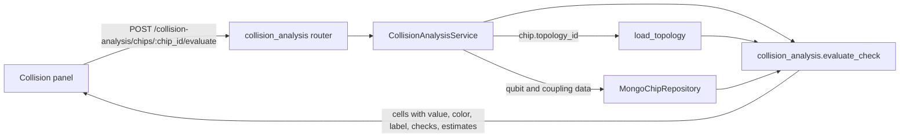

# Custom Dashboards Architecture

Custom dashboards store a layout of typed panels per project and owner; the panels read live chip
data through the existing metrics endpoints and a stateless collision-analysis endpoint.
The user procedure is [Dashboards](../../user-guide/custom-dashboards.md).

## Responsibility boundary

The API owns persistence, visibility, and validation of dashboards, and the collision
computation. It stores no measured values and no computed results: a dashboard is a description
of what to show, and every panel fetches the current data when it renders. The UI owns layout
editing and rendering. Arbitrary user code is out of scope; the only configurable computation is
the fixed set of collision checks and their numeric parameters.

## Dashboard documents

`CustomDashboardDocument` (`src/qdash/dbmodel/custom_dashboard.py`, collection
`custom_dashboard`) holds `project_id`, `dashboard_id` (`dash_<12 hex>`), the owner's `user_id`
and `username` snapshot, `name`, `description`, `visibility`, an optional default `chip_id`, and
`panels`. The unique index is `(project_id, dashboard_id)`.

The shared panel models live in `src/qdash/datamodel/custom_dashboard.py`:

| Model | Meaning |
| --- | --- |
| `PanelLayoutModel` | `x`, `y`, `w`, `h` on a 12-column grid; `x + w <= 12`, `1 <= h <= 12` |
| `DashboardPanelModel` | `panel_id` (unique within the dashboard), `type`, `title`, `layout`, `config` |
| `QubitMetricPanelConfig`, `CouplingMetricPanelConfig` | `metric` key from the metrics configuration |
| `CollisionPanelConfig` | `check` kind, `params` overrides, `hops` subset of `[1, 2]` |
| `MarkdownPanelConfig` | `content`, at most 20000 characters |

`config` is stored as a free dictionary so the UI can keep extra display settings, and
`validate_panels` in `src/qdash/api/services/custom_dashboard_service.py` validates it against
the model for the panel's `type` on every create and update. A collision panel is also checked
against the registered check kinds and parameter names, so a saved dashboard never references
a check the evaluation endpoint would reject. Violations return 422 naming the panel.

## Templates

`src/qdash/api/services/custom_dashboard_templates.py` holds the starter templates as
`DashboardTemplate` values keyed by `template_id`; the only one is `frequency-collision-map`.
`GET /custom-dashboards/templates` lists them, and a create request with `template_id` and no
`panels` copies the template through `instantiate_panels`, which mints a fresh `panel_id` per
panel. The dashboard owns the copy from then on, so editing a template in code never changes a
saved dashboard. Explicit `panels` in the request take precedence over the template, and an
unknown `template_id` returns 422. The template takes its collision panel titles from `CHECKS`,
so the two stay in step. This is deliberately not a template platform: templates are code, not
documents, and there is no user-defined template.

## Visibility and permissions

`CustomDashboardService` applies the sharing rules; the router
(`src/qdash/api/routers/custom_dashboard.py`, prefix `/custom-dashboards`) only chooses the
project dependency.

| Operation | Project dependency | Service rule |
| --- | --- | --- |
| List, get | `get_project_context` (any member) | `visibility == "project"` or `user_id` equals the caller's |
| Create, duplicate | `get_project_context_editor` | Duplicate requires that the source is visible; the copy is private and owned by the caller |
| Update, delete | `get_project_context_editor` | Owner of the document or project role `OWNER`; otherwise 403 |

A dashboard that is not visible to the caller returns 404, not 403, so private dashboards do not
reveal their existence. Every query filters by `project_id`, so dashboards never cross projects.
Ownership compares `user_id`, which survives a username change. Responses carry `can_edit` so the
UI can hide controls without re-deriving the rule.

## Collision analysis

The computation is a port of the qubex-compatible collision checks from
[qdash-playground](https://github.com/msk-ono/qdash-playground) (`examples/collission.py`),
kept as a pure module so it can be tested without MongoDB.

`src/qdash/api/services/collision_analysis.py` defines:

| Symbol | Role |
| --- | --- |
| `CHECKS` | The thirteen checks `Type0A` to `Type9` plus `Type2C`, each with title, target (`qubit` or `pair`), unit, parameters, and legend |
| `PARAMS`, `TYPE2C_PARAMS` | Parameter defaults in GHz and ns, identical to the reference |
| `resolve_params` | Merges overrides into the defaults; rejects unknown names, non-finite values, and values below `min` |
| `CollisionTopology` | Neighbours, directed pairs at one and two hops, and MUX membership, built from a `TopologyDefinition` |
| `CollisionContext` | Topology, effective parameters, qubit data `{parameter: {qid: (value, unit)}}`, and coupling data `{"c-t": (value, unit)}` |
| `Inputs` | Reads values with unit conversion and records every `Default ...` or `Estimated ...` substitution as a note |
| `evaluate`, `evaluate_check` | One target or every target of a check; return `CellResult` with value, hex colour, and an assessment of label, checks, and estimates |

The invariants carried over from the reference:

- Values are compared as ratio to limit; a ratio above one is red, exactly one is orange, below one
  is blue. Type2C reports a signed detuning in MHz and colours by the `two_photon_window`.
- Missing data, division by zero, and non-finite results produce a grey "Not evaluated" cell
  with the reason; the module never fills a gap with a finite guess except through the explicit
  `default_*` parameters, which it records in `estimates`.
- Two-hop pairs are evaluated only by Type1A and Type3A and only inside one MUX. Every other
  check skips them by returning `None`, and the endpoint omits skipped pairs from `cells`.
- Type2B keeps the qubex division formula and notes that its units are not dimensionless.

`CollisionAnalysisService` (`collision_analysis_service.py`) maps chip storage onto that
context. It loads the chip's `topology_id` through `load_topology`
(`src/qdash/common/config/topology.py`) and answers 409 when the chip has no loadable topology.
Qubit parameters are read in this order of stored keys, with the unit assumed when the stored
entry has none:

| Check input | Stored keys | Assumed unit |
| --- | --- | --- |
| `qubit_frequency` | `qubit_frequency` | GHz |
| `resonator_frequency` | `resonator_frequency` | GHz |
| `qubit_anharmonicity` | `qubit_anharmonicity`, then legacy `anharmonicity` | GHz |
| `t1`, `t2_echo` | same name | μs |
| coupling strength | `qubit_qubit_coupling_strength`, then legacy `coupling_strength` | MHz |

A stored `0` counts as missing because NaN results are persisted as `0`. Coupling strengths are
looked up under both `c-t` and `t-c`. Qubit checks evaluate every qubit of the topology, so a
qubit without data appears grey rather than disappearing.

The router (`src/qdash/api/routers/collision_analysis.py`, prefix `/collision-analysis`)
exposes `GET /checks` for the catalogue the panel editor renders and
`POST /chips/{chip_id}/evaluate` with `{check, params, hops}`. Evaluation is a POST because the
parameter set is a nested object, but it is read-only and safe to repeat; the UI wraps it in a
query with a short stale time.

## UI

The feature lives in `ui/src/components/features/custom-dashboards/` behind the routes
`/custom-dashboards` and `/custom-dashboards/[dashboardId]`. Panels are laid out with CSS grid
from each panel's `layout`; edit mode keeps the panel list in local state and persists it with
one `PATCH` of `panels`. Metric panels reuse `DashboardQubitGrid` and `DashboardCouplingGrid`
with the metrics configuration and `getChipMetrics`; the collision panel draws its own map from
`useTopologyConfig` because each cell or edge carries its own colour from the API.

## Extending

- A new starter template is one `DashboardTemplate` added to `TEMPLATES`, with an assertion on
  its panel count and checks in `tests/qdash/api/routers/test_custom_dashboard.py`.
- A new panel type needs a config model in `PANEL_CONFIG_MODELS`, a `PanelType` literal, a
  renderer and editor section in the UI, and a row on the user page.
- A new collision check is one entry in `CHECKS` and one branch in `evaluate`; add its expected
  numbers to `tests/qdash/api/services/test_collision_analysis.py`.
- Changing either router's schemas requires `task generate`.

## Tests

- `tests/qdash/api/services/test_collision_analysis.py`: the reference test suite, ported, on a
  five-qubit topology.
- `tests/qdash/api/routers/test_custom_dashboard.py`: visibility, ownership, project isolation,
  and panel validation.
- `tests/qdash/api/routers/test_collision_analysis.py`: evaluation against seeded qubits and
  couplings, missing topology, and wrong project.
- `ui/src/components/features/custom-dashboards/__tests__/`: list and detail rendering, the
  collision map, and the panel editor.
