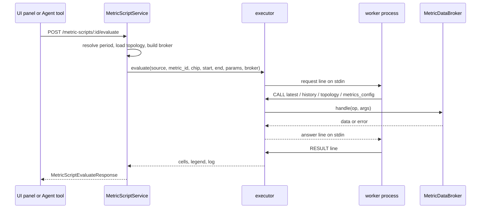

# Metric Scripts Architecture

The metric script runtime (`src/qdash/api/metric_runtime/`) validates and evaluates
user-authored Python in a separate, resource-bounded worker process that holds no credentials,
and serves every value the script reads from a data broker inside the API process. Persistence,
permissions and the dashboard revision policy are in
[Custom Dashboards](./custom-dashboards.md); writing scripts is in
[Metric Scripts](../../user-guide/metric-scripts.md).

## Responsibility boundary

`MetricScriptService` (`src/qdash/api/services/metric_script_service.py`) decides who may run
what, resolves the period and the chip topology, builds the broker, and maps runtime failures to
HTTP errors. The runtime package owns the script API, the import policy, the worker process and
its protocol, and the data broker. The runtime knows nothing about documents or users; the
broker knows nothing about script code.

| Module | Responsibility |
| --- | --- |
| `sdk.py` | The `qdash_metrics` API: `@metric`, `Parameter`, `Legend`, `CellResult`, `MissingData`, `Quantity`/`units` (pint), `QubitPair`, `Topology`, `AnalysisContext` and the `ctx.data` accessors; `load_source` compiles a script and collects its metrics |
| `policy.py` | Import allowlist, disabled builtins, checked `__import__`, and `diagnostic`/`error_message` that point at the script's own line and function |
| `worker.py` | Entry point `python -m qdash.api.metric_runtime.worker`: rlimits, private protocol streams, `catalog` and `evaluate` modes, per-cell evaluation |
| `executor.py` | Spawns and supervises the worker, enforces the wall clock, output bound and concurrency, and answers its data requests through the broker |
| `broker.py` | `MetricDataBroker`: the project-scoped data source of one evaluation, and its caps |
| `template_library.py`, `templates/*.py` | The starter scripts |

## Evaluation flow

`validate` and every save run the worker in `catalog` mode: it executes the module body and
registers the metrics without a broker, so no data is read. `evaluate` loads the source again,
resolves the parameters, builds an `AnalysisContext`, and calls the metric once per qubit of
the topology or once per directed `QubitPair` at the declared `hops`. Each call runs in its own
`try`: `MissingData` makes the cell `missing`, any other exception makes it `error` with a
diagnostic, and the other cells are unaffected. Failures of the whole run (the script does not
load, unknown metric or parameter, invalid legend, timeout, memory or output limit) raise
`MetricRuntimeError`; the service returns them as 422 with `detail = {message, diagnostics,
log}`, and `QueueFullError` as 429.

A relative period is resolved to `[now - days, now]` by `resolve_period` when the evaluation
starts, so the same panel moves with time; absolute periods need timezones
(`src/qdash/datamodel/metric_script.py`).

## Worker protocol

The protocol is line-delimited UTF-8 JSON over the worker's stdin and stdout, documented in the
`worker.py` module docstring:

1. The executor writes one request line: `mode`, `source`, `memory_mb`, `timeout_seconds`, and
   for `evaluate` the `metric_id`, `chip_id`, `start`, `end` and `params`.
2. The worker sends `CALL {"op": ..., "args": ...}` lines for data and blocks until the executor
   answers with one `{"ok": true, "data": ...}` or `{"ok": false, "error": ...}` line.
3. The worker ends with one `RESULT {...}` line carrying the result or the error, its
   diagnostics, and the script log.

Before user code runs, the worker moves the protocol streams to private file descriptors and
points fds 0 and 1 at `/dev/null`, so output from the script or a C extension cannot inject
protocol lines. `print` output goes to a `BoundedLog` that keeps the last 16 KiB.

## Data broker

The broker answers four operations with the caller's `project_id` and the evaluated chip only:

| Operation | Answer |
| --- | --- |
| `metrics_config` | The catalog scripts may read: `qubit_metrics` and `coupling_metrics` from `config/domain/metrics.yaml` with title, unit, scale and description (also `GET /metric-scripts/catalog`) |
| `topology` | The chip's topology template, resolved by the service from `chip.topology_id`; no topology is a 409 before the worker starts |
| `latest` | One `MetricsService.get_chip_metrics(selection_mode="latest", start_at, end_at)` call per evaluation, cached: the latest completed, non-excluded value per target within the period |
| `history` | Task results of the chip with `task_type`, a `qid` variant of the target, `output_parameters.<metric>` present and `start_at` within `[start, end]`, oldest first, each with value, unit, timestamp, task and execution IDs, `excluded` and status |

Caps: `MAX_HISTORY_RECORDS = 5000` records per history call and `MAX_BROKER_CALLS = 2000`
requests per evaluation; exceeding one is a `BrokerLimitError` that the worker turns into an
error on the affected cell, naming the cap. A history span longer than `MAX_HISTORY_DAYS = 400`
is clamped to its most recent 400 days, reported as a notice in the log, and sets `truncated` on
the response.

The SDK applies units in one place. `latest()` returns catalog value × `scale` in the catalog
unit. `history()` uses a record's own unit only when it is a physical unit with the catalog
unit's dimension; records without a unit, with `a.u.`, dimensionless or incompatible units are
read as catalog unit × scale (fidelities stored as `0.99` with unit `a.u.` become `99 %`).
Coupling lookups are directed (`"0-1"` never falls back to `"1-0"`); `ctx.coupling_strength`
is the one deliberate undirected lookup.

## Isolation and threat model

Who can run code: project editors and owners, the same people who can save calibration flows
that run on hardware. Viewers can evaluate only revisions an editor saved and that validated;
validation and draft evaluation require editor rights.

What is enforced:

- **Resource bounds.** A wall-clock timeout kills the worker's process group (it runs with
  `start_new_session=True`). The worker sets `RLIMIT_AS` (the baseline address space plus
  `METRIC_SCRIPT_MEMORY_MB`), `RLIMIT_CPU` (timeout + 1 s), `RLIMIT_FSIZE` (1 MiB) and
  `RLIMIT_NPROC` (0, no child processes) where the platform supports them; macOS rejects
  `RLIMIT_AS`, so local development runs without a memory cap. Protocol output is bounded to
  8 MiB, the log to 16 KiB, and the source to 256 KiB. A process-wide
  `threading.BoundedSemaphore` limits concurrent runs.
- **Credential separation.** `scrubbed_env` gives the worker only `PATH`, `PYTHONPATH`, locale,
  and single-thread BLAS settings: no `MONGO_*`, tokens, or API keys. The worker has no database
  or API client; data flows only through the broker, which scopes every query to the caller's
  project and chip.
- **Guardrails.** `policy.py` allows imports of `numpy`, `scipy`, `math`, `statistics` and
  `qdash_metrics` (public names only) and disables `open`, `exec`, `eval`, `compile`, `input`,
  `breakpoint`, `help`, `exit` and `quit`. They catch mistakes and make intent explicit.

What is not enforced:

- The import and builtin filter is not a sandbox; determined code can escape it.
- The worker runs as the API container's user. Nothing blocks network egress or reads of files
  that user can read inside the API container.

Deployments that need more isolation should add a container egress policy and a
seccomp or AppArmor profile, or run the API under a dedicated low-privilege user.

## Settings

The executor reads these environment variables on every run (`load_settings`). Operators set
them as described in [Limit Metric Script Runs](../../user-guide/setup.md#limit-metric-script-runs).

| Variable | Default | Meaning |
| --- | --- | --- |
| `METRIC_SCRIPT_TIMEOUT_SECONDS` | `60` | Wall-clock limit of one run (minimum 1) |
| `METRIC_SCRIPT_MEMORY_MB` | `1024` | Address space the script may add to the interpreter and preloaded numpy/scipy (minimum 128) |
| `METRIC_SCRIPT_CONCURRENCY` | `2` | Concurrent runs per API process; a run that waits `QUEUE_WAIT_SECONDS = 5` for a slot fails with 429 |

## Differences from qdash-playground

The SDK, policy, worker loop and templates are adapted from qdash-playground by msk-ono
(Apache License 2.0); the repository `NOTICE` file records the attribution. These differences are intentional:

- The module is `qdash_metrics`, not `qdash_playground`.
- `@metric` takes `hops`, the pair distances a pair metric is evaluated for, and pair metrics
  run over the whole chip topology rather than a UI selection.
- `CellResult.assessment` may carry `count`, the number of observations behind a value.
- Coupling metrics are read through `ctx.data[name][pair]` with a directed coupling ID and no
  reverse fallback.
- There is no `ctx.api`: scripts have no network or API access, and the broker is the only data
  path.
- `history()` reads the explicit period on the server instead of approximating it with a
  number of days, and its span and record count are capped.
- Periods come from the panel or the request (relative days or absolute start and end).

## Extending

- A new data operation is a branch in `MetricDataBroker.handle` plus an accessor in `sdk.py`;
  keep it scoped to `project_id` and `chip_id` and covered by a cap.
- A new allowed import must ship in the API image and be added to `ALLOWED_IMPORTS` with a test
  in `tests/qdash/api/metric_runtime/test_policy.py`.
- A new public SDK name goes into `PUBLIC_NAMES`; document it in the user guide and in the
  pi-qdash skill reference (`packages/pi-qdash/skills/qdash-metric-scripts/references/api.md`).

## Tests

- `tests/qdash/api/metric_runtime/test_sdk.py`: units, scale, directed lookups, parameters,
  legends, history semantics.
- `tests/qdash/api/metric_runtime/test_policy.py`: imports, builtins, diagnostics.
- `tests/qdash/api/metric_runtime/test_worker.py`: the real worker process, protocol, limits,
  per-cell errors, and the templates.
- `tests/qdash/api/metric_runtime/test_collision_template.py`: the collision template against
  the reference numbers.
- `tests/qdash/api/routers/test_metric_script.py`: the routes, including the ZX90 median
  end to end through the worker.

## Implementation Files

- `src/qdash/api/metric_runtime/`
- `src/qdash/api/services/metric_script_service.py`
- `src/qdash/api/routers/metric_script.py`, `src/qdash/api/schemas/metric_script.py`
- `src/qdash/datamodel/metric_script.py`, `src/qdash/dbmodel/metric_script.py`,
  `src/qdash/repository/metric_script.py`
- `NOTICE`
