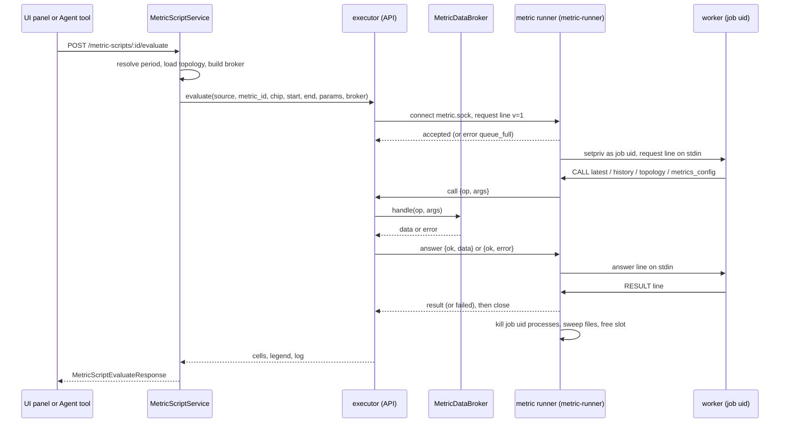

# Metric Scripts Architecture

The metric script runtime validates and evaluates user-authored Python in a worker process that
the dedicated `metric-runner` container starts as a per-job uid, with no credentials and no
network; every value the script reads comes from a data broker inside the API process.
Persistence, permissions and the dashboard revision policy are in
[Dashboards](./dashboards.md); writing scripts is in
[Metric Scripts](../../user-guide/metric-scripts.md). `qdash_metrics` exists only in the worker;
saving scripts from a remote program is the
[Python SDK](./python-sdk.md#metric-scripts-and-dashboards)'s job, which treats the source as text.

## Responsibility boundary

`MetricScriptService` (`src/qdash/api/services/metric_script_service.py`) decides who may run
what, resolves the period and the chip topology, builds the broker, and maps runtime failures to
HTTP errors. The API side of the runtime package (`src/qdash/api/metric_runtime/`) owns the
executor, a client of the metric runner, and the data broker. The metric runner
(`agent-runtime/metric-runner/runner.ts`) owns admission, job identity, supervision and cleanup,
and is the only process of the `metric-runner` container: it shares no container, socket or
resource limit with the [Copilot workspace](../copilot/workspace.md) in `agent-exec`. The
runtime knows nothing about documents or users; the broker knows nothing about script code; the
runner knows nothing about users, projects or data.

| Module | Responsibility |
| --- | --- |
| `sdk.py` | The `qdash_metrics` API: `@metric`, `Parameter`, `Legend`, `CellResult`, `MissingData`, `Quantity`/`units` (pint), `QubitPair`, `Topology`, `AnalysisContext` and the `ctx.data` accessors; `load_source` compiles a script and collects its metrics |
| `policy.py` | Import allowlist, disabled builtins, checked `__import__`, and `diagnostic`/`error_message` that point at the script's own line and function |
| `worker.py` | Entry point `python -m qdash.api.metric_runtime.worker`: umask, rlimits, private protocol streams, `catalog` and `evaluate` modes, per-cell evaluation |
| `executor.py` | Sends each job to the runner over `metric.sock`, answers the relayed data requests through the broker, enforces the API-side deadline, and maps runner messages to exceptions; `METRIC_RUNNER_MODE=local` runs the worker as an API subprocess instead (development only) |
| `broker.py` | `MetricDataBroker`: the project-scoped data source of one evaluation, and its caps |
| `template_library.py`, `templates/*.py` | The starter scripts |
| `agent-runtime/metric-runner/server.ts` | The container's entrypoint (PID 1): reads `METRIC_RUNNER_*`, logs the [memory budget](#memory-budget), starts the runner, stops on `SIGTERM` |
| `agent-runtime/metric-runner/runner.ts` | The runner: global slots and queue, one job uid and job directory per slot, `setpriv`, wall clock, output bound, kill and sweep |
| `agent-runtime/metric-runner/protocol.ts` | Request validation, limits and message shapes of the API ⇄ runner protocol; no dependencies |

The `metric-runner` image (`agent-runtime/metric-runner/Dockerfile`) holds Python with numpy,
scipy and pint, the bun binary, the three runner files, and only `__init__.py`, `sdk.py`,
`policy.py` and `worker.py` of the package, under `/app/metric-runtime/qdash/api/metric_runtime/`;
the broker, executor and templates stay in the API.

## Evaluation flow



`validate` and every save run the worker in `catalog` mode: it executes the module body and
registers the metrics without a broker, so no data is read (a relayed call gets an `ok: false`
answer). `evaluate` loads the source again, resolves the parameters, builds an
`AnalysisContext`, and calls the metric once per qubit of the topology or once per directed
`QubitPair` at the declared `hops`. Each call runs in its own `try`: `MissingData` makes the
cell `missing`, any other exception makes it `error` with a diagnostic, and the other cells are
unaffected. Failures of the whole run raise a `MetricRuntimeError` subclass, mapped as in
[Failure mapping](#failure-mapping).

A relative period is resolved to `[now - days, now]` by `resolve_period` when the evaluation
starts, so the same panel moves with time; absolute periods need timezones
(`src/qdash/datamodel/metric_script.py`).

## Runner protocol

The API opens one connection to `metric.sock` per job and exchanges newline-delimited UTF-8
JSON, one object per line. `protocol.ts` is the reference; `executor.py` is the client.

1. **Request** (API → runner, first line): `{"v": 2, "mode": "catalog" | "evaluate", "source",
   "timeout_seconds", "memory_mb"}`, plus `metric_id`, `chip_id`, `start`, `end` and `params`
   for `evaluate`. The runner refuses unknown fields, a wrong `v`, an unknown mode, wrong types,
   a line over 1 MiB (`REQUEST_MAX_BYTES`) or a source over 256 KiB (`SOURCE_MAX_BYTES`, the
   API's `MAX_SOURCE_BYTES`) with `{"type": "error", "code": "invalid_request"}` and closes.
   A connection that sends no request within 10 s is refused the same way. The runner clamps
   `timeout_seconds` to `[1, METRIC_RUNNER_MAX_TIMEOUT_SECONDS]` and `memory_mb` to
   `[128, METRIC_RUNNER_MAX_MEMORY_MB]`.
2. **Admission** (runner → API): `{"type": "accepted", "v": 2, "job_id": "<16 hex>", "timeout_seconds",
   "queue_seconds"}` once a slot is
   free, or `{"type": "error", "code": "queue_full"}` and close when
   `METRIC_RUNNER_QUEUE_LIMIT` jobs are already waiting or no slot frees within
   `METRIC_RUNNER_QUEUE_WAIT_SECONDS`. Slots are global: one runner process serves every
   API worker and caller. The response reports the adopted timeout and the monotonic
   duration from admission to acceptance; no absolute process clock crosses the socket.
3. **Relay**: each `CALL` line of the worker becomes `{"type": "call", "op", "args"}`. The API
   answers each call, in order, with exactly one `{"type": "answer", "ok": true, "data"}` or
   `{"type": "answer", "ok": false, "error"}`; the runner forwards it to the worker's stdin
   without `type`. An answer over 32 MiB (`ANSWER_MAX_BYTES`), a malformed line, or an answer
   with no pending call ends the job with `failed`/`protocol`.
4. **Completion** (runner → API, last line, then close): `{"type": "result", ...}`, the worker's
   `RESULT` object (`ok`, `result` or `error`, `diagnostics`, `log`, `log_truncated`,
   `skipped_limits`) with `type` added, or `{"type": "failed", "code", "message", "exit_code",
   "signal", "stderr_tail"}`.

| Code | Sent as | Cause |
| --- | --- | --- |
| `invalid_request` | `error` | The request line failed validation or did not arrive in 10 s |
| `queue_full` | `error` | The queue is at its limit, or no slot freed in time |
| `timeout` | `failed` | `timeout_seconds` passed since acceptance; the job was killed |
| `output_limit` | `failed` | Worker stdout exceeded 8 MiB (`OUTPUT_LIMIT_BYTES`) in total |
| `crash` | `failed` | The worker exited without a `RESULT` line, or printed a malformed one; `stderr_tail` holds the last 4 KiB of stderr |
| `protocol` | `failed` | The API sent a malformed, oversized or unexpected line |
| `runner_error` | `failed` | The runner could not create the job directory or start the worker |

Nothing in the request names a user, project or owner. The service builds the broker, pinned to
the authenticated caller's project, the evaluated chip and the period, before the executor
connects, so the runner cannot widen the scope of what the worker reads.

The executor waits at most 30 s (`ADMISSION_TIMEOUT_SECONDS`) for `accepted`; the runner's own
queue wait is shorter. Its data deadline is the API request send time plus `queue_seconds`
plus the smaller of the requested and adopted timeout. This conservatively deducts transport
and delayed acceptance handling, while excluding queue wait. Missing, malformed or old-version
acceptance limits fail closed. Deploy API and runner protocol v2 together.
The socket completion deadline adds 15 s (`DEADLINE_GRACE_SECONDS`) to the data deadline;
this grace never extends data access. Timeout messages report the adopted budget. When the
data deadline passes, a pending call is answered `ok: false`,
the executor closes the socket, and the runner kills the job: closing the connection is the
cancel signal. The executor bounds runner lines to 1 MiB, or 8 MiB plus slack for `result`.

## Worker protocol

The runner (or the executor in local mode) and the worker exchange line-delimited UTF-8 JSON
over the worker's stdin and stdout, documented in the `worker.py` module docstring:

1. The parent writes one request line: `mode`, `source`, `memory_mb`, `timeout_seconds`, and
   for `evaluate` the `metric_id`, `chip_id`, `start`, `end` and `params`.
2. The worker sends `CALL {"op": ..., "args": ...}` lines for data and blocks until the parent
   answers with one `{"ok": true, "data": ...}` or `{"ok": false, "error": ...}` line.
3. The worker ends with one `RESULT {...}` line carrying the result or the error, its
   diagnostics, and the script log.

Before user code runs, the worker sets umask 077, moves the protocol streams to private file
descriptors and points fds 0 and 1 at `/dev/null`, so output from the script or a C extension
cannot inject protocol lines. `print` output goes to a `BoundedLog` that keeps the last 16 KiB.
The worker never sees the runner's socket, only its own pipes.

## Data broker

The broker answers four operations with the caller's `project_id` and the evaluated chip only:

| Operation | Answer |
| --- | --- |
| `metrics_config` | The catalog scripts may read: `qubit_metrics` and `coupling_metrics` from `config/domain/metrics.yaml` with title, unit, scale and description (also `GET /metric-scripts/catalog`) |
| `topology` | The chip's topology template, resolved by the service from `chip.topology_id`; no topology is a 409 before the worker starts |
| `latest` | One `MetricsService.get_chip_metrics(selection_mode="latest", start_at, end_at)` call per evaluation, cached: the latest completed, non-excluded value per target within the period |
| `history` | Task results of the chip with `task_type`, a `qid` variant of the target, `output_parameters.<metric>` present and `start_at` within `[start, end]`, oldest first, each with value, unit, timestamp, task and execution IDs, `excluded` and status |

Caps: `MAX_HISTORY_RECORDS = 5000` records per history call and `MAX_BROKER_CALLS = 2000`
requests per evaluation; exceeding one is a `BrokerLimitError` that the worker turns into an
error on the affected cell, naming the cap. A history span longer than `MAX_HISTORY_DAYS = 400`
is clamped to its most recent 400 days, reported as a notice in the log, and sets `truncated` on
the response. These caps, with the deadline, bound the database work a script can cause in the
API process.

The SDK applies units in one place. `latest()` returns catalog value × `scale` in the catalog
unit. `history()` uses a record's own unit only when it is a physical unit with the catalog
unit's dimension; records without a unit, with `a.u.`, dimensionless or incompatible units are
read as catalog unit × scale (fidelities stored as `0.99` with unit `a.u.` become `99 %`).
Coupling lookups are directed (`"0-1"` never falls back to `"1-0"`); `ctx.coupling_strength`
is the one deliberate undirected lookup.

## Isolation and threat model

Who can run code: project editors and owners, the same people who can save calibration flows
that run on hardware. Viewers can evaluate only revisions an editor saved and that validated;
validation and draft evaluation require editor rights.

The boundary is the job uid inside the `metric-runner` container. The API keeps
authentication, authorization, period and topology resolution, and all database access; the
worker reaches data only through the relayed broker.

| Layer | Enforcement |
| --- | --- |
| Socket | `metric.sock` is 0660 `root:METRIC_RUNNER_SOCKET_GID` (gid 0 by default) in a 0750 directory on the `metric-runner-socket` volume, which only `api` (read-only) and `metric-runner` mount. The API container runs as root and connects; job uids cannot reach the directory |
| Job uid | `60000 + slot` (one uid per slot, at most 256 slots), also outside the chat owner range 20000–59999 of `agent-exec`. A slot, and so its uid, is reused only after the previous job's cleanup finished |
| Privileges | `setpriv --reuid --regid --clear-groups --inh-caps=-all --no-new-privs`, then `python -u -B -P -s -m qdash.api.metric_runtime.worker` (`-P` keeps the cwd off `sys.path`, `-s` drops user site) |
| Files | A fresh job directory `/tmp/metric-jobs/<job_id>`, 0700 and owned by the job uid, created and chowned before the worker starts, so the runner never follows a path the worker could have replaced. The job root is 0711 root: the worker reaches its own directory but cannot list or create siblings. The directory is the worker's cwd, `HOME` and `TMPDIR`; umask 077 keeps files it creates elsewhere private |
| Environment | Only `PATH`, `PYTHONPATH`, `HOME`, `TMPDIR`, `LANG`, `LC_ALL`, `PYTHONDONTWRITEBYTECODE` and single-thread BLAS settings (`workerEnv`); nothing is inherited from the runner, and the container has no credentials to inherit |
| Network | `network_mode: none` for the whole container |
| Container | No `env_file` and no source, workspace or data mounts; `read_only` root with `/tmp` as a `METRIC_RUNNER_TMPFS_SIZE` tmpfs, `cap_drop: ALL` plus the capabilities the supervisor needs, `no-new-privileges`, and limits of `METRIC_RUNNER_PIDS_LIMIT` pids, `METRIC_RUNNER_MEMORY_LIMIT` memory and `METRIC_RUNNER_CPU_LIMIT` CPUs |
| Worker limits | `RLIMIT_AS` (the baseline address space plus `memory_mb`), `RLIMIT_CPU` (timeout + 1 s), `RLIMIT_FSIZE` (1 MiB), `RLIMIT_NPROC` (0, no child processes), and `oom_score_adj` 1000 |
| Runner bounds | Wall clock from acceptance, 8 MiB of worker stdout, 1 MiB request and 32 MiB answer lines, 256 KiB of source |

When a job ends, times out, or loses its client, `killJob` sends `SIGKILL` to the worker's
process group (it is spawned detached), waits for the worker to exit, scans `/proc/*/status`
for processes of the job uid and kills them until none remain (bounded to about 2 s), removes
every top-level entry of `/tmp` and `/dev/shm` the uid owns (by `lstat`, without following
symlinks), and removes the job directory. Only then is the slot released. A runner that
restarts removes leftover job directories before it listens.

The import and builtin filter in `policy.py` allows `numpy`, `scipy`, `math`, `statistics` and
`qdash_metrics` (public names only) and disables `open`, `exec`, `eval`, `compile`, `input`,
`breakpoint`, `help`, `exit` and `quit`. It catches mistakes and makes intent explicit; it is not
a sandbox, and determined code can escape it into the job uid's full rights.

What is not enforced:

- **Jobs share one container.** CPU, memory and pids limits apply to the whole `metric-runner`
  container; there is no per-job cgroup, so concurrent jobs slow each other. Chat workspaces
  are not affected: they run in `agent-exec` under their own limits. Container limits do not
  reserve capacity, so contention with other services on the host remains. Within the
  container, `oom_score_adj=1000` biases OOM victim selection toward workers; it does not
  guarantee that the supervisor survives or that only one job fails. A supervisor crash fails every in-flight
  job, and the API answers 503 until Compose restarts the container.
- **Readable files.** A job uid can read whatever is world-readable in the container: the
  image, the worker's own source, and files another uid left world-readable in `/tmp` or
  `/dev/shm`. Other job directories (0700) are closed to it.
- **The sweep is shallow.** Cleanup removes the uid's processes, its top-level entries of
  `/tmp` and `/dev/shm`, and its job directory; a file it created inside another world-writable
  directory survives until the container restarts.
- **One kernel.** Workers share the host kernel under Docker's default seccomp profile; there is
  no dedicated seccomp or AppArmor profile and no user namespace.

## Failure mapping

`_raise_runtime` in the service turns executor exceptions into HTTP errors with
`detail = {message, diagnostics, log}`, except 429:

| Cause | Exception | HTTP |
| --- | --- | --- |
| Runner `queue_full`, or no local slot within 5 s | `QueueFullError` | 429 |
| Socket missing or refusing, no `accepted` within 30 s, connection closed without `result` or `failed` (before or after acceptance), or `failed`/`runner_error` | `RunnerUnavailableError` | 503 |
| `failed`/`timeout`, the API deadline, `output_limit`, `crash` or `protocol`; `invalid_request`; a malformed runner line | `WorkerFailure` | 422 |
| The script does not load, unknown metric or parameter, invalid legend | `ScriptFailure` | 422 |

A 503 means the runner produced no result. `validate_source` re-raises it (and 429) instead of reporting a failed
validation, so a save never records a revision as invalid because the runner was down or busy.
A timeout keeps the local mode's wording, "exceeded the N s time limit", and a crash appends the
last line of the worker's stderr.

## Local mode

`METRIC_RUNNER_MODE=local` runs the worker as a subprocess of the API process, as the API's own
user, with the API container's (or host's) network and filesystem view. The worker gets a
scrubbed environment (`scrubbed_env`: `PATH`, `PYTHONPATH`, locale and BLAS settings, no
`MONGO_*`, tokens or API keys) and its own session (`start_new_session=True`), and the rlimits,
timeout and output bound apply, but no uid, network or filesystem boundary separates it from the
API. `METRIC_SCRIPT_CONCURRENCY` limits runs per API process with a `threading.BoundedSemaphore`;
on macOS `RLIMIT_AS` is rejected, so runs have no memory cap. The executor logs a warning the
first time local mode runs.

Local mode exists for development only. The `dev-api-local` task sets it, because an API on
the host cannot reach the container socket. Socket mode never falls back to it: an unreachable
runner is a 503. Do not use it where untrusted editors can save scripts.

## Settings

The executor reads these environment variables of the API on every run (`load_settings`).
Operators set them as described in
[Limit Metric Script Runs](../../user-guide/setup.md#limit-metric-script-runs).

| Variable | Default | Meaning |
| --- | --- | --- |
| `METRIC_RUNNER_MODE` | `socket` | `socket` sends jobs to the runner; `local` runs them in the API process (development only) |
| `METRIC_RUNNER_SOCKET` | `/run/metric-runner/metric.sock` | The runner's socket; Compose sets it on `api` with the `metric-runner-socket` volume mounted read-only |
| `METRIC_SCRIPT_TIMEOUT_SECONDS` | `60` | Wall-clock limit of one run (minimum 1); the runner caps it |
| `METRIC_SCRIPT_MEMORY_MB` | `1024` | Address space the script may add to the interpreter and preloaded numpy/scipy (minimum 128); the runner caps it |
| `METRIC_BROKER_CONCURRENCY` | `4` | Data requests served at once per API process in either mode; admission waits at most 5 s and never beyond the remaining run time |
| `METRIC_SCRIPT_CONCURRENCY` | `2` | Local mode only: runs at once per API process; a run that waits `QUEUE_WAIT_SECONDS = 5` for a slot fails with 429 |

Broker calls receive the remaining monotonic run deadline. Both latest-metrics queries and
history queries use PyMongo client-side operation timeouts; history also sets `maxTimeMS`.
Calls with less than 50 ms left issue no database query. Answers completed or encoded after
the deadline are discarded. A busy broker returns a per-cell data-access error.

The API serves calls synchronously and holds the broker slot until the call returns. It does
not spawn background query workers. Driver timeouts bound database waits, but cannot
preempt Python row processing, and server cancellation is not instantaneous. A delayed call
can therefore outlive the runner job; it continues to occupy one of the bounded API broker
slots. Multiple API processes each have their own limit.

The runner reads its settings from the `metric-runner` environment at startup
(`metricRunnerOptionsFromEnv`); an invalid value stops the container.

| Variable | Default | Meaning |
| --- | --- | --- |
| `METRIC_RUNNER_SOCKET` | `/run/metric-runner/metric.sock` | Socket path; a blank value means the default |
| `METRIC_RUNNER_SOCKET_GID` | `0` | Group allowed to connect |
| `METRIC_RUNNER_CONCURRENCY` | `2` | Jobs running at once across every API process (1–256) |
| `METRIC_RUNNER_QUEUE_LIMIT` | `16` | Jobs allowed to wait for a slot; more are refused with `queue_full` |
| `METRIC_RUNNER_QUEUE_WAIT_SECONDS` | `5` | How long a job waits for a slot before `queue_full` |
| `METRIC_RUNNER_MAX_TIMEOUT_SECONDS` | `300` | Upper clamp of a request's `timeout_seconds` |
| `METRIC_RUNNER_MAX_MEMORY_MB` | `1024` | Upper clamp of a request's `memory_mb` |
| `METRIC_RUNNER_PYTHON` | `python3` | Interpreter with numpy, scipy and pint |
| `METRIC_RUNNER_PYTHONPATH` | `/app/metric-runtime` | Directory holding the worker package copy (set in the image) |
| `METRIC_RUNNER_JOB_ROOT` | `/tmp/metric-jobs` | Parent of the job directories |
| `METRIC_RUNNER_ISOLATE_USERS` | on as root | Job uids and `setpriv`; off, jobs run as the runner's own user with a warning |

Compose also reads these from `.env` for the container itself:

| Variable | Default | Meaning |
| --- | --- | --- |
| `METRIC_RUNNER_MEMORY_LIMIT` | `3g` | Memory cgroup limit of the container, shared by every job, the supervisor and `/tmp` |
| `METRIC_RUNNER_CPU_LIMIT` | `2` | CPUs of the container |
| `METRIC_RUNNER_PIDS_LIMIT` | `256` | Processes of the container |
| `METRIC_RUNNER_TMPFS_SIZE` | `256m` | Size of the `/tmp` tmpfs that holds the job directories |

`metric-runner` reads no `env_file`; Compose interpolates these variables from `.env` into its
`environment` block and resource limits, so operators set them there like the API's. A
`METRIC_SCRIPT_TIMEOUT_SECONDS` or `METRIC_SCRIPT_MEMORY_MB` above the runner's caps is clamped
silently, so raise the caps with it.

### Memory budget

Every job, the supervisor and the `/tmp` tmpfs are charged to the container's one memory
cgroup. The settings fit when

```text
METRIC_RUNNER_CONCURRENCY × (METRIC_RUNNER_MAX_MEMORY_MB + 128 MiB)
  + 128 MiB + METRIC_RUNNER_TMPFS_SIZE ≤ METRIC_RUNNER_MEMORY_LIMIT
```

The defaults use 2 × (1024 + 128) + 128 + 256 = 2688 MiB of 3072 MiB. The two 128 MiB terms are
`WORKER_BASELINE_RSS_MB` and `SUPERVISOR_RSS_MB` in `runner.ts`, rounded up from these
measurements in the `metric-runner` image on Linux arm64 (Python 3.11, numpy 2.4.6, scipy
1.17.1, pint 0.25.3):

| Process | VmSize | VmRSS |
| --- | --- | --- |
| Worker after its preloads (`worker`, `sdk`, numpy, scipy, pint), when `apply_limits` runs | 107 MiB | 39 MiB |
| Same, after the script also imports `scipy.optimize`, `scipy.stats`, `scipy.signal` and `scipy.interpolate` | 257 MiB | 103 MiB |
| Supervisor (`bun server.ts`), idle after startup | 5.7 GiB | 28–37 MiB |

`RLIMIT_AS` caps a worker's virtual size at its size when `apply_limits` runs plus `memory_mb`.
Because the resident set never exceeds the virtual size, a worker's resident set stays below
about 107 MiB + `memory_mb`, which the 128 MiB term covers; imports the script makes after the
limit count against `memory_mb`. `RLIMIT_AS` is a per-job line, which turns most oversized
allocations into a `MemoryError` inside the script; it does not protect the cgroup. The cgroup
is the hard line; `oom_score_adj` biases victim selection without guaranteeing supervisor
survival. The queue, output,
request and answer bounds keep the supervisor's own memory small.

At startup the runner reads the cgroup limit (`/sys/fs/cgroup/memory.max`, or
`memory.limit_in_bytes` on cgroup v1) and the `/tmp` tmpfs size and logs the budget line. When
the formula exceeds the limit it logs a warning and still starts; jobs that use their whole
allowance at the same time can then be OOM-killed.

## Differences from qdash-playground

The SDK, policy, worker loop and templates follow qdash-playground with these intentional
differences:

- The module is `qdash_metrics`, not `qdash_playground`.
- `@metric` takes `hops`, the pair distances a pair metric is evaluated for, and pair metrics
  run over the whole chip topology rather than a UI selection.
- `CellResult.assessment` may carry `count`, the number of observations behind a value.
- Coupling metrics are read through `ctx.data[name][pair]` with a directed coupling ID and no
  reverse fallback.
- There is no `ctx.api`: scripts have no network or API access, and the broker is the only data
  path.
- `history()` reads the explicit period on the server instead of approximating it with a
  number of days, and its span and record count are capped.
- Periods come from the panel or the request (relative days or absolute start and end).

## Extending

- A new data operation is a branch in `MetricDataBroker.handle` plus an accessor in `sdk.py`;
  keep it scoped to `project_id` and `chip_id` and covered by a cap. The runner relays any
  `op` unchanged and needs no change.
- A new allowed import must ship in both images: `agent-runtime/metric-runner/requirements.txt`
  for the runner and the API image for local mode and tests. Add it to `ALLOWED_IMPORTS` with a test in
  `tests/qdash/api/metric_runtime/test_policy.py`.
- A new module the worker imports from `metric_runtime` must be added to the `COPY` list in
  `agent-runtime/metric-runner/Dockerfile`, which ships only the worker's files. In Compose, the
  `metric-runner` service bind-mounts `src/qdash/api/metric_runtime` over that copy, so source
  edits apply without a rebuild.
- A change to the runner protocol changes `protocol.ts` and `executor.py` together; bump
  `v` (`METRIC_PROTOCOL_VERSION`, `PROTOCOL_VERSION`) when an old API and a new runner could
  meet.
- A new public SDK name goes into `PUBLIC_NAMES`; document it in the user guide and in the
  pi-qdash skill reference (`packages/pi-qdash/skills/qdash-metric-scripts/references/api.md`).

## Tests

- `tests/qdash/api/metric_runtime/test_sdk.py`: units, scale, directed lookups, parameters,
  legends, history semantics.
- `tests/qdash/api/metric_runtime/test_policy.py`: imports, builtins, diagnostics.
- `tests/qdash/api/metric_runtime/test_worker.py`: the real worker process in local mode,
  protocol, limits including `oom_score_adj`, per-cell errors, and the templates.
- `tests/qdash/api/metric_runtime/test_socket_executor.py`: the executor against a fake runner
  on a Unix socket in `tmp_path`: the call relay and answer format, `queue_full`,
  `invalid_request`, each `failed` code, malformed and oversized lines, an unreachable runner,
  a runner that closes after acceptance, the API deadline, a call after the deadline, and the
  settings.
- `tests/qdash/api/metric_runtime/test_collision_template.py`: the collision template against
  the reference numbers.
- `tests/qdash/api/routers/test_metric_script.py`: the routes, including the ZX90 median
  end to end through the worker, and 503 on validate, save (no revision) and evaluate when the
  runner is unavailable.
- `agent-runtime/test/metric-protocol.test.mjs`: request validation and clamping, answers,
  worker messages, the line splitter, options from the environment, and the memory budget with
  its cgroup and tmpfs parsing.
- `agent-runtime/test/metric-runner.test.mjs`: the real runner on a Unix socket: invalid
  requests, the request timeout, the socket's file mode, and a worker that cannot start. Live
  tests run the real worker (catalog, evaluate with relayed calls, `queue_full`, a waiting job,
  timeout, client disconnect, output limit); they skip unless the interpreter in
  `METRIC_RUNNER_TEST_PYTHON` or `.venv/bin/python` imports numpy, scipy and pint. The tests
  never run as root, so `setpriv`, the `/proc` scan, the sweep and the cgroup OOM path have no
  automated test; check them in the container.

Run `task test-api` (or `uv run pytest tests/qdash/api/metric_runtime`) for the Python side
and `task ci-agent-runtime` for the runner.

## Implementation Files

- `src/qdash/api/metric_runtime/`
- `src/qdash/api/services/metric_script_service.py`
- `src/qdash/api/routers/metric_script.py`, `src/qdash/api/schemas/metric_script.py`
- `src/qdash/datamodel/metric_script.py`, `src/qdash/dbmodel/metric_script.py`,
  `src/qdash/repository/metric_script.py`
- `agent-runtime/metric-runner/server.ts`, `agent-runtime/metric-runner/runner.ts`,
  `agent-runtime/metric-runner/protocol.ts`
- `agent-runtime/metric-runner/Dockerfile`, `agent-runtime/metric-runner/requirements.txt`: the
  runner image, the worker copy and its Python packages
- `compose.yaml`: the `api` and `metric-runner` services and the `metric-runner-socket` volume
