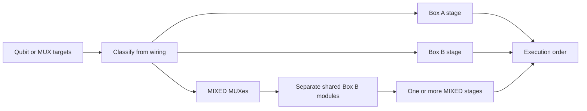

# 1-Qubit Calibration Scheduler

`OneQubitScheduler` turns qubit or MUX targets into an execution order that respects wiring-box,
MUX, and shared-module constraints.

## Wiring Model

Each wiring entry names a MUX and its control, read-in, read-out, and pump modules. Module IDs whose
base name ends in `A` or `B` determine the box classification of that MUX.

| Classification | Meaning | Scheduling consequence |
| --- | --- | --- |
| `A` | All recognized modules belong to Box A | Run in the A stage |
| `B` | All recognized modules belong to Box B | Run in the B stage |
| `MIXED` | Modules span both boxes, are unrecognized, or mapping is missing | Isolate from A and B stages |

Qubit-to-MUX mapping follows the hardware convention that MUX `N` owns qubits `4N` through
`4N + 3`. Within a stage, different MUX groups may run in parallel, while qubits in the same MUX
group run sequentially.

MIXED MUXes need one additional constraint. MUXes that use the same Box B control-module base ID
are placed in different sequential groups.



The result executes A, B, and then every MIXED stage. MUX groups inside one stage are parallel;
the qubits inside each group remain sequential.

## Schedule Forms

The scheduler exposes three forms for different execution APIs.

| Method | Result | Use when |
| --- | --- | --- |
| `generate()` | `OneQubitScheduleResult` | Each MUX worker runs its qubits sequentially |
| `generate_rounds()` | `OneQubitRoundScheduleResult` | Every qubit of round N finishes before round N+1 starts |
| `generate_simultaneous_spectroscopy_batches()` | `MuxBatchScheduleResult` | One spectroscopy call measures a whole selected batch |

Each form has a corresponding `*_from_mux()` convenience method that expands MUX IDs and applies
`exclude_qids` before scheduling.

### MUX-group schedule

```python
from qdash.workflow.engine import OneQubitScheduler

scheduler = OneQubitScheduler(chip_id="64Qv3")
schedule = scheduler.generate_from_mux(
    mux_ids=[0, 1, 2],
    exclude_qids=["5"],
)

for stage in schedule.stages:
    run_mux_groups_in_parallel(stage.parallel_groups)
```

Stages are ordered A, B, then MIXED. Multiple MIXED stages can appear when shared Box B modules
force sequential groups. `parallel_groups` is grouped by MUX and sorted by MUX ID.

### Round schedule

`generate_rounds()` returns `OneQubitRoundScheduleResult.rounds`, a flat list of `OneQubitRound`
entries that the `parallel_by_round` execution mode runs in order. Box stages remain sequential.
Each round's `parallel_qids` come from different MUXes; each of those qubits runs the step's full
call list, and the next round starts when all of them finish. `get_rounds_by_box()` and
`total_rounds` read the result, and `to_dict()` serializes it under `rounds` with a `round_index`
per entry. Checkerboard ordering is enabled by default; the exact ordering policy is described in
[1-Qubit Ordering Strategies](./one-qubit-ordering-strategies.md).

### Simultaneous spectroscopy schedule

The spectroscopy API accepts `mode="local_index"` or `mode="all"`.

- `local_index` creates up to four steps based on `int(qid) % 4`.
- `all` creates one step containing all selected qubits.

This API reports box classification for observability but does not split the batch on A/B resource
conflicts. Its caller and backend operation must support the selected simultaneous measurement.

## Invariants and Failure Behavior

- An empty qubit or MUX selection raises `ValueError`; excluding every expanded qubit does too.
- A missing wiring file raises `FileNotFoundError`.
- An unmapped qubit is classified as MIXED conservatively.
- Stage and MUX order are deterministic.
- A result describes legal ordering only. It does not acquire a hardware reservation or execute a
  backend call.

## Execution Modes

A one-qubit step's `execution_mode` selects a strategy in `ONE_QUBIT_STRATEGIES`
(`workflow/service/strategy.py`), and the strategy selects a schedule form. Every strategy except
`simultaneous_spectroscopy` runs a target's full call list as one unit of work, so a mode decides
only when targets wait for each other.

| `execution_mode` | Strategy | Schedule form | Stage result key | Waiting rule |
| --- | --- | --- | --- | --- |
| `parallel_by_mux` | `OneQubitParallelByMuxStrategy` | MUX-group | `1q_parallel_by_mux` | Each MUX group starts its next qubit when its current qubit finishes |
| `parallel_by_round` | `OneQubitParallelByRoundStrategy` | Round | `1q_parallel_by_round` | A round of qubits from different MUXes finishes before the next round starts |
| `sequential` | `OneQubitSequentialStrategy` | MUX-group | `1q_sequential` | One qubit at a time, MUX group after MUX group |
| `simultaneous_spectroscopy` | `OneQubitSimultaneousSpectroscopyStrategy` | Simultaneous spectroscopy | `experimental_simultaneous_spectroscopy` | Each call is a barrier for its batch |

A round is one `OneQubitRound` of the round schedule. It is not a per-task barrier and does not
align pulse timing. With qubits 0 and 1 selected on MUX 0 and qubits 8 and 9 on MUX 2
in the same hardware stage, `parallel_by_mux` can start qubit 1 while qubit 8 is still
running. The default checkerboard ordering pairs qubits 0 and 8, then qubits 1 and 9.
`parallel_by_round` finishes both qubit 0 and qubit 8 before qubits 1 and 9 start.
The three non-spectroscopy strategies keep box stages sequential and delegate parallel
worker creation to the service scheduling helpers.

`BringUp` and the flow templates that take an `execution_mode` parameter default to
`parallel_by_mux`; `OneQubitCheck`, `OneQubitFineTune`, `CustomOneQubit`, and the pipeline spec
default to `parallel_by_round`. `datamodel/one_qubit_execution_mode.py` defines the
`OneQubitExecutionMode` literal. Pydantic checks it for pipeline specs and flow-run parameters;
the step classes and `get_one_qubit_strategy()` call `validate_one_qubit_execution_mode()`, which
raises `ValueError` for any other value. The [user guide](../../user-guide/creating-workflows.md#choose-an-execution-mode)
shows the waiting rules as an animation.

### Migrate from the former names

The former names are removed without aliases; old values, the `mode` key, and the `mode`
parameter fail validation instead of falling back to a default.

| Former | Current |
| --- | --- |
| `mode` parameter, argument, or spec key | `execution_mode` |
| `serial`, `scheduled`, `synchronized` | `sequential`, `parallel_by_mux`, `parallel_by_round` |
| `OneQubitSerialStrategy`, `OneQubitScheduledStrategy`, `OneQubitSynchronizedStrategy` | `OneQubitSequentialStrategy`, `OneQubitParallelByMuxStrategy`, `OneQubitParallelByRoundStrategy` |
| `generate_synchronized()`, `generate_synchronized_from_mux()` | `generate_rounds()`, `generate_rounds_from_mux()` |
| `SynchronizedOneQubitScheduleResult` (`steps`, `get_steps_by_box()`, `total_steps`) | `OneQubitRoundScheduleResult` (`rounds`, `get_rounds_by_box()`, `total_rounds`) |
| `SynchronizedStepInfo` (`step_index`) | `OneQubitRound` (`round_index`) |
| Round schedule metadata `num_steps` and `to_dict()` key `steps` | `num_rounds` and `rounds` |
| `MuxOrderingStrategy.generate_synchronized_steps()` | `MuxOrderingStrategy.generate_rounds()` |
| `DefaultSynchronizedStrategy` (metadata `default_synchronized`) | `DefaultOrderingStrategy` (metadata `default`) |
| `calibrate_step_qubits_parallel` | `calibrate_round_qubits_parallel` |
| `OneQubitStageRunner.collect_scheduled_qids()`, `execute_scheduled_mux_schedule()` | `collect_mux_group_qids()`, `execute_parallel_by_mux_schedule()` |
| Stage result keys `1q_serial`, `1q_scheduled`, `1q_synchronized`; `sequential` result group `serial` | `1q_sequential`, `1q_parallel_by_mux`, `1q_parallel_by_round`; group `sequential` |
| Pipeline catalog field `one_qubit_modes` | `one_qubit_execution_modes` |

## Source and Tests

- `workflow/engine/scheduler/one_qubit_scheduler.py` owns wiring classification and schedule
  generation.
- `workflow/engine/scheduler/one_qubit_types.py` defines the three result forms.
- `workflow/engine/scheduler/one_qubit_plugins.py` defines ordering strategies.
- `workflow/service/strategy.py` maps execution modes to strategies that consume schedules.
- `datamodel/one_qubit_execution_mode.py` defines the execution modes and their validation.
- `tests/qdash/workflow/engine/scheduler/test_one_qubit_scheduler.py` covers classification,
  grouping, rounds, and spectroscopy modes.

`tests/qdash/workflow/service/test_one_qubit_execution_mode.py` and
`tests/qdash/datamodel/test_one_qubit_execution_mode.py` cover the execution modes, their defaults,
and the rejection of the former names.

Run the scheduler test module after scheduler changes. Update the ordering tests as well when a change affects
the order within a MUX or across rounds.
