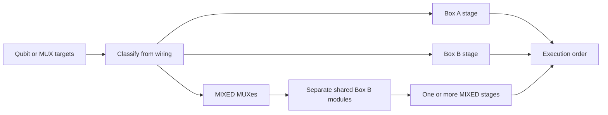

# 1-Qubit Calibration Scheduler

`OneQubitScheduler` turns qubit or MUX targets into an execution order that respects wiring-box,
MUX, and shared-module constraints.

## Wiring Model

Each wiring entry names a MUX and its `ctrl`, `read_in`, `read_out`, and `pump` channels.
`_extract_box_type()` matches each channel ID against `^([A-Za-z0-9]+)(?:-\d+)?$` and reads the
last character of the base name: `R21B-5` is Box B and `Q73A` is Box A. Any other ID is
unrecognized and ignored. The scheduler does not read `box.yaml`, so a box `type` such as
`quel1-a` or `quel3` has no effect.

| Recognized box types of a MUX | Classification | Scheduling consequence |
| --- | --- | --- |
| Only `A` | `A` | Run in the A stage |
| Only `B` | `B` | Run in the B stage |
| Both `A` and `B`, or none | `MIXED` | Run after the A and B stages |

A MUX with one recognized `A` channel and otherwise unrecognized channels is therefore `A`, not
`MIXED`. IDs in the `<box ID>:<port>` form of the `quel1` and `quel3` templates, such as
`BOX_A:4` or `quel3-02-a01:4`, contain `:` and never match, so every MUX of such a chip is
`MIXED`.

Qubit-to-MUX mapping comes from the `mux_mapping` passed to the scheduler, which the workflow
service resolves from the chip's topology template (see
[MUX Membership in Topology Templates](./square-lattice-topology.md#mux-membership-in-topology-templates)).
Without a mapping, MUX `N` owns qubits `4N` through `4N + 3`. A MUX or qubit outside an explicit
mapping is an error. Within a stage, different MUX groups may run in parallel, while qubits in the
same MUX group run sequentially.

A standalone qubit, which the topology lists in no MUX, has no wiring row, so its hardware sharing
is unknown. Every schedule form runs standalone qubits after the MUX stages, one at a time: one
`STANDALONE` stage with a single sequential group, or one round (or spectroscopy step) per
qubit. A selection of only standalone qubits does not read the wiring.

MIXED MUXes get one additional constraint: MUXes whose `ctrl` channels share a Box B base ID,
such as `R21B`, go to different sequential stages. This is the only resource check between MUXes;
the scheduler is not a general conflict checker. Without Box B `ctrl` names, as with
`<box ID>:<port>` wiring, all MIXED MUXes form one stage and run in parallel even when they use
the same box. [Check Parallel Execution on QuEL-3](../../user-guide/setup/qubex-backend.md#check-parallel-execution-on-quel-3)
gives the operating guidance for such wiring.



The result executes A, B, every MIXED stage, and then the `STANDALONE` stage. MUX groups inside one stage are parallel;
the qubits inside each group remain sequential.

## Schedule Forms

The scheduler exposes three forms for different execution APIs.

| Method | Result | Use when |
| --- | --- | --- |
| `generate()` | `OneQubitScheduleResult` | Each MUX worker runs its qubits sequentially |
| `generate_rounds()` | `OneQubitRoundScheduleResult` | Every qubit of round N finishes before round N+1 starts |
| `generate_simultaneous_spectroscopy_batches()` | `MuxBatchScheduleResult` | One spectroscopy call measures a whole selected batch |

Each form has a corresponding `*_from_mux()` convenience method that expands MUX IDs, adds any
`standalone_qids`, and applies `exclude_qids` before scheduling.

### MUX-group schedule

```python
from qdash.workflow.engine import OneQubitScheduler

scheduler = OneQubitScheduler(chip_id="64Qv3")
schedule = scheduler.generate_from_mux(
    mux_ids=[0, 1, 2],
    exclude_qids=["5"],
)

for stage in schedule.stages:
    run_mux_groups_in_parallel(stage.parallel_groups)
```

Stages are ordered A, B, MIXED, then STANDALONE. Multiple MIXED stages can appear when shared Box B modules
force sequential groups. `parallel_groups` is grouped by MUX and sorted by MUX ID.

### Round schedule

`generate_rounds()` returns `OneQubitRoundScheduleResult.rounds`, a flat list of `OneQubitRound`
entries that the `parallel_by_round` execution mode runs in order. Box stages remain sequential.
Each round's `parallel_qids` come from different MUXes; each of those qubits runs the step's full
call list, and the next round starts when all of them finish. `get_rounds_by_box()` and
`total_rounds` read the result, and `to_dict()` serializes it under `rounds` with a `round_index`
per entry. Checkerboard ordering is enabled by default; the exact ordering policy is described in
[1-Qubit Ordering Strategies](./one-qubit-ordering-strategies.md).

### Simultaneous spectroscopy schedule

The spectroscopy API accepts `mode="local_index"` or `mode="all"`.

- `local_index` creates one step per local MUX slot.
- `all` creates one step containing all selected multiplexed qubits.

In both modes each standalone qubit gets a step of its own after the MUX steps.

This API reports box classification for observability but does not split the batch on A/B resource
conflicts. Its caller and backend operation must support the selected simultaneous measurement.

## Invariants and Failure Behavior

- An empty qubit or MUX selection raises `ValueError`; excluding every expanded qubit does too.
- A missing wiring file raises `FileNotFoundError`.
- With a topology, a qubit the topology does not define, or a member of a MUX without a
  `wiring.yaml` row, raises `MuxMappingError`. Without a topology, a qubit of a MUX the wiring
  does not list is logged as a warning and omitted from stage and round schedules;
  simultaneous-spectroscopy batches retain it.
- Stage and MUX order are deterministic.
- A result is an ordering under the A, B, and Box B `ctrl` rules above, not a check of the
  hardware. It does not acquire a hardware reservation or execute a backend call; reservations
  between executions are described in
  [Hardware Reservations](../workflow/engine-architecture.md#hardware-reservations).

## Execution Modes

A one-qubit step's `execution_mode` selects a strategy in `ONE_QUBIT_STRATEGIES`
(`workflow/service/strategy.py`), and the strategy selects a schedule form. Every strategy except
`simultaneous_spectroscopy` runs a target's full call list as one unit of work, so a mode decides
only when targets wait for each other.

| `execution_mode` | Strategy | Schedule form | Stage result key | Waiting rule |
| --- | --- | --- | --- | --- |
| `parallel_by_mux` | `OneQubitParallelByMuxStrategy` | MUX-group | `1q_parallel_by_mux` | Each MUX group starts its next qubit when its current qubit finishes |
| `parallel_by_round` | `OneQubitParallelByRoundStrategy` | Round | `1q_parallel_by_round` | A round of qubits from different MUXes finishes before the next round starts |
| `sequential` | `OneQubitSequentialStrategy` | MUX-group | `1q_sequential` | One qubit at a time, MUX group after MUX group |
| `simultaneous_spectroscopy` | `OneQubitSimultaneousSpectroscopyStrategy` | Simultaneous spectroscopy | `experimental_simultaneous_spectroscopy` | Each call is a barrier for its batch |

A round is one `OneQubitRound` of the round schedule. It is not a per-task barrier and does not
align pulse timing. With qubits 0 and 1 selected on MUX 0 and qubits 8 and 9 on MUX 2
in the same hardware stage, `parallel_by_mux` can start qubit 1 while qubit 8 is still
running. The default checkerboard ordering pairs qubits 0 and 8, then qubits 1 and 9.
`parallel_by_round` finishes both qubit 0 and qubit 8 before qubits 1 and 9 start.
The three non-spectroscopy strategies keep box stages sequential and delegate parallel
worker creation to the service scheduling helpers in `service/_internal/scheduling_tasks.py`.
Each parallel call runs on a Dask cluster of `_DEFAULT_DASK_WORKERS` (16) single-threaded
processes; MUX groups or round qubits beyond that wait for a free process. There is no
per-step setting for the number of parallel qubits, and the pool size is not a hardware limit.

`BringUp` and the flow templates that take an `execution_mode` parameter default to
`parallel_by_mux`; `OneQubitCheck`, `OneQubitFineTune`, `CustomOneQubit`, and the pipeline spec
default to `parallel_by_round`. `datamodel/one_qubit_execution_mode.py` defines the
`OneQubitExecutionMode` literal. Pydantic checks it for pipeline specs and flow-run parameters;
the step classes and `get_one_qubit_strategy()` call `validate_one_qubit_execution_mode()`, which
raises `ValueError` for any other value. The [user guide](../../user-guide/creating-workflows.md#choose-an-execution-mode)
shows the waiting rules as an animation.

## Manual Rounds

With `execution_mode="manual"` a step runs its own `rounds` instead of a schedule, so no strategy
of `ONE_QUBIT_STRATEGIES` and no `OneQubitScheduler` method runs. `manual` belongs to
`OneQubitStepExecutionMode`, which only `OneQubitCheck`, `OneQubitFineTune`, `CustomOneQubit`,
and their pipeline specs accept; templates and `BringUp` keep `OneQubitExecutionMode`.

`common/manual_rounds.py` holds every check that needs no worker runtime, so the worker, the
pipeline `/validate` dry run, and the execution-plan preview reject the same rounds with the same
messages, each naming the step, the 1-based round, and the targets:

| Check | Function | When |
| --- | --- | --- |
| Shape: non-empty rounds of canonical qubit ID strings (no leading zeros), a qubit in one round only | `parse_qubit_rounds()` | Step construction and spec validation |
| `rounds` only with `manual`, required with it | `qubit_rounds_for_mode()` | Step construction and spec validation |
| Qubits defined by the topology, wired MUX members, a standalone qubit alone in its round, one qubit per MUX, one box stage per round, no shared Box B `ctrl` module among mixed MUXes | `qubit_round_issues()` | `Step.preflight()` before the pipeline reserves anything, again before the step's workers |
| Rounds name exactly the step's current qubits | `qubit_candidate_issues()` | Before the step's workers |

The hardware rules are this scheduler's model, so an automatically generated round passes them,
and they share `channel_box_type()` and `channel_module_id()` with `OneQubitScheduler`. MUX
membership comes from the same `MuxMapping`: the worker passes the session's pinned mapping, and
the API resolves the chip's `topology_id` the same way (`ChipRoundModel.mux_mapping`). A topology
that cannot be loaded becomes `ChipRoundModel.mapping_error`, which rejects every round, and a
topology without MUXes needs no `wiring.yaml`. MUX targets of the dry run and the preview expand
through `mux_target_qids()` in member-slot order. A qubit
appears once per step because results are keyed by qubit. `CalibSession.run_pipeline()` calls
`preflight()` on every step after `Pipeline` validation; `run_qubit_rounds()` in
`workflow/service/manual_rounds.py` then runs each round through
`run_qubit_calibrations_parallel()`, the `parallel_by_round` worker path, records stage
`1q_manual` as `round_1`, `round_2`, ..., and never filters, reorders, or splits a round.
`plan_pipeline_resources()` adds the round qubits to the reservation with the run's pinned mapping,
so a standalone qubit in a round reserves the whole chip. The user procedure is
[Write Manual Execution Rounds](../../user-guide/manual-execution-rounds.md).

### Migrate from the former names

The former names are removed without aliases; old values, the `mode` key, and the `mode`
parameter fail validation instead of falling back to a default.

| Former | Current |
| --- | --- |
| `mode` parameter, argument, or spec key | `execution_mode` |
| `serial`, `scheduled`, `synchronized` | `sequential`, `parallel_by_mux`, `parallel_by_round` |
| `OneQubitSerialStrategy`, `OneQubitScheduledStrategy`, `OneQubitSynchronizedStrategy` | `OneQubitSequentialStrategy`, `OneQubitParallelByMuxStrategy`, `OneQubitParallelByRoundStrategy` |
| `generate_synchronized()`, `generate_synchronized_from_mux()` | `generate_rounds()`, `generate_rounds_from_mux()` |
| `SynchronizedOneQubitScheduleResult` (`steps`, `get_steps_by_box()`, `total_steps`) | `OneQubitRoundScheduleResult` (`rounds`, `get_rounds_by_box()`, `total_rounds`) |
| `SynchronizedStepInfo` (`step_index`) | `OneQubitRound` (`round_index`) |
| Round schedule metadata `num_steps` and `to_dict()` key `steps` | `num_rounds` and `rounds` |
| `MuxOrderingStrategy.generate_synchronized_steps()` | `MuxOrderingStrategy.generate_rounds()` |
| `DefaultSynchronizedStrategy` (metadata `default_synchronized`) | `DefaultOrderingStrategy` (metadata `default`) |
| `calibrate_step_qubits_parallel` | `calibrate_round_qubits_parallel` |
| `OneQubitStageRunner.collect_scheduled_qids()`, `execute_scheduled_mux_schedule()` | `collect_mux_group_qids()`, `execute_parallel_by_mux_schedule()` |
| Stage result keys `1q_serial`, `1q_scheduled`, `1q_synchronized`; `sequential` result group `serial` | `1q_sequential`, `1q_parallel_by_mux`, `1q_parallel_by_round`; group `sequential` |
| Pipeline catalog field `one_qubit_modes` | `one_qubit_execution_modes` |

## Source and Tests

- `workflow/engine/scheduler/one_qubit_scheduler.py` owns wiring classification and schedule
  generation.
- `workflow/engine/scheduler/one_qubit_types.py` defines the three result forms.
- `workflow/engine/scheduler/one_qubit_plugins.py` defines ordering strategies.
- `workflow/service/strategy.py` maps execution modes to strategies that consume schedules.
- `datamodel/one_qubit_execution_mode.py` defines the execution modes and their validation.
- `common/manual_rounds.py` and `workflow/service/manual_rounds.py` check and run manual rounds;
  `tests/qdash/common/test_manual_rounds.py`,
  `tests/qdash/workflow/service/test_manual_rounds_steps.py`, and
  `tests/qdash/workflow/test_manual_rounds_fake_e2e.py` cover them.
- `tests/qdash/workflow/engine/scheduler/test_one_qubit_scheduler.py` covers classification,
  grouping, rounds, and spectroscopy modes.

`tests/qdash/workflow/service/test_one_qubit_execution_mode.py` and
`tests/qdash/datamodel/test_one_qubit_execution_mode.py` cover the execution modes, their defaults,
and the rejection of the former names.

Run the scheduler test module after scheduler changes. Update the ordering tests as well when a change affects
the order within a MUX or across rounds.
