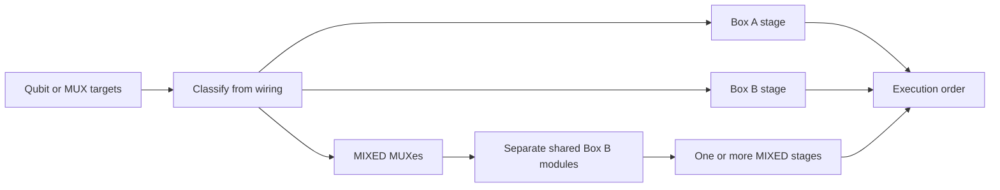

# 1-Qubit Calibration Scheduler

`OneQubitScheduler` turns qubit or MUX targets into an execution order that respects wiring-box,
MUX, and shared-module constraints.

## Wiring Model

Each wiring entry names a MUX and its control, read-in, read-out, and pump modules. Module IDs whose
base name ends in `A` or `B` determine the box classification of that MUX.

| Classification | Meaning | Scheduling consequence |
| --- | --- | --- |
| `A` | All recognized modules belong to Box A | Run in the A stage |
| `B` | All recognized modules belong to Box B | Run in the B stage |
| `MIXED` | Modules span both boxes, are unrecognized, or mapping is missing | Isolate from A and B stages |

Qubit-to-MUX mapping follows the hardware convention that MUX `N` owns qubits `4N` through
`4N + 3`. Within a stage, different MUX groups may run in parallel, while qubits in the same MUX
group run sequentially.

MIXED MUXes need one additional constraint. MUXes that use the same Box B control-module base ID
are placed in different sequential groups.



The result executes A, B, and then every MIXED stage. MUX groups inside one stage are parallel;
the qubits inside each group remain sequential.

## Schedule Forms

The scheduler exposes three forms for different execution APIs.

| Method | Result | Use when |
| --- | --- | --- |
| `generate()` | `OneQubitScheduleResult` | Each MUX worker runs its qubits sequentially |
| `generate_synchronized()` | `SynchronizedOneQubitScheduleResult` | All MUXes must finish position N before position N+1 starts |
| `generate_simultaneous_spectroscopy_batches()` | `MuxBatchScheduleResult` | One spectroscopy call measures a whole selected batch |

Each form has a corresponding `*_from_mux()` convenience method that expands MUX IDs and applies
`exclude_qids` before scheduling.

### MUX-group schedule

```python
from qdash.workflow.engine import OneQubitScheduler

scheduler = OneQubitScheduler(chip_id="64Qv3")
schedule = scheduler.generate_from_mux(
    mux_ids=[0, 1, 2],
    exclude_qids=["5"],
)

for stage in schedule.stages:
    run_mux_groups_in_parallel(stage.parallel_groups)
```

Stages are ordered A, B, then MIXED. Multiple MIXED stages can appear when shared Box B modules
force sequential groups. `parallel_groups` is grouped by MUX and sorted by MUX ID.

### Synchronized schedule

`generate_synchronized()` emits a flat list of steps. Box stages remain sequential, and every
`parallel_qids` list is one synchronization barrier. Checkerboard ordering is enabled by default;
the exact ordering policy is described in
[1-Qubit Ordering Strategies](./one-qubit-ordering-strategies.md).

### Simultaneous spectroscopy schedule

The spectroscopy API accepts `mode="local_index"` or `mode="all"`.

- `local_index` creates up to four steps based on `int(qid) % 4`.
- `all` creates one step containing all selected qubits.

This API reports box classification for observability but does not split the batch on A/B resource
conflicts. Its caller and backend operation must support the selected simultaneous measurement.

## Invariants and Failure Behavior

- An empty qubit or MUX selection raises `ValueError`; excluding every expanded qubit does too.
- A missing wiring file raises `FileNotFoundError`.
- An unmapped qubit is classified as MIXED conservatively.
- Stage and MUX order are deterministic.
- A result describes legal ordering only. It does not acquire a hardware reservation or execute a
  backend call.

The high-level `OneQubitScheduledStrategy` consumes MUX-group schedules, while
`OneQubitSynchronizedStrategy` consumes synchronized schedules. Both keep box stages sequential and
delegate parallel worker creation to the service scheduling helpers.

## Source and Tests

- `workflow/engine/scheduler/one_qubit_scheduler.py` owns wiring classification and schedule
  generation.
- `workflow/engine/scheduler/one_qubit_types.py` defines the three result forms.
- `workflow/engine/scheduler/one_qubit_plugins.py` defines ordering strategies.
- `workflow/service/strategy.py` consumes schedules during calibration.
- `tests/qdash/workflow/engine/scheduler/test_one_qubit_scheduler.py` covers classification,
  grouping, synchronized steps, and spectroscopy modes.

Run that test module after scheduler changes. Update the ordering tests as well when a change affects
the order within a MUX or across synchronized steps.
