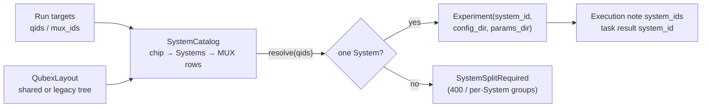

# Chips and Systems

A QDash chip is the physical device and stays the primary key of every record. A System is
the set of control boxes that drives part of that chip, named by its `system_id` in the Qubex
`system.yaml`. QDash derives the System of a run from the targeted qubits at run time and
records it; it never stores Systems on the chip document.

## Why Systems exist

Qubex 1.5 configures hardware per System and deprecates `chip_id` as the entry point. A chip
driven by quel1 and quel3 boxes at the same time needs two Systems, because the two backends
cannot share one `Experiment` and read different units in `capture_delay.yaml`. Everything else
about the chip (qubits, couplings, calibration history, notes) belongs to the chip. Earlier
deployments modelled the second System as a second chip (`144Qv3-quel3`); the catalog below
resolves that name so both forms keep working until the data is merged.

## Components

`QubexLayout` (`src/qdash/common/config/qubex_layout.py`) owns every Qubex path. The tree
declares its layout in `<root>/qubex-config.json`: `layout_version` `"2.0"` is the shared
layout (`<root>/config/*.yaml`, `<root>/params/<system_id>/`, `<root>/calibration/<system_id>/`)
and `"1.0"` the legacy per-chip layout (`<root>/<chip_id>/{config,params,calibration}`).
The manifest is the contract with the qubex team; for a repository that does not carry it yet
the presence of `<root>/config/chip.yaml` selects shared, the Config page shows a **no manifest**
badge and provisioning warns (`manifest_warning`). `QUBEX_LAYOUT` overrides both. Shared files are addressed by chip ID, owned directories by System ID, and
`repo_relpath` gives the repository path used for publishing.

`qubex_config_schema.py` validates files against the JSON Schemas in
`config/domain/qubex-config-schemas/` (published at
`https://oqtopus-team.github.io/qdash/schemas/qubex-config/`, copies in
`docs/public/schemas/qubex-config/`). `schema_for` maps a repository path to its schema per
layout version, `validate_text` checks content before it is saved, and `validate_tree` checks the
shared files plus the params directories of given Systems. Pipeline preflight, provisioning
(`validate_staged`) and the Config page validate endpoint call it; the schemas describe
structure only, and `SystemCatalog` still owns consistency (boxes exist, one System per MUX).
[qubex-config Layout](../../reference/qubex-config-layout.md) lists both versions file by file.

`SystemCatalog` (`src/qdash/common/config/system_catalog.py`) is the only reader of `chip.yaml`,
`system.yaml` and `wiring.yaml`. For a QDash chip it lists the Systems, the MUXes each System
wires, the MUX size (`topology.mux_size`, default 4), and maps targets to Systems.

| Configuration | Systems of the chip |
| --- | --- |
| No `system.yaml`, or a single-entry file | One implicit System, `system_id == chip_id`; wiring read by chip key, or every group flattened |
| Catalog entries with `chip_id` equal to the chip | Those Systems; wiring read by `system_id`, then by chip ID |
| An entry named like the QDash chip whose `chip_id` differs | Only that System (one QDash instance per System); its `chip_id` is the Qubex chip |
| The same MUX in two Systems | `ValueError`; the execution lock falls back to the whole chip |

`SystemEntry` carries `driver` (the QDash backend implementation, `qubex` today) and `backend`
(`quel1`, `quel3`). A vendor outside Qubex becomes another System of the same chip with its own
driver, never a new chip.

## Resolution in a run

`CalibOrchestrator._create_backend` resolves the session's qids and MUXes with the catalog and
stores `system_ids` in the session config and the execution note. A session that resolves to one
System also gets `system_id`; `QubexBackend.connect()` passes it to `Experiment(system_id=...)`
with `config_dir` (by chip) and `params_dir` (by System) from the layout, and the task executor
stamps `system_id` on every task result. Targets that span Systems raise `SystemSplitRequired`,
and a coupling across Systems raises `CrossSystemCoupling`. When the configuration tree cannot
be read, the chip ID is used as the System ID, which keeps the legacy `params/<chip_id>`
location.

The same catalog feeds the schedulers and the execution lock: `OneQubitScheduler` and
`CRScheduler` read wiring rows through it, and `resolve_execution_resource_scope` derives
`mux:` / `module:` / `channel:` resources from the rows of the chip's Systems only, so a shared
`wiring.yaml` holding other chips does not widen a lock to the whole chip.

Services that write parameters outside a run (manual update, seed import, GitHub
synchronization) use `default_system_id(layout, chip_id)`: the System named like the chip, or
the chip's only System.

## Invariants

- `chip_id` is the key of every document; `system_id` appears only on task results and in the
  execution note. Results recorded before Systems existed are backfilled with
  `system_id = chip_id` by the `backfill-task-result-system-id-v1` migration.
- One Experiment per System: a run never connects to two Systems at once. Multi-System runs
  are split into per-System sessions by the scheduled strategy (see
  [Multi-System execution](../workflow/multi-system-execution.md)).
- MUX numbers are unique within a chip, and a MUX belongs to exactly one System.

## Migration path

Legacy trees keep working unchanged: each chip directory is one implicit System. The
qubex-config repository's `scripts/convert_layout.py` converts a tree to the shared layout and
verifies with the Qubex `ConfigLoader` that every System reads the same qubits, boxes and wiring
before and after. A chip that was modelled as two QDash chips is merged afterwards with
`python -m qdash.dbmodel.merge_chip_systems --from-chip 144Qv3-quel3 --to-chip 144Qv3`, which
replaces the System's qubit and coupling documents, copies history with the chip ID rewritten,
and leaves the chip document and cool-downs of the source instance alone. Run it without
`--apply` first; the report lists every collection it would touch.

## Tests

- `tests/qdash/common/config/test_qubex_layout.py`, `test_system_catalog.py`: layout detection
  (manifest, probe, override) and every resolution rule, including the alias and duplicate-MUX
  cases.
- `tests/qdash/common/config/test_qubex_config_schema.py`: path-to-schema mapping per version,
  accepted and rejected documents, every params template, and the published schema copies.
- `tests/qdash/common/test_execution_resources.py`: shared wiring with other chips keeps
  MUX-granular locks.
- `tests/qdash/workflow/engine/test_qubex_backend_params_sync.py`,
  `test_orchestrator_run_params.py`: System selection at `connect()`, refusal of split targets,
  recording of `system_ids`.
- `tests/qdash/dbmodel/test_merge_chip_systems.py`: the chip merge command.

## Implementation files

- `src/qdash/common/config/qubex_layout.py`
- `src/qdash/common/config/qubex_config_schema.py`
- `config/domain/qubex-config-schemas/`
- `src/qdash/common/config/system_catalog.py`
- `src/qdash/workflow/engine/backend/qubex_paths.py`
- `src/qdash/workflow/engine/backend/qubex.py`
- `src/qdash/workflow/engine/orchestrator.py`
- `src/qdash/workflow/engine/task/executor.py`
- `src/qdash/common/execution_resources.py`
- `src/qdash/dbmodel/merge_chip_systems.py`
