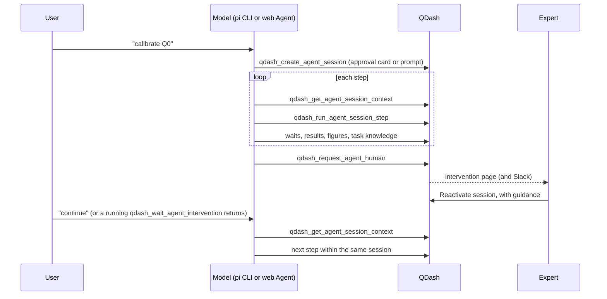

# Agentic Calibration

Agentic calibration is the closed loop in which an agent decides the next measurement and QDash
performs it, judges it, and records it. Two agent-side drivers use the same QDash contract
(sessions, actions, gates, commits, interventions; see [Agent Platform](./agent-platform.md)):

- **The model-driven loop**, the primary path: in pi CLI or the QDash web **Agent**, the model
  chooses every step from the latest result, the task knowledge, and the skills, inside a
  session the user approved once, and stops for an expert through QDash when the next step is
  unclear. See [The model-driven loop](#the-model-driven-loop).
- **The fixed-plan runner** of the Python client (`qdash-agent run-plan`): a deterministic path
  for a plan a person wrote, a graph of nodes each running one task on one qubit with one
  candidate parameter. A plan with `autonomy: auto` lets the evaluation planner pick the next
  node from the task knowledge's `next_actions` table. It serves reproducible runs and remains
  compatible with existing scripts.

The operator's procedure for both is in [Agent Calibration](../../user-guide/agent-calibration.md).

## The model-driven loop

pi-qdash's loop tools (`extensions/tools/agent-loop.ts`) give the model the loop in both hosts,
with the same code and the same approval boundary. The model owns every judgement: which task
comes next, whether a result is good, when to ask a person. The tools own only mechanics that
must not depend on the model's memory: reading QDash's records, keeping a step inside the
session, and not repeating work.

### Approval

Creating the session with `qdash_create_agent_session` is a reviewed write: the user approves
its qubits, tasks, override bounds, quality gates, action budget, round budget
(`max_rounds_per_target`), expiry, and `autonomy: auto` once. That approval covers the
session's own steps, so `qdash_run_agent_session_step` and `qdash_request_agent_human` are
session-granted writes (`SESSION_GRANTED_WRITE_TOOL_NAMES` in `extensions/lib/tool-policy.ts`)
that neither host asks about again. The approval belongs to the user who created the session,
and QDash only scopes sessions to the project, so each call asks QDash who the client is signed
in as (`client.getCurrentUser()`, `GET /auth/me`) and `sessionOwnerRefusal` refuses another
editor's session or an unknown user before any write; a name the model supplies is never used.
QDash checks the same again (see [Server checks](#server-checks)). They refuse a session with `autonomy: confirm_each`, where
every action goes through the reviewed `qdash_submit_agent_action` and
`qdash_execute_agent_action`. No script may call a session-granted tool. The `policy` parameter
of `qdash_create_agent_session` is one schema, `agentSessionPolicySchema` in
`packages/pi-qdash/extensions/lib/agent-session-policy.ts`, which the pi CLI and the web runtime
both expose. It spells out `AgentSessionPolicy` with its nested types, including `autonomy`,
`max_rounds_per_target`, and `parameter_updates` as an object, so Pi rejects a malformed policy,
such as `parameter_updates` sent as a list, before the approval and before any QDash call; the
tool checks the policy again before it asks. `preApprovalProblems` adds the checks a schema
cannot express, such as a quality gate on a task outside `allowed_tasks` or a session-wide
`quality_gates`, and both hosts run it before they show an approval (the pi write gate and the
runtime's approval card). QDash still validates every policy itself. A client that sends
`task_quality_gates` refuses a created session whose response lacks them, because a QDash
release that predates the field ignores it.

Commits and backend applies are reviewed writes unless the same approval also granted
`parameter_updates` ([Update authority](#update-authority)). The approval card
(`AgentSessionPolicyPreview` in `ui/src/components/features/chat/`) and the pi confirmation
(`agentSessionApprovalText`) list the qubits, tasks, bounds, each quality gate with the task
it checks, budget, expiry, the evaluation mode, whether parameter updates and backend applies
are granted, and for each granted parameter its bounds or that its task's own checks decide,
above the exact policy. An `auto`
session cannot replace a paused one: QDash refuses to create one for qubits that one of the same
user's sessions on the chip is paused for, and `qdash_create_agent_session` checks
`pausedSessionConflict` first.

### State from QDash's records

`buildAgentLoopContext` (`extensions/lib/agent-loop.ts`) derives the loop state from the
session, its actions, its interventions, and the candidates of recent completed runs, which
`qdash_get_agent_session_context` reads on every call. A restarted pi or a new chat therefore
reaches the same state as the process that started the work, and `qdash_list_agent_sessions`
(backed by `GET /agent-sessions` with `mine`, `chip_id`, and repeated `status` filters, expiry
applied before filtering) finds the session when its id is not in the conversation.

| State | Meaning | A step may run |
| --- | --- | --- |
| `ready` | Active, `auto`, budget left, nothing in flight | Yes |
| `in_flight` | A dispatched run has not settled; the model waits for it | No |
| `waiting_for_expert` | Paused on an unanswered intervention | No |
| `resume_needs_plan_runner` | An expert authorized resuming a `qdash-agent run-plan` plan; `resume-plan` claims it | No |
| `confirm_each` | The user approved no autonomous steps | No |
| `budget_exhausted` | Every action used; only an intervention can be recorded | No |
| `expired`, `ended` | Over and never reactivated | No |

QDash returns datetimes in UTC, often without an offset. The context reads them with
`parseServerTimestamp` (`extensions/lib/server-time.ts`): a value without an offset is UTC, an
explicit `Z` or offset is kept, and the reported timestamps gain `Z` so they name one instant.
The host's time zone never changes the result. An `expires_at` that is not an ISO date-time
counts as expired, so a malformed record cannot extend the session.

The context also reports, for the newest intervention, the original question, the attempts, the
expert's decision and guidance, the actions recorded since the answer, and
`expert_answer_pending_review` while no action has followed the answer yet.

### One step

`decideAgentStep` checks a requested step against the context before anything reaches QDash,
because a proposal QDash rejects on scope still uses an action of the budget: the task, the
qubit, each override against its bounds, and reconfiguration against the policy. It adds two
loop rules. A task on a qubit stops at the session's `max_rounds_per_target`. An identical
finished measurement (same task, qubit, and overrides) runs again only when
`repeatOfActionId` names it, so a model that lost its context does not repeat a measurement
by accident, and a deliberate repeat is visible in the record. These client checks only give a
clear early answer; the decisions that hold under concurrency are QDash's.

The tool then proposes the action with an idempotency key derived from the tool call id
(`callIdempotencyKey`) and dispatches it. When a host replays an interrupted call (the web
runtime replays pinned tools after a restart), the same key finds the action the call already
created and dispatch is idempotent once it left `not_started`, so nothing is measured twice. An
authorized action that was never dispatched is dispatched instead of proposing a new one. The
model follows the run with `qdash_wait_agent_action` and `qdash_wait_execution` and reads the
result before the next step.

### Server checks

The tools send the proposal (`POST /agent-sessions/{id}/actions`), the dispatch (`POST
.../actions/{action_id}/execute`), and the intervention with `autonomous: true`. QDash then
checks, with the request's authenticated user and its own records:

| Request | QDash refuses | Status |
| --- | --- | --- |
| Any autonomous request | A signed-in user other than the session's `created_by`, or none | 403 |
| Any autonomous request | A session whose `autonomy` is not `auto` | 409 |
| Proposal (`run_task` only) | A measurement of the session that is dispatching or running; an undispatched identical action (dispatch it instead); a task and qubit at `max_rounds_per_target`; a finished identical measurement without `repeat_of_action_id` naming it | 409 |
| Dispatch | Another measurement of the session that is dispatching or running | 409 |
| Proposal (`run_task` only) | Unresolved evidence anywhere in the session, a repeat of the same task included, until an expert's `resume` answer cites that action; a backend apply of the session still in progress (see [Unresolved evidence](#unresolved-evidence)) | 409 |
| Proposal of a dependent step | A different task on a qubit whose newest valid result of a granted task is not committed or, with `apply_backend`, not applied (see [Update authority](#update-authority)) | 409 |

A refused proposal is not recorded and uses no budget. `AgentSessionService.submit_action`
loads the session, reads its history, and authorizes with a compare-and-set on the state
version it loaded, so the history checks and the authorization are one decision: a proposal
counted in between changes the version and the second proposal fails with a version mismatch.
For that, the history must hold every action the loaded version counted. The counting update
therefore stores the action record in the session document (`pending_action`), and every load
of the session (`materialize_pending_action` in `agent_session_gate.py`) inserts it before
anything reads the history, the same way a pause stores its records; a submission is refused
while a payload is still pending. Dispatch progress does not change the state version, so
`execute_action` checks running measurements again after it reserved its own action: of two
concurrent dispatches, at least one sees the other's reservation and is released (both may be
refused, never both run). Without `autonomous`, requests keep their earlier behavior, so the
reviewed tools and `qdash-agent` plans are unchanged, and a request without the new fields
hashes as before for idempotent retries.

The client side reads the history between two reads of the session (`loadAgentLoopContext`,
up to `SNAPSHOT_ATTEMPTS` reads). Equal versions mean the history is complete for that version;
a session that keeps changing reports `snapshot_consistent: false` and allows no step. This only
improves what the model sees; it is not a guarantee by itself. A QDash release that does not
return the `autonomous` field on actions gets no dispatch from the step tool, because it does
not make these checks.

### Dependent steps

A step measures on the current calibration state: a qubex task reads its declared inputs from
the Qubit record for a fresh run, and staged candidates are not part of that state. A step that
needs a value an earlier step measured (Rabi after Chevron's frequency) therefore runs after
that value is committed. In a session whose approval granted `parameter_updates` for it, the
model commits it with `qdash_commit_agent_session_update` after a result it assesses as pass
([Update authority](#update-authority)). Otherwise the model proposes
`qdash_commit_agent_candidate` or `qdash_commit_agent_candidate_set` and the user approves that
call. A value Qubex reads from its own configuration files reaches a run only after a backend
apply: under the grant's `apply_backend`, or through `qdash_apply_agent_candidate_commit`, a
reviewed write. The commit advances the state version, so the model reads the context again
before the next step. If the user declines a reviewed commit, the model reports the staged
value instead of measuring as if it had changed.

Only an accepted candidate can be committed (`gate_task_result` in
`agent_session_service.py`). A candidate is accepted on one of two bases, which it reports in
`acceptance_basis`:

- `session_bounds`: the output's name is a key of `allowed_overrides` and the value lies inside
  those bounds. Each key bounds a task input a step may override and also the task output of
  the same name.
- `task_checks`: the output is a parameter the session's [update authority](#update-authority)
  grants from this task, and `allowed_overrides` holds no bounds for it. Only the task's own
  completion checks decide, which passed because only a completed task result yields
  candidates.

Any other output is staged with `accepted: false` and the reason "not allowed by the session
policy", and the policy cannot change after approval. Bounds that exist always apply, so a
session approved with bounds keeps them.

QDash cannot tell who wrote a number in a policy: it records bounds and gates as approved with
the session. No managed configuration of output bounds exists. The task catalog's input limits
(`greater_than_or_equal`, `less_than_or_equal`) apply to inputs, and the thresholds in
`config/domain/metrics.yaml` are display metadata, so neither is a candidate bound. The
`policy` parameter of `qdash_create_agent_session`, its prompt guidelines, and the
`qdash-agent-calibration` skill therefore tell the model never to author a bound or gate: it
puts numbers in the policy only when the user stated them, and without them the task's own
checks are the criterion. This is guidance; the server cannot verify where a number came from.
A bound is a deterministic check, not a quality verdict.

### Quality gates

A quality gate bounds a quality metric of a task result, not an output parameter.
`TaskResultHistoryDocument.quality_metrics` holds only what the workflow engine writes there,
which is the fit coefficient of determination `r2` when the task's `RunResult` reports one
(`RECORDED_QUALITY_METRICS` in `src/qdash/datamodel/quality_metrics.py`). A fidelity or a
frequency is an output parameter: an output of `RandomizedBenchmarking` such as
`average_gate_fidelity` is never a quality metric of any task.

`AgentSessionPolicy.task_quality_gates` maps a task to metric bounds, for example
`{"CheckRabi": {"r2": {"minimum": 0.9}}}`. A gate checks only results of its own task, and a
missing metric on such a result rejects the candidate. `CreateAgentSessionRequest` refuses,
before anything is stored, a gate whose task is not in `allowed_tasks`, a task with no metric,
and a metric QDash does not record. The task catalog does not declare which tasks report `r2`,
so creation cannot prove that a gated task will report it; a result without it fails closed.

The session-wide `quality_gates` field checks every candidate of every task. A new session must
leave it empty, because a metric one task reports would reject every other task's candidates.
A session approved before `task_quality_gates` keeps its session-wide gates with their exact
meaning; to scope them to a task, approve a new session. `quality_gates_for` returns the gates
that apply to one task, and each candidate lists them in `applied_quality_gates`, as do the
audit's measurement facts and the update evidence.

### Update authority

`AgentSessionPolicy.parameter_updates` is an opt-in part of the session approval:
`parameters` (the outputs that may change), `tasks` (a subset of `allowed_tasks` whose results
may supply them), and `apply_backend` (default `false`). It requires `autonomy: auto`. The
grant needs no numeric bounds; bounds in `allowed_overrides`, when the user gave them, apply on
top. A session without it, including every session created before the field existed, grants
nothing, and its commits and applies stay reviewed.

`qdash_commit_agent_session_update` is session-granted. It reads the grant from the session
QDash returns, refuses a parameter, task, or result outside it, records the model's `pass`
decision on exactly that action (`next_action: propose_commit`), and sends `POST
.../candidates/{parameter}/commit` with `autonomous: true` and that `decision_id`. With
`apply_backend` it then sends `POST .../commits/{commit_id}/apply` with `autonomous: true`. A
QDash release that does not return `parameter_updates` gets no commit from the tool, because it
would ignore the flag. The reviewed commit and apply tools take no such flag, so a model cannot
turn a reviewed call into a granted one.

QDash checks each autonomous commit in `agent_parameter_update.check_commit`, with the request's
authenticated user and its own records:

| Check | Refused when |
| --- | --- |
| Authority | The signed-in user is not the creator (403), the session is not `auto`, or the grant does not name the parameter and the action's task |
| Measurement | The action did not complete, the candidate is rejected by its bounds or the quality gates of its task, a newer settled measurement of the same task and qubit exists, or another measurement of the session is running |
| Assessment | `decision_id` is not a decision of the session by its creator, does not cite the action, is not `pass`, names a next step other than `propose_commit`, `next_task`, or `complete`, or was superseded; any decision on the action was ever `fail` or `inconclusive`; a later decision on it is not `pass` |
| Evaluations | The session's evaluation mode is `required` and the task result has no evaluation; an evaluation of the task result is still pending or running; ended `failed`, `cancelled`, or `interrupted`; completed without a diagnosis, without a `fit_reliability` or `calibration_diagnosis` answer, with a fit other than `Reliable`, or with a status other than `SUCCESS`; or has a reviewer who disagreed |
| Session evidence | Any run of the session has [unresolved evidence](#unresolved-evidence) |
| State | The stored value is not exactly the one recorded when the action was proposed (`metadata.parameter_baseline`), or none was recorded; the candidate was already committed; the session is not active; or the state version moved |

The task's own completion checks, such as the R² threshold that fails a task in
`TaskExecutor`, apply because only a completed task result yields candidates. The commit
records `authority: session_policy`, the `decision_id`, and `assessment_evidence`
(`qdash.agent-update-evidence.v3`): the agent-reported assessment; the server-computed gates
with `acceptance_basis`, the bounds, `applied_quality_gates`, and `task_checks`; the
evaluation facts with the evaluator's reported model; and a note that neither the pass nor the
gates are a scientific verdict.

### Evaluation mode

`AgentSessionPolicy.evaluation` fixes at approval whether the calibration evaluator
(`qcal_evaluate` from pi-qcaleval) is part of the session. The evaluator is separate from the
task's completion checks and from bounds and gates.

| Mode | Agent | QDash before a commit |
| --- | --- | --- |
| `off` (default for new sessions) | Does not call `qcal_evaluate` and reports no evaluator verdict | Needs no evaluation; `evaluation_state` is `not_requested` when none exists |
| `required` | Evaluates each result before committing it | Refuses an autonomous or reviewed commit without a completed evaluation with a `Reliable` fit and a `SUCCESS` diagnosis; waits while one is pending |
| `null` (sessions approved before the field) | Evaluates when the host offers `qcal_evaluate`, as before | As before; `evaluation_state` is `none` when no evaluation exists |

In every mode, an evaluation that exists for the result must support the update, so turning
the evaluator off never clears a pending, failed, disputed, or negative evaluation, and
[unresolved evidence](#unresolved-evidence) still stops the session. The mode cannot change
during the session, and no request field overrides it. pi-qcaleval stays installed; the mode
reaches the model through the session context's `scope.evaluation` and `next`, so skipping the
call under `off` is guidance, while `required` is enforced by QDash.

The stored value is versioned by its content, because `QubitDocument` has no version field and
standalone MongoDB has no transactions (`qdash.dbmodel.agent_parameter_state`). An autonomous
proposal of a granted task records the stored granted parameters in
`metadata.parameter_baseline`. The commit compares the stored value with that baseline, and
then writes with one `find_one_and_update` whose filter requires the stored sub-document to
still equal it, so a value someone wrote in between, with or without `calibrated_at`, is never
overwritten: the commit is recorded `failed` (409) and nothing is written. A reviewed commit
writes the same way against the value it read just before. Writers outside agent sessions
(`update_calib_data` in workflow result saving and manual edits, and reviewed set commits) still
save the whole qubit document and can overwrite an agent's value afterwards; the apply checks
below then refuse it rather than write over theirs.

An autonomous apply (`check_apply`) needs `apply_backend`, a `session_policy` commit by the
creator that is still exactly the stored value (`after_snapshot`), no unresolved evidence, no
earlier apply request, and `push_to_github: false`; a failed apply is retried only through the
reviewed call. Both record `backend_authority` and `backend_requested_by`. That API check is
early, not final. Every agent apply, reviewed or granted, takes the chip's apply lease
(`agent_backend_apply_locks`, one record per chip) when it reserves the dispatch, and holds it
until the worker settles the apply, so two agent applies never write a chip's parameter files
at once; a lease whose holder already settled is stale and replaced. Under the lease, the worker
(`agent_candidate_apply`) checks a `session_policy` value against the stored one before it
writes the files and again after it verified them, and rolls back its write and fails the apply
when either check, the verification, or the GitHub push fails. A qubit write after the second
check is ordered after the apply. Workflow runs that write parameter files themselves
(`update_params`) do not take the lease, so the lease orders agent applies only among themselves.

The rollback undoes only the YAML keys the apply wrote, so it never erases a value another writer
saved in the meantime. `YamlParamsUpdater.apply` records each key's previous value in a
`ParamsApplyRecord` under the same file lock (`<file>.yaml.lock`) as the write, and releases the
lock after each file. `rollback` then takes the lock again for each file and restores a key only
while it still holds the value the apply wrote. A key another writer changed since is left in
place, and the apply's `backend_error` lists it after `backend rollback left later changes in
place`. A `meta.unit` the apply added is removed only when the file's data is back to its state
before the apply, and a file the apply created is removed only when nothing else remains in it.
The check compares values, so a later writer that saved the same value as the apply is not
distinguishable from it and its key is restored. The guarantee covers writers that go through
`YamlParamsUpdater` and its lock: ordinary task results, the pre-push sync, the backend's
connect-time sync, and manual edits. A GitHub pull (`pull_github`), chip scaffolding, and a person
editing the files by hand bypass the lock and are not protected. A worker that dies after the
write and before the rollback leaves the applied value in the files; the operating system releases
its file locks.

#### Unresolved evidence

`review_evidence` stops the session on a questionable result. A settled run of the session has
unresolved evidence when it did not complete, any decision on it was `fail` or `inconclusive`,
an evaluation of its result ended `failed`, `cancelled`, or `interrupted`, has no diagnosis,
judged the fit unreliable, reported a status other than `SUCCESS`, completed without both a
`fit_reliability` and a `calibration_diagnosis` answer, or a reviewer disputed it, or, for a
granted task, its candidates cannot be read, carry no granted parameter, or were rejected. Any
such run refuses every autonomous step, commit, and apply of the session. An evaluation still
pending or running makes them wait instead.

Only an expert clears it: an intervention answered with `resume` whose attempts cite exactly
that action, answered at or after the latest of all the action's problems was recorded. QDash
collects every problem of the action, not only the first: each `fail` or `inconclusive`
decision (`recorded_at`) and each unusable evaluation (its `completed_at` or a reviewer
verdict's `updated_at`, whichever is later). An answer given before a later failed evaluation,
diagnosis, decision, or reviewer verdict of the same action does not cover it. A settled
evaluation without `completed_at`, or with any reviewer verdict (`verdict`, `verdicts`, or
`verdict_history`) whose `updated_at` is missing or unreadable, has no provable time, so no
answer covers it. An evaluation without verdicts is timed by `completed_at` alone. An answer that
covers the problems still waits for an evaluation of the action that is pending or running. A repeat
of the same task, a new `pass`, an answer to an intervention that does not cite the action, or
a `stop` answer clears nothing, and each new questionable result, a repeat's included, needs its
own answer. The answer lets the plan continue, including the repeat it calls for; it never makes
the result committable and grants nothing outside the session's scope.

`dependency_refusal` then keeps a dependent step from reading an old value. A different task on
a qubit waits while the newest valid completed result of a granted task on it has an accepted
granted candidate that is not committed or, with `apply_backend`, not applied, including when its
apply failed. An expert's answer does not skip that; the value is committed and applied, under
the grant or through the reviewed calls. A result an expert's answer resolved carries no update
to wait for. A repeat of a valid result needs no answer; the newer result supersedes it.

### Stopping for an expert

A run that settles without completing gets a mechanical next step (`FAILED_RUN_HINT` in
`extensions/lib/agent-loop.ts`): the session context adds it while that result has no decision,
and the `qdash_wait_agent_action` result adds it after the action record when the run failed.
It says that QDash refuses every further step, a repeat included, until an expert answers an
intervention that cites the run, and tells the model to call `qdash_request_agent_human` with it
in `attemptActionIds` before any wider research, because only that call pauses the session and
reaches an expert. It names no
cause and starts nothing. `qdash_record_agent_decision` with `nextAction: request_human` in an
active session says in its result that it opened no intervention.

`qdash_request_agent_human` records an intervention through `POST
/agent-sessions/{id}/interventions` with the reason, summary, question, and attempts that
reference the session's actions and their executions, under a key derived from the tool call
id. It carries no checkpoint, so it uses the pause and the
[execution barrier](#the-execution-barrier) of every intervention, and the expert's resume on
the intervention page (**Reactivate session**) sets it to `resumed` and the session to `active`
directly. While the session waits, QDash refuses new actions, dispatches, commits, and applies,
and `qdash_run_pipeline` and `qdash_execute_flow` refuse to start on the same chip and targets
for the same user (`pausedSessionConflict`), because a flow or pipeline would bypass the pause
and the candidate gate. They also refuse when the session list cannot be read, including on a
QDash release without it (404 or 405).

### Continuing

The loop continues in one of two ways, and neither starts a process:

- **Explicit.** The user asks pi to continue. The model reads the session again with
  `qdash_get_agent_session_context`; this works after pi restarted or in a new chat.
- **Live.** The model called `qdash_wait_agent_intervention` in a turn that is still open. The
  wait returns the same context once the session leaves `waiting_for_human` or its intervention
  is answered. It times out after at most an hour (default 15 minutes) and polls at least five
  seconds apart; in the web runtime it parks between polls like the other
  [waiting tools](./architecture.md#code-mode-and-deferred-tools), and in pi CLI it polls in
  the process with `pollUntilSettled`. In both hosts `boundedCheck` (`extensions/lib/waits.ts`)
  bounds each poll by the time left (at least `MIN_CHECK_MS`, one second) and by cancellation,
  and drops a late answer or failure; the client takes no `AbortSignal`, so an abandoned HTTP
  read still runs until the client's request timeout. A closed pi process or a finished chat turn does not
  wake up when the expert answers.

The expert's guidance reaches the model as data with a fixed rule (`GUIDANCE_RULE`): it is
evidence for the next decision, not an instruction to execute and not permission. The session's
scope, budget, expiry, and QDash's checks stay as they were, so guidance that asks for another
task or a wider range only leads the model to tell the user a new session is needed. No pi-qdash
tool answers, resumes, claims, or reactivates an intervention, and a completed, cancelled, or
expired session is never reactivated.

## The fixed-plan runner

The rest of this section describes the Python client's runner. Its loop runs on the agent side
as a **plan** a person approved once.

<Diagram name="agentic-calibration-loop" caption="The plan, the step runner, and the evaluation planner run outside QDash. QDash authorises each action, measures without writing, gates the candidate, evaluates the figure against the task knowledge, and commits only the accepted set." />

### Three loops, one boundary

The design keeps three loops apart so that each can be bounded and audited on its own.

| Loop | Where it runs | Decides | Bounded by |
| --- | --- | --- | --- |
| Step | `AgentCalibrationRunner.run_step` (client) | Whether one measurement produced an accepted candidate | The session grant: tasks, qubits, overrides, quality gates, state version |
| Plan | `AgentPlanRunner.run_plan` (client) | Which node runs next | `max_node_executions`, `max_node_visits` per node, the remaining action budget, the node graph |
| Evaluation | `EvaluationPlanner.choose_next` (client) with `POST /evaluations/runs` (API) | Which plan node the evaluated status leads to | `next_actions`, `max_rounds_per_target`, the session's override bounds |

Every decision crosses the boundary as a request QDash can refuse. The agent never writes a
parameter, never widens its scope, and never runs a task the plan does not name; the planner
returns a node id, not a task. A model's judgement reaches the hardware only through the
`next_actions` table a person wrote into `task.md`.

### Before the first measurement

Two checks run before any hardware time is spent, so that a plan fails for a reason a person
can read rather than in the task's own validation.

The plan runner validates the graph (unique ids, known targets, no reserved `$complete`,
`$default`, or `$escalate` id) and the session policy: the qubit, every task, every candidate
parameter, reconfiguration if a node asks for it, and `max_node_executions` against the actions
the session still has. A failure is returned as `human_escalation` with no action created.

The pipeline preflight in `POST /calibration-pipelines/validate` covers the agent's other
entry point, `qdash_run_pipeline`: run-parameter names and types, the session-scoped
`readout_duration`, and the calibrated inputs each qubit task needs, including the readout
duration the stored Rabi parameters were measured with. See
[Calibration Pipeline](../workflow/calibration-pipeline.md#preflight-checks) and
[Parameter Resolution](../workflow/parameter-resolution.md).

### One node visit

<Diagram name="agentic-calibration-plan-states" caption="A node visit: budget, run, outcome, planner decision, node rule. Red boxes end the plan for a person; the evaluation planner's rules fill the decision box." />

The runner checks the node budget (`max_node_executions` for the plan, `max_node_visits` for
the node about to run, whichever rule led back to it), then runs the node with three override
layers: the values
earlier nodes accepted (carried), the node's own `parameter_overrides`, and the one-shot
overrides a planner attached to its last decision. Each visit gets a deterministic idempotency
key from the plan prefix, the node index, and the visit count, so a revisit is a new action
while a transport retry before dispatch reuses the same one.

The step outcome is one of four transitions:

| Transition | Meaning | What the plan does |
| --- | --- | --- |
| `pass` | The candidate passed the session's bounds and quality gates | Carries the value, counts a completed node, asks the planner, then follows `on_pass` or the next node |
| `rollback` | The candidate was rejected; nothing is carried | Asks the planner, then follows `on_rollback` or stops |
| `retry` | No measurement happened, or QDash timed out | Re-runs with the same key only while no operation id exists and `max_pre_dispatch_retries` allows; otherwise returns |
| `human_escalation` | The action was rejected by the policy, or a planner or graph error | Returns at once |

The planner's answer is checked before it is used: an unknown node, overrides on a sentinel,
a non-finite override, or `$complete` after a `rollback` ends the plan as `human_escalation`.
A planner that raises ends it the same way. `$default` is recorded and the node's own rule
applies.

With `commit_on_success`, a plan that ends in `pass` commits the latest accepted candidate per
parameter as one **candidate set**: QDash re-resolves each referenced task result, re-runs the
gates, and writes the set with one Qubit save and one audit record
(`POST /agent-sessions/{id}/candidate-set-commits`). Any other ending leaves every value
uncommitted.

### The evaluation planner

`EvaluationPlanner` is the only planner shipped with QDash. It turns the calibration
evaluation into a plan decision without adding any judgement of its own:

1. It creates an evaluation run for the node's task result (`trigger: single`) and waits for it.
2. It reads the status question's answer (`status`, `suggested_range`) and the fit question's
   (`fit_reliability`), as [Calibration Evaluation](./evaluation.md) defines them.
3. It looks the status up in the task's `next_actions` (`GET /tasks/{name}/knowledge`).
4. It checks any override against the session's `allowed_overrides` and the target node's
   visits against `max_rounds_per_target`.

The keys of `next_actions` are exactly the statuses the evaluation can report for that task:
`SUCCESS` plus one code per bullet under `## Common failures` in `task.md`
([Knowledge Layout](./knowledge-layout.md)). CheckRabi's table today reads:

| Status | Action | Effect in the plan |
| --- | --- | --- |
| `SUCCESS` | `continue` | `$default`: the node's `on_pass` or the next node |
| `NO_SIGNAL` | `run_task: CheckChevron` | Jump to the plan node that runs CheckChevron; its accepted `qubit_frequency` is carried on |
| `LOW_CONTRAST`, `RAPID_DECAY`, `FREQUENCY_MISMATCH`, `BEATING_PATTERN` | `request_human` | `$escalate` with the entry's note as the reason |

A `retry` entry re-runs the same node with the entry's `overrides`, or with the midpoint of the
evaluation's suggested range when `suggested_range_parameter` names the parameter. No CheckRabi
entry uses it, because the evaluator's range describes the swept pulse duration rather than
an input.

The planner stops the plan (`$escalate`) when the table has no entry for the status, when the
same status comes back three times for one node, when the fit was unreliable twice in a row,
when a node would exceed `max_rounds_per_target`, when an override leaves the session bounds,
and when the evaluation was skipped, failed, or timed out. A failed evaluation's reason names
the evaluation and run ids and the exception class, never the evaluator's or the transport's
error text; the runner's own failure reasons (`safe_error_reason` in
`clients/python/src/qdash/client/services/agent_runner.py`) follow the same rule, because the
reason becomes the intervention summary, the attempt reason, and the resume outcome. Each decision is kept as an
`EvaluationPlannerTrace` and printed by `run-plan` under `evaluations`, so a reviewer can
record a verdict on every evaluation that steered the run.

## Human interventions

An intervention is QDash's durable record that an agent stopped and needs a person. It is the
only thing that pauses a session for a human, and QDash is its source of truth: Slack only
points to it. The operator's procedure is in
[Agent Calibration](../../user-guide/agent-calibration.md#when-the-agent-stops-for-an-expert).

There are three entry points, and only these:

| Entry point | Records | Resume |
| --- | --- | --- |
| `qdash_request_agent_human` in pi or chat, in an `auto` session | The reason, summary, question, and attempts referencing the session's actions, without a checkpoint | The expert's resume reactivates the session; the model continues as [Continuing](#continuing) describes |
| `AgentPlanRunner.run_plan(record_interventions=True)`, the default of `qdash-agent run-plan` | Every non-pass ending, with an `AgentInterventionReason`, the step outcomes as references, and a plan checkpoint | `qdash-agent resume-plan` claims the resume and continues the plan |
| An authorised `request_human` action (`qdash_submit_agent_action` in pi or chat, the path of a `confirm_each` session) | The diagnosis as the question, linked to the action, without a checkpoint | The expert's resume reactivates the session; the agent continues with its own proposals |

The plan runner classifies each ending: the evaluation planner sets `escalation_reason` on its
`$escalate` decisions (`unknown_outcome` for a status without a `next_actions` entry,
`recovery_exhausted` for a round or repeat limit, `evaluation_failed` for a failed, skipped, or
unreliable evaluation, `policy_limit` for an override outside the bounds, `agent_request` for a
`request_human` entry), and the runner classifies its own stops (budgets and visit limits as
`recovery_exhausted`, policy rejections and preflight refusals as `policy_limit`, API and
execution failures as `platform_error`). A known recoverable status stays in the bounded loop
and records nothing.

`POST /agent-sessions/{id}/interventions` pauses an active session and records the
intervention in one compare-and-set on the session document (see
[The execution barrier](#the-execution-barrier)). The request does not carry an expected state
version; the server retries up to five times against the current version, so a concurrent
action delays the stop, and only a session that keeps changing returns 409. Recording needs neither `run_task` budget nor an unexpired session:
on an expired, completed, or cancelled session the record is kept with `pauses_session: false`
and can only be closed. The server checks that targets, tasks, and checkpoint nodes are inside
the policy, and that each attempt's ids form one chain of the session's evidence
(`AgentInterventionService._validate_attempt_evidence`): the action belongs to the session and
its execution is the one [`agent_execution_links`](#execution-grouping) links to that action; an
execution or task result cited without an action came from an execution of the session; the
task result came from that execution, on the session's chip, for the attempt's `qid` and
`task_name`; and the evaluation evaluated that task result within the cited run. No id is
required, so an attempt that failed before dispatch cites only its action or nothing. An
attempt's `transition`, `status`, and `reason` are what the runner reported, stored as given;
the intervention page labels them so. A checkpoint's `source_execution_id` is provenance only
and must name an execution of the session's chip. Each failure is a plain 422, never
`checkpoint_rejected`. A repeated request with the same
idempotency key returns the same record; a second intervention while the session already waits
is refused with the waiting one's id.

The checkpoint holds the approved plan, its idempotency prefix, `node_path`, per-node visit
counts, the stopped node, the accepted candidates as `(action_id, parameter_name, task_id)`, the
plan bounds, and the evaluation planner's stop-rule history. The runner writes it, so the server
reconciles it with its own records before accepting it
(`AgentInterventionService._validate_checkpoint`):

- **One plan per session.** The first checkpoint binds the session to its plan: the pause stores
  the prefix, the hash of the nodes, the target, and the bounds in the session's
  `plan_binding`. A later checkpoint that changes any of them is refused with 422, so a fresh
  prefix or a raised `max_node_visits` cannot restart the budget. An evaluation-planned
  checkpoint must limit node visits to the policy's `max_rounds_per_target`.
- **Counts from QDash's actions.** Every `run_task` action of the session must carry a plan key
  (`{prefix}-node-{index}[-visit-{n}]-action`) whose node has the action's task, target, and
  override names; a session that also ran actions outside the plan cannot record a checkpoint.
  A node's visits may be higher than its actions show, because a visit can stop before its
  action reaches QDash, but never lower. The visit counts must match `node_path`, and the path
  must extend the one the previous checkpoint recorded.
- **Candidates from the plan's runs.** Each carried candidate must name an authorised action of
  the plan, the `candidate_parameter` of that action's node, and the task result of that
  action's execution, task, target, and chip; one candidate per parameter.

A checkpoint that breaks the policy or contradicts itself (visit counts that do not match its
`node_path`, two candidates for one parameter, an evaluation planner without the visit limit)
is refused with a plain 422, like any other invalid reference. A well-formed checkpoint that
QDash's records do not support (a changed plan, a path or planner history that does not extend
the recorded one, a session that also ran `run_task` actions outside the plan, lowered visits,
or a candidate that no run of the plan produced) is refused with 422 and
`detail: {"code": "checkpoint_rejected", "message": ...}`. These reconciliation checks run after
every other check, so the code never covers a scope, reference, or format failure. Nothing of
the rejected checkpoint is stored.

On that code alone, `AgentPlanRunner` records the stop again without a checkpoint, under the
idempotency key with `-nocp` appended and with a fixed sentence appended to the summary, so the
session still pauses and Slack is still notified. The runner keeps QDash's message in
`AgentPlanOutcome.checkpoint_rejection` (`checkpoint_rejection` in the `run-plan` output) and
does not send it in the record. Such a record has no plan to resume: `claim-resume` refuses it,
`resume_state_from_intervention` raises, and an expert's resume only reactivates the session. A
401, 403, 409, transport failure, or any other 422 is reported in `intervention_error` without a
second request.

Resume blockers and the **Resume from** options count each node's visits as the larger of the
checkpoint and the actions, and a resume is blocked when the checkpoint is not the bound plan.
Because action keys derive from the prefix, the node index, and the visit count, a resumed node
is a new visit with a new key, and re-running an interrupted resume reproduces the keys of the
actions it already submitted, which QDash returns instead of measuring again. A planner that
decides differently on the re-run can still choose a node the first run did not reach. The
resumed runner re-reads each carried candidate from QDash and stops if one is no longer
accepted. The planner's stop-rule history is only checked for not shrinking; the hard bounds
are the visit counts, the node executions, and the session's action budget.

The expert's answer (`POST .../respond`) is bound to the session's state version. Resume is
refused while a blocker holds: the session is not paused on this intervention, it expired, it
used all its actions, its remaining actions do not cover the plan's remaining node executions,
the chosen node is at its visit limit, or an operation that passed the session's execution gate
has not settled: a measurement, a candidate commit, or a backend apply. A stop cancels the
session and is never blocked. A resume of a plan with a checkpoint sets
`resume_authorized` and keeps the session paused; `POST .../claim-resume` with a claim key then
reactivates it for one runner, re-checking the blockers, and `POST .../resume-outcome` records
how the resumed run ended. Guidance is stored text; it never becomes an override, a target, or a
write. `qdash-agent resume-plan` prints it with the result and does not pass it to a planner or a
model; in pi or chat, `qdash_get_agent_session_context` hands it to the model as evidence.

A resumed run is complete only when its outcome is recorded. If `POST .../resume-outcome`
fails, `resume-plan` prints the result, exits with status 3, and prints a command that records
the outcome with `--record-outcome` and the same claim key, which claims and runs nothing. Once
an outcome is recorded, `resume-plan` with that claim key prints it and exits without running;
another claim key is refused.

The answer touches two documents. The intervention is written first as `responding`, the
session's compare-and-set carries the response id in `intervention_resolution_id`, and the
intervention is then settled. A read settles a response that a crash left half applied: it
finishes it when the session carries its response id and rolls it back to `open` after 60
seconds otherwise. The claim settles the same way through `resume_claim_key`.

### The execution barrier

QDash's MongoDB is a standalone server, so no multi-document transaction is available. The
barrier that keeps a paused session from changing hardware, backend, or calibration state is
built from single-document compare-and-set updates on the session document, which MongoDB
applies one at a time. `src/qdash/api/services/agent_session_gate.py` holds it.

- **Counted action.** The update that counts a submitted action stores its record in
  `pending_action`; the record is inserted afterwards and by every later load, so no load
  returns a state version without the action it counted (see [Server checks](#server-checks)).
  The read-only session graph does not insert it; it shows the payload and marks it pending
  (see [Execution grouping](#execution-grouping)).
- **Pause.** One update moves the session from `active` to `waiting_for_human`, sets
  `active_intervention_id`, and stores the intervention record (and, for `request_human`, the
  action record) in `pending_intervention`. The records are then inserted into their
  collections, and the payload is cleared. Every load of the session, and the Slack sweeper,
  inserts a payload that a crash left behind; the inserts are idempotent, so a retry with the
  same idempotency key returns the same intervention, and no record exists without its pause.
- **Operations.** Dispatching a `run_task` action, dispatching a backend apply, and saving a
  candidate commit each mark their own record as reserved first (`dispatching` with an
  unconfirmed token, or a commit in `reserving`), then pass a session update that matches only
  `status: active`, then confirm the reservation and start. If the pause wins the session
  first, the gate refuses with 409, the reservation is released, and nothing is sent; the
  action stays authorised for a resumed session.
- **In flight.** An operation that passed the gate before the pause continues: a pause does not
  stop a measurement or apply already sent to the worker, nor a Qubit save already reserved.
  Its record shows it as in flight, and resume stays blocked until it settles. A resume reads
  these records while the session is paused, so no new operation can pass the gate between
  that read and the update that resumes the session.
- **Crashed requests.** A reservation that never passed the gate is released after 60 seconds,
  with a compare-and-set that makes a stalled request's later confirmation fail. A confirmed
  dispatch whose request crashed before the run was recorded is never released, because QDash
  cannot tell whether the run started; the expert stops the session instead.

Slack delivery is recorded on the intervention after it is saved
(`AgentInterventionService.deliver_notification`). An attempt takes a two-minute lease with a
compare-and-set, posts the root message with the shared bot to `SLACK_AGENT_CHANNEL_ID`, and
stores the channel and timestamp; a stored timestamp is never posted again. A failure is retried
with exponential backoff (30 seconds doubling, at most 30 minutes) by a sweeper each API worker
starts when the channel is configured, and is marked `failed` after six attempts;
`POST .../notification/retry` makes one more attempt. Status changes reply in the thread. The
stored `last_error` and `last_reply_error` hold only the exception type and, for a Slack API
error, Slack's error code (`SlackApiError: channel_not_found`), never the exception text, which
can quote request headers or the token; the warning log uses the same summary. A post
that times out after Slack accepted it is indistinguishable from a lost one, so delivery is at
least once, not exactly once.

### Stopping a session

`POST /agent-sessions/{id}/stop` (`AgentSessionService.stop_session`) ends an active or paused
session on a person's request, with an `idempotency_key` and a `reason`. Any project editor may
send it, as any editor may stop a session from an intervention. One compare-and-set on the
session's status and state version sets `cancelled`, clears `active_intervention_id`, stores
`stop` (who, when, why, the status it ended, and the state version it created), and stores the
`cancelled` end message; a write that changed the session first makes it decide again, at most
five times. From then on the gate refuses every dispatch, commit, backend apply, and resume claim,
and `submit_action` refuses every action. The stop closes the session's `open` and
`resume_authorized` interventions as `stopped` with a `session_stopped` event; a response that
was being recorded when the stop won rolls back to `open`, and the next read closes it. The
audit shows a `session_stopped` entry.

A stop does not cancel what passed the gate before it, and QDash has no API that cancels a
measurement already sent to the worker. The response's `in_flight` lists those operations as
QDash records them after the stop (`in_flight_operations` in `agent_session_gate.py`): a
measurement still `dispatching`, `queued`, or `running`, a commit being saved, or a backend apply
in progress. A `dispatching` measurement may have passed the gate just before the stop, so it is
listed until it settles. Repeating a stop with its key returns `already_stopped`, and a stop of a
session that already ended (`completed`, `cancelled`, or `expired`) returns `already_ended` and
changes nothing; an expired session is reported as expired, not stopped.

`complete_session` ends a session whose goal is reached. Like `request_human`, it uses no action
budget, so a session that used its last action can still be completed. The session page shows
**Stop session** for an active or paused session, and the agent ends a session only through
`qdash_end_agent_session`, a reviewed write that reads the session back
(see [pi-qdash Reference](../../reference/pi-qdash.md)). A decision with `nextAction` `stop` or
`complete` only records the agent's choice.

### Session start and end messages

The same channel, bot, and `SLACK_AGENT_NOTIFICATION` toggle also announce when a session starts
and ends (`src/qdash/api/services/agent_session_notifications.py`). The start message follows
the creation of an approved session, not a proposal or a chat. The end message follows the
first and only update that ends it: an authorized `complete_session` (`completed`), an expert's
stop or a stop request (`cancelled`), or the expiry (`expired`). A pause for an expert is not an end and keeps
only its intervention message.

Each message's delivery state is stored on the session document: `start_notification` by the
insert that creates the session, and `end_notification` by the status-guarded update that ends
it (`end_notification_update` in `agent_session_gate.py`). Only one end update can match the
session's status, so there is one end event, and a crash after the transition leaves a pending
delivery rather than a lost one. Delivery reuses the intervention lease, backoff, attempt limit,
and error summary; a request's background task makes the first attempt, and the notification
sweeper retries due messages and expires overdue sessions, so an expiry is announced without a
reader. A message that used up its six attempts stays `failed`; no endpoint retries it. Delivery
is at least once for the same reason as above. A message never changes the session.

A message names the project, environment, chip, targets, creator, session id, and the model the
host reported (or "not reported"), with links to the session page and its graph for the
session's project. A start message adds the tasks, autonomy, client (`skill_name`), and expiry;
an end message adds who ended it and counts of authorized measurements, committed updates,
interventions, and actions used, all read from QDash's records. Recorded values are sent as
Slack `plain_text`, so none is read as formatting, a mention, or a link. An end message replies
in the start message's thread, broadcast to the channel, when the start message was sent. A
session created before these messages existed gets none, and a session created while they
were disabled is never announced later.

## Experiment audit

A session's experiment audit is a chronological timeline that
`AgentSessionAuditService.timeline` (`src/qdash/api/services/agent_session_audit.py`) builds on
every read from the records QDash already keeps. It is not a second store: raw data, figures, and
mutable state stay in their own records, and the timeline references them by ID. It keeps the
intent, parameters, result IDs, fitted values, figure and raw-data references, decision, and
next action of each step, so a person can review a run and a later skill revision can be
written from it.

| Event `kind` | Source record | What it adds |
| --- | --- | --- |
| `session_created` | `agent_sessions` | Policy, and the skill and model identity the client reported at creation |
| `action_proposed` | `agent_actions` | Action type, requested overrides, the agent's `intent` (its diagnosis), authorization and reason, submitting account (`metadata.submitted_by`, recorded from now on) |
| `measurement` | action, `execution_history`, `task_result_history` | Execution and task-result IDs and statuses, effective inputs, scalar outputs with units and errors, quality metrics, gate results recomputed by `AgentSessionService.gate_task_result`, figure and raw-data counts with the `/tasks/{task_id}/result` path |
| `evaluation` | `evaluation` (same project, a task result of the session) | Status, evaluator model, scalar diagnosis fields, reviewer verdicts |
| `decision` | `agent_decisions` | The agent's assessment, interpretation, and next action, with the evidence snapshot QDash froze |
| `candidate_commit`, `candidate_set_commit` | `agent_candidate_commits`, `agent_candidate_set_commits` | Committed value, previous and new value, committing account; for a commit, its `authority`, and for a `session_policy` commit (actor kind `agent`) the `decision_id` and `assessment_evidence` |
| `backend_apply` | `agent_candidate_commits` | Apply status, operation, changed files, verification, git commit, apply `authority` and requesting account |
| `intervention_opened`, `intervention_response`, `intervention_resumed`, `resume_outcome` | `agent_interventions` | Question, summary, attempts, the expert's decision and guidance, the resume and its outcome |

Each event carries a stable `event_id` (`<kind>:<source id>`) and the reference IDs it
concerns. `provenance` separates QDash's facts (`server_record`) from text a party supplied
(`agent_reported`, `human_reported`, `evaluator_reported`). `status_is_current` marks a status
read live from a record that can still change, such as a running measurement or a queued apply.
`missing` lists facts the records do not hold: a session or step without a reported `model`, an
action from before `submitted_by` existed, a finished measurement no decision cites. The timeline never
fills them in, so a historical session shows what it recorded and nothing it did not. Failure
and error text that can carry transport details is not copied: a failed commit reads
`Candidate persistence failed`, and dispatch, apply, and evaluation errors appear only as
`dispatch_error_recorded` or `error_recorded`. A scope rejection appears as a rejected
`action_proposed` with no `measurement`.

**Model identity.** `model` (`AgentModelIdentity` in `src/qdash/datamodel/agent_session.py`) is
the `provider`, `model_id`, and `host` a client reported for one record. The session, each action
(`metadata.model`), each decision, and each intervention store the identity sent with their own
request, so a model switch or a resume in the other host shows on later records only; a retry
with the same idempotency key keeps the first record's model, because `model` is excluded from
the request hash. The timeline sets `model` on `session_created`, `action_proposed`, `decision`,
and `intervention_opened`, and on a `session_policy` `candidate_commit` from the decision it
rests on (`assessment_evidence.assessment.model`); a reviewed commit stays a person's act with no
model. An agent event without one lists `model` in `missing`. QDash cannot verify the identity:
it is client reported, accepts only identifier characters (no URL, credential, or free text),
and changes no scope or approval. The audit header and `AgentSessionResponse` keep
`model_name`, the `provider/model_id` label of the session's `model`, or empty when none was
reported; an older session's free-text `model_name` is not read as an identity.

pi-qdash fills `model` from the host, never from a tool argument: `hostModelIdentity`
(`packages/pi-qdash/extensions/lib/host-model.ts`) reads `ctx.model` in pi CLI (host `pi`), and
the agent runtime passes the conversation's harness model reference as `qdashHostModel` with
host `qdash-web-agent` (`runCodingAgentTool` in `agent-runtime/src/durable-tools.ts`). An
approval card stores the model that made the call (`ApprovalRequest.model`), so the approved
write reports it even when the user switched models before approving. The Python
`qdash-agent start-session` reports `--model-provider` and `--model-id` with host
`qdash-agent-cli`.

### Decisions

`POST /agent-sessions/{session_id}/decisions` (`RecordAgentDecisionRequest`) records the one
fact the other records lack: how the agent read a result and why it chose the next step. Only
the session's creator records one, through an editor request; the record changes no session
state, passes no execution gate, and is allowed in every session status, so a paused, stopped,
or expired session keeps its trail. Every referenced action, evaluation, intervention, and
superseded decision must belong to the session (409 otherwise); another project's session is
404. The idempotency key is unique per session, and a retry with the same body returns the same
record. Records are never updated: a correction is a new decision with `supersedes_decision_id`,
and the timeline marks the original `superseded`.

A session holds at most 2000 decisions (`MAX_DECISIONS_PER_SESSION`); the next one is refused
with 409 and a detail that says the audit is full. The quota check and the record are one
insert, so the bound holds without a transaction on a standalone MongoDB: each record takes the
next `quota_slot` (one past the session's highest), and unique indexes on (session,
`quota_slot`) and (session, idempotency key) make MongoDB refuse a second record for a slot or
a key. A refused insert means a concurrent recording won; `_insert_in_free_slot` then returns
that record when it carries the same key and body, or tries the next slot, up to
`MAX_SLOT_ATTEMPTS` times before it answers 503. Nothing is reserved apart from the record
itself, so a crash before the insert holds no slot, and a crash after it leaves a complete
record that a retry with the same key returns without taking another slot. A record removed
outside the API leaves its slot unused rather than reused.

When a decision is recorded, QDash copies its own reading of each cited action into
`evidence_snapshot`: the execution status at that moment, the task-result ID and status, scalar
inputs, outputs, quality metrics, and gate results. A later status change shows in the live
`measurement` event while the decision keeps what it was based on. The snapshot copies at most
50 scalars per record and says how many it left out; arrays and objects are never copied.

pi records decisions without relying on the model to remember a note.
`qdash_run_agent_session_step` records one from `assessment` and `interpretation`, or from its
rationale, on the finished results no decision cites yet, linked to the action it proposed
(including one QDash rejected). It dispatches only after QDash confirms that record. When QDash
refuses it (the audit is full, a cited reference is foreign), does not answer, or answers 5xx,
the step returns `Not dispatched:` text with the reason and the authorized action's ID, and
nothing runs. Calling the step again with the same task, qubit, and overrides reuses that
action, so a retry uses no more of the action budget; a replay of the same call sends the same
decision key, and a new call first looks for a decision already linked to the action, so a
record whose answer was lost is not written twice. Without the session's decision list (an
older release, or a failed read), a step that follows a finished result is refused before it
proposes anything. `qdash_request_agent_human` records the intervention first and then a
`request_human` decision linked to it; when that decision is not stored, the session is still
paused and the expert notified, and the result says the decision is missing rather than
recorded. `qdash_record_agent_decision` covers decisions no step carries, and the loop context
lists results without a decision. The decision text is a concise statement the agent supplies,
not its hidden reasoning or prompt.

### Reading and export

`GET /agent-sessions/{session_id}/audit` returns `AgentSessionAuditResponse` pages, oldest
first, 100 events by default and at most 500. Events sort by time, then the session state
version their source recorded or inherited (stored times have millisecond precision, so records
of one millisecond share a time), then cause before effect, then `event_id`. Sorting alone does
not make paging safe: a task result or evaluation written late can sort before events already
read, so every response belongs to one snapshot.

A snapshot contains two matching projected reads. The timeline uses ordinary queries, one
collection after another, without a multi-collection transaction.
`AgentSessionAuditService._read_snapshot` fingerprints each read (SHA-256 of the header and
events) and returns when two consecutive fingerprints agree. This does not establish an atomic
point-in-time database view. Values can change and revert between reads, for example when a
dispatch reservation is released from `dispatching` to `not_started`; these changes can go
undetected. The fingerprint binds pages to matching projected content. When no consecutive
reads agree within `SNAPSHOT_ATTEMPTS` (3) reads, the request returns 503 and the reader retries.

The fingerprint is the response's `snapshot_id`. The first page takes a snapshot; its
`next_cursor` names the project, the session, the snapshot, and the position after the page. A
later page reads the records once more and is served only when they still fingerprint as that
snapshot, so every page of one cursor chain holds the same records. When anything changed
between pages (a late result, a new decision or intervention, a status that moved), the page is
refused with 409, and the reader starts again without a cursor; a page of a newer snapshot is
never served under an older cursor. A cursor of another session or project, a position past the
snapshot, a malformed cursor, or a cursor of the earlier format is 400. `total_events` counts
the snapshot, and `complete` means the response ends it: with the earlier pages of the same
`snapshot_id`, the reader holds every event of the snapshot. Records written after the
snapshot, such as a run of an active session that finishes later, are not in it; a new first
page or export reads them.

`GET .../audit/export` returns one whole snapshot with `schema_version`
`qdash.agent-session-audit.v1`, or 413 when it exceeds 100000 events, rather than a shortened
file. Pages and an export of the same unchanged records carry the same `snapshot_id`. Reads need
project membership, like every other session read. The session page renders the timeline
(`AgentSessionAuditTimeline`), shows only pages of its first page's snapshot, offers to read the
audit again from the start after a 409, and says when a downloaded export is a newer snapshot
than the timeline on screen. pi reads the audit with `qdash_get_agent_session_audit`, which tells
the model to discard its pages and start again after a 409.

The audit is an application record: QDash's API only appends decisions, and the other records
keep their existing write paths. It is not tamper-proof against a database administrator, and
it does not freeze external artifacts such as figure files.

## Execution grouping

The Execution page presents a session as one experiment over its real executions without
making the session an execution. The session stays the authority for policy, budget, and
pauses; each measurement stays an ordinary execution whose workflow and hardware lifecycle the
session does not own. Nothing here dispatches, locks, cancels, or writes: the grouping and the
graph are read-only projections in `src/qdash/api/services/execution_group_service.py`.

**Link authority.** An execution belongs to a session only when an authorized `run_task` action
of that session names it: the action's `operation_id` matches the execution's
`note.flow_run_id`, or its `operation_id` or `execution_id` matches the `execution_id`. The
execution must be in the session's project and on its chip. `resolve_chip_links` and
`link_for_execution` in `src/qdash/api/services/agent_execution_links.py` hold the one
resolution used by the list, an execution's `agent_session` field, the graph, and the audit
when attributing measurements:

- An action resolves through its `operation_id` first, then its `execution_id`. A flow run id
  that several executions carry resolves to the earliest by `start_at`, then `execution_id`,
  never by database order.
- An action whose `operation_id` and `execution_id` resolve to two different executions on the
  chip is ambiguous and links neither.
- Actions are taken by `created_at`, then `state_version_before`, then `action_id`, across all
  sessions of the chip. The first action that resolves to an execution holds it, so no execution
  sits in two groups or is two measurements; a later action that resolves to it is claimed.

A claimed or ambiguous action is a link conflict, not an undispatched action: the list names it
and its holder in the session's `missing`, and the graph shows it as a `measurement` node with
status `link_claimed` or `link_ambiguous`, `missing` `execution_link_claimed` or
`execution_link_ambiguous`, no execution, task result, or dispatch `sequence`, and its own
`dispatch_status`. The audit also marks the link conflict as missing and excludes that action's
execution results and evaluations, while preserving its recorded dispatch status. The `agent-session:<id>` tag is not a link: a tagged execution without such
an action stays its own row, and its detail reports `linked: false`. No record is written to
group, and no `upstream_id` is changed.

**Attribution.** Each `ExecutionResponseSummary` of `GET /executions` and of the grouped list
carries `agent_session` only when an action holds the execution, from one `resolve_chip_links`
per request rather than a lookup per row; a tag never sets it. A linked `agent_session` also
carries the session's `created_by` and, when a model was reported, `model_name`. The UI labels such a run
**Agent** · @user with the execution's recorded user, and names `created_by` as the user
responsible for the session. It never derives the label from a name or tag, and it does not
present `created_by` as the expert who answered, resumed, or authorized a commit; those stay
in the audit records.

**Pagination.** `GET /executions/groups` (`listExecutionGroups`) groups before it pages. Rows
are the chip's sessions plus the executions no session holds, merged newest first: an execution
by `start_at`, as `GET /executions` orders it, and a session by its latest activity, the latest
start of its executions or its `created_at` before the first. With `date`, an execution needs
its start on that day; a session needs its creation or an execution start on that day, is ordered
by its latest activity of that day, and still lists every execution with `in_filter`. The
response counts rows (`total`) apart from executions (`total_executions`, equal to the ungrouped
list's total, and `grouped_executions`). A row carries at most `MAX_LIST_CHILDREN` (20) of its
latest executions and `children_omitted`. Each request reads the identifiers of the chip's
sessions, their dispatched actions, and the matching executions, then at most `skip + limit`
ungrouped execution identifiers; the page's sessions are read with one query per collection, not
one audit per row. `GET /executions` is unchanged.

**Status boundary.** A row's `status` is the session's, with an active or paused session past
`expires_at` reported as `expired` without a write (`stored_status` keeps the record's value);
each child keeps its execution's status. `counts.in_flight` counts measurements being
dispatched, queued, or whose execution is scheduled, running, or cancelling, so an active
session with none is idle, not failed, and holding no execution lock while it waits for an
expert is normal. The pipeline progress of `_pipeline_progress`, which infers a run's status from
the project lock, is not used for sessions. Facts the records do not hold, such as a dispatched
action whose execution is not found on the chip, are listed in `missing`.

**Graph.** `GET /executions/groups/agent-sessions/{session_id}` (`getAgentSessionGraph`)
reads the session in the caller's project (404 otherwise) and returns typed nodes and edges.
It writes nothing: unlike `load_agent_session`, it does not insert a `pending_action` or
`pending_intervention` payload or record an expiry. A session past `expires_at` is reported as
`expired` with its `stored_status`; a record the session counted but has not written is shown
from its payload, with `action_record` in the node's `missing` and the record named in the
session's `missing`. The session's own load writes them on its next operation. Nodes are
`measurement` (an authorized `run_task`, with the execution it holds by the link authority
above, the task result of that execution only, figure count, latest evaluation, dispatch
`sequence`, and per-target `attempt`), `proposal` (a rejected action),
`session_action` (an authorized `request_human` or `complete_session`), `decision`, and
`intervention` (question and answer in one node); every node has a stable `node_id` built from
its record's id. Edges are `sequence` (the next dispatched measurement; temporal only),
`evidence` (each `evidence_action_ids` entry, and each `evaluation_ids` entry through its task
result), `next_action`, `retry_of` (a declared `repeat_of_action_id`), `escalation` (an
intervention's action, a decision's intervention), and `follow_up` (an intervention's
predecessor or follow-up). A reference outside the graph is listed in the node's `missing`
instead of an edge. Nodes carry ids and scalars, never raw arrays. The response keeps at most
the latest `MAX_SESSION_GRAPH_NODES` (1000) nodes with `complete` and `omitted_nodes`.

The graph and the audit answer different questions. The graph is a live projection of how the
session's records relate: it reads the records in several queries without a snapshot, so a
graph read while the session changes can combine records from slightly different moments. The
audit above is the ordered timeline of the session, checked for consistency and exportable.
Use the audit, not the graph, as the record of what happened.

The UI lives in `ui/src/components/features/execution/`: `AgentSessionGroupRow` in the list,
`AgentSessionGraphPageContent` and `AgentSessionGraphDiagram` on
`/execution/[chipId]/sessions/[sessionId]`, and `ExecutionAgentSessionNotice` on the execution
detail and panel. The graph page pins its requests to the linked project with
`useLinkedProject`, as the session pages do, and the list adds the project to its query key and
request header; a project switch closes the panel and collapses the groups. Tests:
`tests/qdash/api/services/test_execution_group_service.py`,
`tests/qdash/api/routers/test_execution_groups.py`, and the `__tests__` of those components.

## Statuses

Each layer keeps its own status, and the plan reads them from the outside in.

| Object | Values | Set by |
| --- | --- | --- |
| Agent session | `active`, `waiting_for_human`, `completed`, `cancelled`, `expired` | `active` on creation; recording an intervention (directly or with an authorised `request_human`) sets `waiting_for_human`; an expert's resume or a runner's claim sets `active` again, an expert's stop or a stop request (`POST /agent-sessions/{id}/stop`) sets `cancelled`; `complete_session` sets `completed`; a read, a list, or the notification sweeper after `expires_at` sets `expired`, paused or not |
| Intervention | `open`, `responding`, `resume_authorized`, `resumed`, `stopped`, `discarded` | See [Human interventions](#human-interventions); current servers no longer set `discarded` |
| Intervention Slack delivery | `disabled`, `pending`, `sending`, `sent`, `failed` | The API's delivery attempts |
| Session start and end delivery | The same values, per message, with `event` `started`, `completed`, `cancelled`, or `expired` | The API's delivery attempts |
| Action decision | `authorized`, `rejected` | The policy check at proposal time; a rejection is recorded and never executed |
| Action execution | `not_started`, `dispatching`, `queued`, then the execution's `running`, `completed`, `failed`, `cancelled`; `failed` on a dispatch error | Dispatch, then each read syncs the linked execution's status; see [The execution barrier](#the-execution-barrier) |
| Candidate | `accepted` true or false with a reason and `acceptance_basis` | Its bounds, or the update grant's task checks, and the quality gates of its task |
| Candidate commit, candidate set commit | `reserving`, `committing`, `committed`, `failed` | `reserving` until the session gate passes, `committing` during the Qubit save, settled after it |
| Evaluation run | `running`, `completed`, `interrupted`, `cancelled` | The API worker; a stale heartbeat marks `interrupted` |
| Evaluation | `pending`, `running`, `completed`, `failed`, `interrupted`, `cancelled` | One per task result in the run |
| Step transition | `pass`, `retry`, `rollback`, `human_escalation` | The step runner, from the action, execution, and candidate above |
| Plan outcome | The same four transitions, with `node_path`, `completed_nodes`, `planner_decisions`, and the candidate set commit; a non-pass ending adds `escalation_reason`, `checkpoint`, and the recorded `intervention` | The plan runner |

The session's `autonomy` (`confirm_each` or `auto`) and `max_rounds_per_target` are policy,
not status: they never change after creation, and `run-plan --planner evaluation` refuses a
session without `auto`. With that planner, `max_rounds_per_target` is passed to the runner as
`max_node_visits`, and a plan node that commits or applies on its own is refused, because the
planner may escalate after the value is already written; only `commit_on_success` writes.

## What the design does not do yet

- The evaluation planner runs only from the Python client; the model-driven loop does not
  start or resume a plan, and a pi session and a plan should not share a session.
- A plan is one qubit, and a model-driven step is one task on one qubit; parallel work over
  topology groups is not implemented, and a session's steps run one at a time.
- Nothing continues the model-driven loop in the background: after the expert answers, it
  continues only when the user asks or while a bounded wait is still open in a live turn.
- `ConfigureEF` ordering is not preflighted: each hardware pipeline step gets a fresh
  Experiment, so it must sit in the same step as the EF tasks it serves.
- Task results carry no failure class (platform error, missing prerequisite, measurement
  failure); the preflight, the evaluation statuses, and the intervention reasons are the only
  taxonomy.
- Slack messages carry no buttons, and Slack replies do not reach QDash; experts answer on the
  intervention page.
- Interventions, expert answers, and the experiment audit are kept for later review and export;
  nothing distills them into skill or task-knowledge changes.
- Nothing compares the evaluation's verdicts with a person's; the traces exist so that such a
  comparison can be built.

## Implementation Files

- `packages/pi-qdash/extensions/tools/agent-loop.ts`, `packages/pi-qdash/extensions/lib/agent-loop.ts`:
  the model-driven loop tools, loop state, step checks, and the pause guard of flows and
  pipelines; `packages/pi-qdash/extensions/lib/waits.ts`: `WAIT_AGENT_INTERVENTION`
- `packages/pi-qdash/extensions/lib/agent-session-policy.ts`: the session policy schema both
  hosts expose; tests in `agent-runtime/test/tool-schemas.test.mjs`
- `packages/pi-qdash/skills/qdash-agent-calibration/SKILL.md`: the loop's procedure for the model
- `packages/pi-qdash/tests/agent-loop-tool.test.mjs`, `agent-runtime/test/agent-loop-parity.test.mjs`,
  `agent-runtime/test/durable-waits.test.mjs`: the loop against a stateful fake of the
  agent-session API (`packages/pi-qdash/tests/helpers/fake-agent-qdash.mjs`) in both hosts
- `agent-runtime/validation/fake-loop/`: the opt-in run of the loop with the real chat model
  against a local fake-backend QDash; see [Agent Loop Validation](./agent-validation.md)
- `clients/python/src/qdash/client/services/agent_runner.py`: step runner, plan runner,
  planner protocol and sentinels
- `clients/python/src/qdash/client/services/evaluation_planner.py`: evaluation planner, range
  parsing, traces
- `clients/python/src/qdash/client/services/agent_cli.py`: `start-session --autonomy`,
  `run-plan --planner evaluation`
- `src/qdash/datamodel/agent_session.py`: session policy, `AgentAutonomy`, statuses
- `src/qdash/datamodel/task_knowledge.py`: `NextAction`, `status_codes()`, `next_action_problems()`
- `src/qdash/api/services/agent_session_service.py`: action policy, candidate gates, candidate set
  commit
- `src/qdash/api/services/agent_parameter_update.py`: update authority checks for autonomous
  commits, applies, and dependent steps, and unresolved evidence; tests in
  `tests/qdash/api/services/test_agent_parameter_updates.py`
- `src/qdash/dbmodel/agent_parameter_state.py`: compare-and-set parameter writes and the chip
  apply lease; worker checks in `src/qdash/workflow/service/agent_candidate_apply_flow.py`
- `src/qdash/api/services/agent_intervention_service.py`,
  `src/qdash/api/services/agent_intervention_slack.py`: interventions, resume, Slack delivery
- `src/qdash/api/services/agent_session_notifications.py`: session start and end messages;
  tests in `tests/qdash/api/services/test_agent_session_notifications.py`
- `src/qdash/datamodel/quality_metrics.py`: the quality metric names the workflow records
- `src/qdash/api/services/agent_session_gate.py`: execution barrier, pause recovery, in-flight
  checks
- `src/qdash/api/services/agent_session_audit.py`: decision records, evidence snapshots, the
  audit timeline, pages, and export; tests in `tests/qdash/api/services/test_agent_session_audit.py`
  and `tests/qdash/api/routers/test_agent_session_audit.py`
- `ui/src/components/features/agent-session/`: session and intervention pages
- `src/qdash/api/services/agent_execution_links.py`,
  `src/qdash/api/services/execution_group_service.py`: action-to-execution links, the grouped
  Execution list, and the graph; see [Execution grouping](#execution-grouping)
- `src/qdash/api/services/calibration_pipeline_preflight.py`: pipeline preflight
- `clients/python/tests/test_agent_runner.py`, `clients/python/tests/test_evaluation_planner.py`,
  `tests/qdash/api/services/test_agent_session_service.py`,
  `tests/qdash/api/services/test_agent_intervention_service.py`,
  `tests/qdash/api/services/test_agent_session_barrier.py`,
  `tests/qdash/api/routers/test_agent_intervention_e2e.py`
