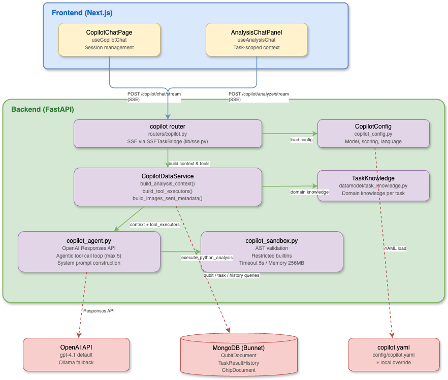

# Copilot Architecture

## Overview

QDash Copilot is an AI-powered assistant that helps experimentalists interpret qubit calibration results. It provides two interaction modes:

1. **Chat about a task result** (sidebar or floating window) -- Opened from a task result with that result's context and figures, for questions about one calibration result (e.g., CheckT1, CheckRabi).
2. **Chat Page** -- A dedicated chat interface for chip-wide questions, cross-qubit comparisons, and exploratory data analysis.

Both are the same chat with the same planner; the first just opens with a task result as its context. The evaluation model's recorded judgements are a separate thing (see "Planner-less evaluation runs"). Forum AI replies are one planner turn each on the same runtime.

Both run on the Pi Agent Runtime (`agent-runtime/`) with the pi-qdash tools, a sandboxed Python tool served by the API, and SSE streaming for progress.

## Component Diagram



## Key Files

| File | Responsibility |
|------|---------------|
| `src/qdash/api/routers/copilot.py` | FastAPI router with `/config`, `/chat/stream` (general and task chats), `/sandbox/python`, chat sessions |
| `src/qdash/copilot/runtime.py` | Data loading: `build_task_context()`, `build_images_sent_metadata()`, qubit/task/history queries |
| `src/qdash/api/services/pi_chat_service.py` | Runtime bridge: request payloads, the task chat's opening message and figures, NDJSON to SSE translation, `thread_reply` / `complete_once` for forum reply turns |
| `src/qdash/copilot/` | Shared Copilot runtime used outside the API process |
| `src/qdash/copilot/tooling/sandbox.py` | Sandboxed Python execution: AST validation, restricted builtins, resource limits |
| `src/qdash/copilot/contracts/models.py` | Pydantic models: `TaskContext`, `TaskContextBundle`, `ChatRequest` (with `task`); request schemas |
| `src/qdash/api/lib/sse.py` | SSE utilities: `sse_event()` formatter |
| `src/qdash/copilot/config/settings.py` | Configuration loader: `CopilotConfig`, `ModelConfig`, `TaskChatConfig`; YAML loading with local override |
| `src/qdash/datamodel/task_knowledge.py` | `TaskKnowledge` model with domain-specific knowledge per calibration task |
| `config/copilot/config.yaml` | Enablement, languages, how a task chat opens |
| `config/copilot/chat.yaml` | Planner models for every chat |
| `config/copilot/evaluation.yaml` | Evaluation model (calibration VLM) |
| `agent-runtime/src/evaluate.ts`                           | Planner-less evaluation of one task result: evidence tool, then `qcal_evaluate`, as one record                                     |
| `src/qdash/api/services/evaluation_service.py`             | Bulk evaluation runs: selection per chip, background execution through the runtime, records and verdicts                          |
| `ui/src/hooks/useCopilotChat.ts` | React hook for the chat page: session management, SSE consumption, localStorage persistence |
| `ui/src/contexts/ChatDockContext.tsx` | Where the chat is shown outside the chat page: the docked sidebar (`ChatSidebar`) or the floating window, and opening a chat about a task result |
| `ui/src/components/features/chat/CopilotChatPage.tsx` | Chat page UI: session list, message rendering, blocks/chart display |

## Pi runtime authentication

The API forwards the authenticated user's access token and selected `X-Project-Id` to the Pi runtime on each chat or analysis turn, including approval responses. When no project header is supplied, it uses the user's default project. The internal `AGENT_RUNTIME_TOKEN` still authenticates API-to-runtime requests; user credentials travel in separate internal headers and are never added to model input or durable conversation state.

Each open conversation gets its own tool registry and a private temporary pi-qdash profile. Read tools, approved writes, and the Python sandbox use that user's credentials. The runtime overrides connection arguments supplied by a model or an older stored tool call and never falls back to `QDASH_API_TOKEN` or an administrator login. QDash API endpoints enforce the user's permissions.

The pinned pi-qdash version accepts a configuration file rather than an injected client. The runtime creates the profile in a private directory with a mode-0600 file and removes it when the conversation closes, including failures. Docker Compose mounts `/tmp` as tmpfs so these credentials do not enter the container's persistent filesystem. Deployments outside Compose should provide an equivalent memory-backed temporary directory.

## Configuration

### `config/copilot/`

Three small files, each with an optional `*.local.yaml` overlay, deep-merged by `ConfigLoader`:

```yaml
# config.yaml
enabled: true
thinking_language: en      # Internal reasoning language
response_language: auto    # Follow the latest user message; use ja/en to pin it
task_chat:                 # How a chat about a task result opens
  multimodal: true
  max_expected_images: 2

# chat.yaml: the planner models every chat can use; the first is the default
chat_models:
  - provider: openai-compatible
    name: qwen3.8-flash-next
    api_style: completion
    base_url: env:OPENAI_COMPATIBLE_BASE_URL
    api_key_env: OPENAI_COMPATIBLE_API_KEY

# evaluation.yaml: the model pi-qcaleval judges calibration plots with
evaluation_models:
  - provider: vllm
    name: nvidia/Ising-Calibration-1.5-31B-NVFP4
    base_url: env:VLLM_BASE_URL
    api_key_env: VLLM_API_KEY
```

YAML string values support shell-style environment variable references such
as `${OPENAI_API_KEY}`, so environment-specific or sensitive values should be supplied
through environment variables instead of committed template files. The Pi runtime
builds its `models.json` from `chat_models` and `evaluation_models` at startup.

### Environment Variables

| Variable | Purpose |
|----------|---------|
| `OPENAI_API_KEY` | OpenAI API authentication |
| `OLLAMA_BASE_URL` | Ollama / OpenAI-compatible server URL (default: `http://localhost:11434`) |
| `OLLAMA_API_KEY` | Optional API key for the Ollama / OpenAI-compatible server |
| `DS4_BASE_URL` | DeepSeek v4 OpenAI-compatible gateway base URL |
| `DS4_API_KEY` | DeepSeek v4 API key |
| `NEXT_PUBLIC_API_URL` | API base URL for frontend (default: `/api`) |

### Developing a pi extension against the runtime

The Agent Runtime image installs `@oqtopus-team/pi-qdash` at a pinned version
(`agent-runtime/Dockerfile`), so a published release is the only way an
extension normally reaches it. While developing another extension (for example
`pi-qcaleval`), clone it under `agent-runtime/extensions/` (gitignored) and start
the runtime with the override:

```bash
git clone https://github.com/orangekame3/pi-qcaleval.git agent-runtime/extensions/pi-qcaleval
docker compose up -d agent-runtime
```

`compose.yaml` always mounts `agent-runtime/extensions/` at `/app/extensions`
(read-only); the directory is tracked through a `.gitkeep`, so the mount exists in
every clone and is empty in production. At startup the runtime takes every
subdirectory whose `package.json` carries a `pi` manifest as a checkout and
passes it to pi's resource loader as an additional extension path. No override
file or environment variable is involved, so `task deploy` and a plain
`docker compose up -d` behave the same. A checkout of a package the image also
installs (pi-qcaleval once pinned, or pi-qdash) replaces the installed copy; pi
rejects the installed one as a tool-name conflict, which the runtime logs as
"local checkout ... replaces installed ...". A pi-qdash checkout keeps the
per-name allowlist (`ALLOWLISTED_PACKAGES`), so developing it in place never
exposes a tool that production would filter; run `bun install` inside the
checkout first, since pi-qdash has dependencies of its own. The checkout must use the pi package layout
(`package.json` with a `pi.extensions` manifest, like pi-qdash) and may depend only
on the packages the runtime already ships (`@earendil-works/pi-coding-agent`,
`typebox`), because its imports resolve from the runtime's `node_modules`.

A checkout is trusted by its path, not by tool name: every tool it defines is
offered to the model without the pi-qdash allowlist review
(`agent-runtime/src/allowed-tools.ts`), with three limits. The same trust applies
in production to the packages listed in `TRUSTED_EXTENSION_PACKAGES` (for example
`@orangekame3/pi-qcaleval`), which the image installs at a pinned version next to
pi-qdash in `agent-runtime/Dockerfile`; a package is added to that list only after
review, and the version pin is the release gate.

- An experimental write name (`EXPERIMENTAL_WRITE_TOOL_NAMES`) still needs
  `AGENT_RUNTIME_ENABLE_WRITE_TOOLS=true`, and then goes through the same
  approval card as the pinned tool.
- A checkout tool is rerun after an interrupted turn only when its pi
  `annotations.readOnlyHint` is `true`; other local tools are reported to the
  model as interrupted instead, so a side-effecting tool never runs twice.
- A checkout tool that reuses a pinned tool's name replaces the pinned
  implementation; the runtime logs the replacement at startup.

Checkout tools receive the same extension context as pi-qdash tools, including
`modelRegistry` for calling a model other than the conversation's. Their pi
`promptSnippet` and `promptGuidelines` are inlined into the system prompt under
"Additional tools", since the pi-qdash tool guide does not know them. A checkout
tool that declares an `images` parameter (for example `qcal_evaluate`) gets it
filled by the runtime: the newest figure in the conversation, whether a user
attachment or a figure a pi-qdash tool returned, is taken from the durable
transcript, so the model never has to copy image bytes into a call. Bytes the
model copies anyway are replaced by that figure, since a retyped base64 string
is usually corrupt; they are kept only when the conversation holds no figure.

A checkout tool that declares `task_name` and `knowledge` parameters (again
`qcal_evaluate`) gets `knowledge` filled the same way: when the model names the
task and passes no reference of its own, the runtime fetches the task's review
guide from the QDash API as the user (`GET /tasks/{task_name}/knowledge`,
`review_prompt_text`, or the full `prompt_text` for a task without a review
guide, cut at 6000 characters) and passes it. Every evaluation of a task is thus
read against the same host-maintained reference, kept in the task knowledge
repository, rather than against a summary the planner improvised. The exact
text the evaluation model received is stored in the tool result's
`details.prompt`.

The runtime's `/chat` body carries two image lists: `initial_images` (the
task chat's opening figures, attached only when the conversation is new)
and `images` (attachments of the current turn, attached every time). Restart the
runtime after editing the extension; the startup log lists the local paths and
the tools they contributed. Anything placed under `agent-runtime/extensions/` on
the host is trusted the same way, so keep that directory empty on production hosts.

## Planner-less evaluation runs

The chat is one entry point to the evaluation core; a bulk request from the
chip page is another, and it does not need a planner. The runtime's
`POST /evaluate` route (`agent-runtime/src/evaluate.ts`) runs, for one task
result, exactly the two tools the planner would call: `qdash_build_qcal_evidence`
(evidence text plus the task figure) and then `qcal_evaluate`, with the same
auto-fill as in chat (figure bytes from the evidence, QDash's reference for
the task name the evidence reports). It answers with a record of what the
evaluation model saw and said: the evidence context, the figure hashes, the
reference's size and hash, the exact prompt, the parsed diagnosis or the raw
answer, the model, the duration, and the extension that judged (package name,
version, and the checkout commit when a mounted checkout is in use). The route
is synchronous and needs the same headers as `/chat`; concurrency is the
caller's to limit.

pi-qcaleval asks the evaluation model for the diagnosis as a JSON object with
six keys. On a chat-completions API (vLLM) it constrains decoding to that
schema through `response_format`, since the calibration model, asked for JSON
in the prompt alone, now and then closes the object after the first key; a
server that refuses the format is asked plainly. An answer that still lacks
keys is asked for once more, and the more complete one kept. The record says
how the answer was obtained (`attempts`, `structured`, `stop_reason`, and
`calls`: each model call's duration, stop reason and output tokens) and,
when it is not the whole diagnosis, keeps the text (`raw`) and the keys it
lacks; the API derives `complete` and `missing_keys` from the diagnosis on
every read, so older records are judged the same way. A run's summary adds
its wall time (`elapsed_ms`) and the completed evaluations' model time added
up (`duration_ms_total`), so two runs can be compared on cost as well as on
outcome.

The route has two modes. `direct` (the default) runs the two tools as such.
`planner` opens a throwaway conversation on the given chat model, tells it
to summarise the result and judge its figure, and reads the record off the
`qcal_evaluate` result it produced; the durable tool wrapper stamps every
evaluation result with a `host` record (figure hashes, the reference's size
and hash, the context, the call's duration), so a planner turn leaves the
same record as a direct evaluation, plus the planner's answer and the tools
it called. The two modes differ in what reaches the evaluation model (the
planner writes its own context and may pass its own reference), which is
exactly what the stored records make comparable.

The API turns that into runs (`src/qdash/api/services/evaluation_service.py`,
router `src/qdash/api/routers/evaluation.py`): `POST /evaluations/runs`
selects the latest evaluable result of one task per qubit or coupling of a
chip (or that of one day, or a given list of task results), stores one
pending `evaluation` record per task result under an `evaluation_run` (with
its `trigger`, `bulk` from the chip page or `single` for one task result, and
its `mode`, `direct` or `planner` with the chat's planner model), and
executes them in the background of the API worker as the requesting user, a
few at a time (`EVALUATION_CONCURRENCY`, default 2). Entities without an
evaluable result (no result, no figure, still running) are reported as
skipped. `GET /evaluations/runs` and `GET /evaluations/runs/{run_id}` show
progress and the records; `GET /evaluations?task_id=` lists every evaluation
of one task result across runs; `PUT /evaluations/{id}/verdict` stores a
person's agreement or disagreement, the ground truth for comparing runs.

The chat is the third entry. When the planner calls `qcal_evaluate` during a
chat, the durable tool wrapper's `host` record (which also names the task
result the figures were fetched for) rides on the runtime's `tool_end` event,
and the API files it as a run of one with `trigger: "chat"` and the planner's
final answer; the trace shows "recorded as an evaluation" with a link. A
judgement of a figure that no tool fetched (a user attachment) is not recorded.
So every judgement the evaluation model makes, from the chip page, a single
result or a chat, is on one ledger.

A run is a snapshot: the same selection evaluated again after a change to
the extension, the model, or the task's reference yields a second run with
the same shape, so parse rate, success rate, agreement rate and duration
can be compared run against run. The UI does that on `/evaluations/compare?a=&b=`
(`ui/src/components/features/evaluations/EvaluationComparePageContent.tsx`, pure
joining in `evaluationCompare.ts`): the two runs' settings side by side with the
differing ones flagged, totals, and one row per entity (joined by qid, noting
whether both judged the same task result) with each side's fit quality, success
and verdict; a row expands to both records. No API is added: the page reads the
two run details and joins them in the browser. A run interrupted by an API
restart keeps its unfinished records as pending; request it again rather than
resuming it.

## Two Modes

### Chat about a task result

Opened from a task result (metrics modal, task history, execution detail) with "Ask AI".

- **Endpoint**: `POST /copilot/chat/stream` with `task: {task_name, chip_id, qid, execution_id, task_id}`
- **Context**: Full `TaskContext` including task knowledge, qubit parameters, experiment results, historical data, neighbor qubit data, and coupling parameters, rendered into the opening message together with the result's figures
- **Use case**: "Is this T1 result normal?", "Why does the fit R² look low?"

### Chat Page

A standalone page (`/copilot`) for general questions about the calibration system.

- **Endpoint**: `POST /copilot/chat/stream`
- **Hook**: `useCopilotChat`
- **Context**: Chip ID, optional qubit ID, scoring thresholds
- **Use case**: "Compare T1 across all qubits", "Show me the frequency trend for Q16"
- **Sessions**: Persisted to localStorage with multi-session support
