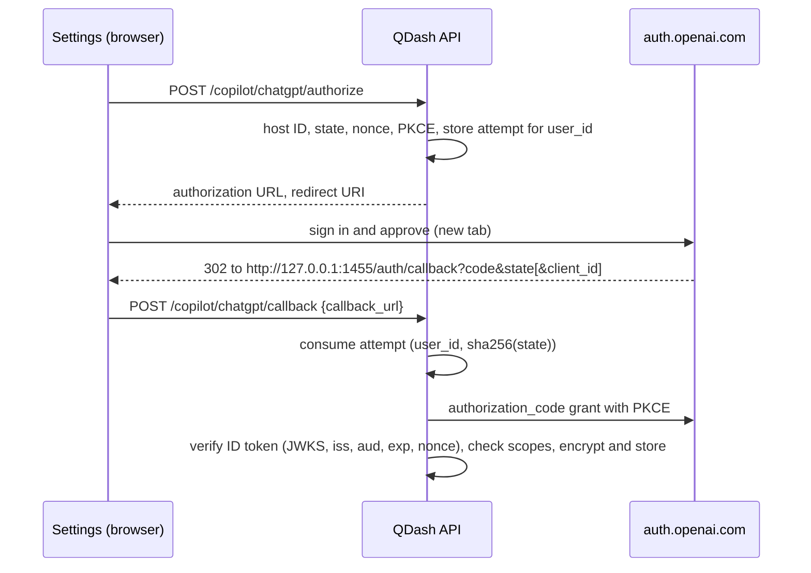
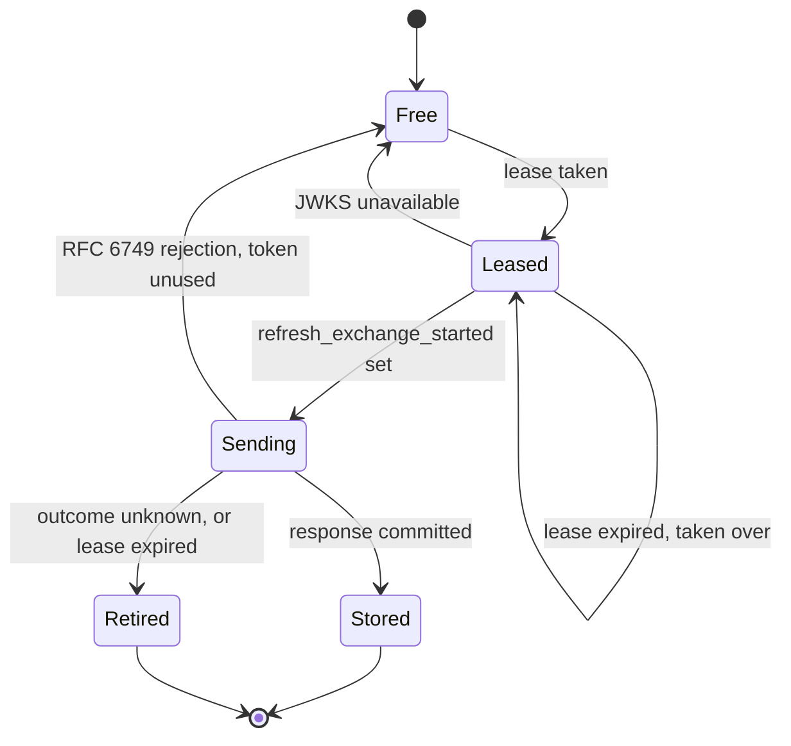

# ChatGPT Plan Connections

A ChatGPT plan connection lets one QDash user answer their own Copilot chats with a ChatGPT model
billed to their own ChatGPT plan, through OpenAI's
[Sign in with ChatGPT plan usage](https://developers.openai.com/siwc/token-sharing-open-source)
flow. The API owns the connection: registration, tokens, refresh, and sign-out. The Pi runtime
only receives the access token for one chat turn. Deployment models in `chat.yaml` and
`evaluation.yaml`, evaluations, forum replies, and the tools a chat calls are unchanged; the user
steps are in [Use Your ChatGPT Plan](../../user-guide/ai-chat.md#use-your-chatgpt-plan).

## Sign-in

`src/qdash/api/lib/chatgpt_oauth.py` builds every request exactly as OpenAI documents it:
`client_id=dynamic_agent_client` with `agent_name_hint=QDash` for a first registration, the issued
`oaiapp_...` client ID afterwards, the scopes `openid profile email offline_access resource.invoke
chatgpt.tokens.use.direct`, `resource=https://api.openai.com/v1`, S256 PKCE, and a fresh `state` and
`nonce` per attempt. QDash sends `login_hint` on reauthorization but never `id_token_hint`, because
the authorization URL passes through the browser and ID tokens stay on the server.

OpenAI accepts only an `http://127.0.0.1:<port>/auth/callback` redirect, which reaches the user's
computer rather than a QDash server. The user therefore copies the address their browser landed on
into Settings. This keeps the documented protections: only the API holds the PKCE verifier and
nonce, the attempt is bound to the authenticated `user_id` and found by the SHA-256 of its state,
`find_one_and_delete` consumes it once, it expires after 10 minutes, and starting a new attempt
deletes the previous one. A pasted address with another host, port, path, or scheme is rejected
before anything is sent to OpenAI. The port comes from `QDASH_CHATGPT_CALLBACK_PORT`.

`ChatGPTConnectionService.complete_authorization` then enforces the registration rules:

| Case | Rule |
| --- | --- |
| New registration | The callback must carry an issued client ID other than `dynamic_agent_client` |
| Reauthorization | A callback client ID must equal the saved one, and the ID token `sub` must equal the saved subject |
| `error=access_denied` | Stop without exchanging a code |
| Granted scopes without `chatgpt.tokens.use.direct` | Keep the sign-in with status `plan_disabled`; no inference; **Enable ChatGPT plan usage** repeats OAuth with `prompt=consent` |
| Different account while tokens exist | Refused with 409; the user disconnects first, so one registration's tokens never replace another's |

Only the newest attempt may store tokens. `start_authorization` increments the connection's
`auth_generation` atomically and records the new value on the attempt; `disconnect` increments it
too and deletes the user's attempts. A callback whose attempt is from an older generation fails
with 409 `superseded`: before the code exchange when the generation is already stale, and
otherwise at the write, because the tokens are stored with one `update_one` filtered on the
attempt's generation. A callback that loses that race therefore cannot restore tokens after a
sign-out or overwrite a newer sign-in, and the session it obtained is revoked. A session obtained
by a callback that then fails ID-token validation or the subject check is revoked as well; in
every failure the stored connection stays as it was. Two callbacks with the same address exchange
the code once, because `find_one_and_delete` consumes the attempt.

## Storage and Identity

`src/qdash/dbmodel/chatgpt_connection.py` keeps one `ChatGPTConnectionDocument` per QDash
`user_id`, the immutable internal ID from the authenticated session. Routes in
`src/qdash/api/routers/chatgpt.py` take no user ID; the browser cannot name another user.

| Field | Content |
| --- | --- |
| `host_id` | `urn:uuid:` UUIDv4 created before the first sign-in and kept for the user's lifetime, sent as `ext_agent_host_id`; each user is a separate agent host of the QDash server and the value carries no user data |
| `client_id`, `subject`, `issuer`, `email` | The registration and validated identity; kept after sign-out for the next sign-in |
| `encrypted_tokens` | Access, refresh, and ID tokens as one Fernet ciphertext; no plaintext token field exists |
| `auth_generation` | Orders sign-in attempts and sign-out, described above |
| `token_version`, `refresh_lock_until`, `refresh_owner`, `refresh_exchange_started` | Refresh race guards described below |
| `models` | The account's `GET /v1/models` entries with `visibility: "list"`, written only while `token_version` still matches the access token that listed them |

`src/qdash/api/lib/credential_cipher.py` reads the Fernet keys from `QDASH_CREDENTIAL_KEY` or
`QDASH_CREDENTIAL_KEY_FILE` (Compose generates the file into a volume mounted only by the API). A
`MultiFernet` decrypts with any listed key and encrypts with the first, so keys rotate by
prepending. Without a key, the status reports `available: false`, a sign-in answers 503, and
nothing is stored; an undecryptable record is
cleared and marked `reauth_required`. No response, log line, or browser storage carries a token;
the schemas in `src/qdash/api/schemas/chatgpt_connection.py` have no token field.

## Refresh and Sign-out

`access_token(user_id)` returns the stored access token while more than 10 minutes remain, so a
long chat turn does not outlive it, and otherwise refreshes it with the issued client ID and
`resource`, without `scope`. OpenAI rotates the refresh token on every refresh, so QDash sends each
refresh token to the token endpoint at most once across all API workers. The only exceptions
are a request that never left the API and an RFC 6749 error response, listed in the table below.

A worker takes a 60-second lease with one atomic `find_one_and_update` on `token_version`,
`refresh_lock_until` and `refresh_exchange_started`, and writes a random `refresh_owner`. Every
later write by the holder is filtered on `token_version` and `refresh_owner`, so a worker that
lost its lease can neither store tokens nor release a newer owner's lease. The other workers wait
up to 25 seconds for `token_version` to change and read the new token, or fail with 503.

Before it sends the refresh token, the holder sets `refresh_exchange_started` in a write fenced
on its ownership. An expired lease can be taken over only while that flag is clear, so a worker
that stalled before sending never sends after a takeover. Once the flag is set, no worker takes
the lease over. When a waiter finds the lease expired with the flag set, the holder crashed or
its request outlived the lease, and nothing proves the request ended: the waiter retires the
session with `last_error_code` `refresh_outcome_unknown`, status `reauth_required`, and an
incremented `token_version`, then revokes the old refresh token. That cleanup is filtered on the
observed `token_version`, `refresh_owner`, the flag and the expired lease, so it never touches a
newer sign-in or a live holder. A response that arrives later fails the holder's fenced commit;
its new refresh token is revoked and not stored, so it cannot restore the retired session or
replace a newer sign-in.

The refresh runs synchronously in the request. HTTP timeouts apply per operation, so the request
has no total deadline; correctness depends on the flag, not on how long the request takes.

Before the refresh, the API loads OpenAI's JWKS; when that fails, the refresh token is still
unused, so the lease is released and the turn fails with 503. A refresh response may omit the ID
token; the original one is kept. When it includes one, `verify_refreshed_id_token` applies
[OpenID Connect Core section 12.2](https://openid.net/specs/openid-connect-core-1_0.html#RefreshTokenResponse):
the signature must verify against the JWKS, the issuer, audience (the issued client ID) and
`sub` must equal the original sign-in's, and a `nonce` may appear only with the original value.
When the original ID token carried a `chatgpt_account_id` in the `https://api.openai.com/auth`
claim, the new one must carry the same. A refresh never changes `subject`, `issuer`, or `email`.

| Refresh result | Effect |
| --- | --- |
| Success | New ciphertext written only while `token_version`, `refresh_owner` and `refresh_exchange_started` are unchanged, then `token_version` incremented and the lease released |
| Session retired, signed out or replaced meanwhile | The new refresh token is revoked and not stored |
| `invalid_grant`, `invalid_refresh_token`, `token_expired`, `refresh_token_expired`, `refresh_token_invalidated`, `refresh_token_reused`, `invalid_client` | Tokens cleared, status `reauth_required`, registration kept |
| Refreshed ID token invalid or for another account | Tokens cleared, the new refresh token revoked, status `reauth_required`, registration kept |
| JWKS unavailable, or connection to OpenAI not established (`RequestNotSentError`) | Token never sent; lease released, credentials kept, turn fails with 503 |
| HTTP 400 or 401 whose JSON body has a string `error` of `invalid_request`, `unauthorized_client`, `unsupported_grant_type`, or `invalid_scope` | An [RFC 6749 section 5.2](https://www.rfc-editor.org/rfc/rfc6749#section-5.2) error response; section 6 issues tokens only for a valid request, so the token is unspent. Lease released, credentials kept, turn fails; the next request that needs a token sends the same refresh token again |
| Any 5xx, read timeout or other error after connecting, any other 4xx (for example 429 or a proxy's 403), or an unreadable HTTP 200 body | Outcome unknown: tokens cleared, old refresh token revoked, status `reauth_required` with `refresh_outcome_unknown`, registration kept |

A 5xx is never treated as proof that the token was not rotated. A proxy or gateway between the
API and OpenAI can return any 5xx after OpenAI processed the refresh, and OpenAI does not document
that its own 5xx responses leave the refresh token unspent. Retiring costs the user one sign-in;
resending a rotated token could end the session or reuse a spent token.

`disconnect` clears the tokens and the refresh lease and increments `token_version` and
`auth_generation` in one update, deletes the user's pending attempts, then revokes the old
refresh token at the discovery document's `revocation_endpoint`, with up to three attempts on
network errors and 5xx. It reports whether OpenAI confirmed the revocation. A turn already running keeps the
access token it was given until it ends; the token is never reused after that.

## Chat Turns

The chat model provider `chatgpt` marks a plan model. `chat_stream` in
`src/qdash/api/routers/copilot.py` resolves it for the authenticated user only:

1. The model must be in the user's cached account catalog (listed once more if not) and in the
   runtime's plan models.
2. `turn_token` returns a fresh token with the `token_version` of the token set it came from, or
   raises; the turn then ends with an SSE `error` whose
   `code` is `not_connected`, `plan_disabled`, `reauth_required`, or `temporarily_unavailable`.
   Nothing falls back to another model, the operator's `OPENAI_API_KEY`, or another user.
3. `QDashAuth.chatgpt_access_token` sends the token in `X-QDash-ChatGPT-Token` next to
   `X-QDash-Token`.

`agent-runtime/src/plan-models.ts` serves the provider. The shared `ModelRuntime` does not know
`chatgpt`, so a durable reference to a plan model, a tool reusing the conversation model (the
`qcal_evaluate` fallback), an evaluation, or a forum reply cannot run on any credential. For one
turn, `SharedRuntime.openSession` wraps the shared runtime with `withPlanToken`: requests for
`chatgpt/<id>` go to a separate catalog that holds only pi's `openai` provider, has no environment
or stored credentials, and receives the token as the request `apiKey`. The token lives in that
closure; it is not written to the SQLite store, a credential file, or the environment.

Pi 1.5.2 treats a non-`sk-` bearer for `https://api.openai.com/v1` as Sign in with ChatGPT and
follows OpenAI's [preview limitations](https://developers.openai.com/siwc/token-sharing-open-source/preview-limitations):
`store: false`, `stream: true`, the whole context in `input`, developer instead of system
messages, and no `max_output_tokens`, `temperature`, `prompt_cache_retention`, or
`previous_response_id`. `planModel` offers only catalog models whose tools pi declares in
`additional_tools` items (`supportsAdditionalTools` and `supportsMidConvoSystemMessages`) and drops
sampling parameters. The runtime lists them at `POST /plan-models`; the API intersects them with
the account's catalog.

A Responses error with an OpenAI plan code, such as `subscription_sharing_usage_limit_exceeded`,
reaches the API as the runtime's error text. `pi_chat_service.translate` replaces it with guidance,
a `code`, and the ChatGPT usage URL, and `record_inference_error` keeps it for Settings
until a later plan turn completes and `clear_inference_error` removes it. Both writes are filtered
on the user ID and the `token_version` captured with the turn's access token, never on a version
read after the turn. A turn that ends after a sign-out, a new sign-in, or a refresh by another
request therefore neither records an error on nor clears the error of the newer token set. QDash
does not retry, infer a reset time, or switch models.

## Test

| Suite | Covers |
| --- | --- |
| `tests/qdash/api/services/test_chatgpt_connection_service.py` | Authorization parameters, PKCE exchange, ID-token checks, state binding and replay, attempts superseded by a newer start or a sign-out, plan scope, reauthorization, refreshed ID tokens, refresh lease ownership, one send per refresh token (response slower than the lease, crash after sending, unknown outcomes including every 5xx, concurrent requests, late results and server errors after a new sign-in), RFC 6749 rejections, model catalog and turn errors fenced on `token_version`, terminal errors, sign-out races, encryption |
| `tests/qdash/api/routers/test_chatgpt_connection.py` | Route authentication, responses without tokens, cross-user callbacks, chat turns without fallback, error mapping, turns that end after the user connected again |
| `agent-runtime/test/plan-models.test.mjs` | The Responses request pi sends with a plan token, per-user tokens in concurrent turns, no ambient credential |
| `ui/src/components/features/settings/__tests__/ChatGPTConnectionSettings.test.tsx` | Settings states, the pasted-address step, disconnect, the one-time confirmation |

Run `uv run pytest tests/qdash/api -k chatgpt`, `bun test test/plan-models.test.mjs` in
`agent-runtime/`, and `bunx vitest run src/components/features/settings` in `ui/`.
