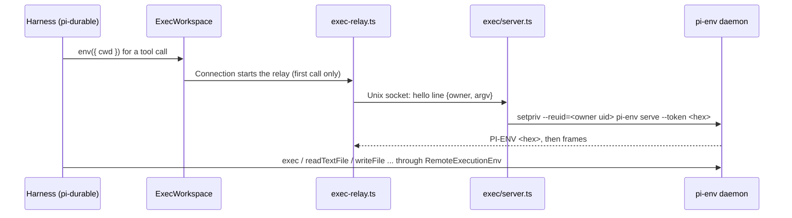

# Copilot Workspace

The workspace is the shell and file system behind the chat's `bash`, `read`, `write`, and
`edit` tools: a directory per conversation in the `agent-exec` container, which holds no
QDash credentials and reaches no QDash service. The Agent Runtime never runs model-written
code itself. The same container and server process also run the API's metric script jobs
([Metric runner](#metric-runner)).

## Responsibility boundary

| Part | Owns | Leaves to others |
| --- | --- | --- |
| `agent-exec` container (`agent-runtime/exec/`) | Running commands and file operations, one pi-env daemon per conversation as the owner's own uid; metric script jobs, one job uid per slot | Authentication, QDash data, model access |
| Agent Runtime (`agent-runtime/src/exec-env.ts`) | One connection per open conversation, the conversation's directory, the four tools | Executing anything locally |

The model gets data into the workspace by writing it into a file. The container uses
`network_mode: none`; the runtime connects through a shared Unix socket.

## Request flow

1. `SharedRuntime.openSession` creates an `ExecWorkspace` for the owner and the chat's store
   session (the chat's own session ID, or for a branch the store it shares; see
   [Branches](./chat-streaming.md#branches)) and
   passes `env: (target) => workspace.env(target.cwd)` to `Harness.open`, with the agent's
   `cwd` set to the conversation's directory.
2. The first tool call creates that directory (`createDir`, recursive) and starts the
   connection. pi-env's `Connection` spawns `bun src/exec-relay.ts --socket ... --owner <id>`
   and appends `serve --token <hex>`; the relay sends the hello line and then pipes the
   daemon's stdin and stdout over the Unix socket, interpreting nothing.
3. `exec/server.ts` checks the hello's shape (`parseHello`), creates
   `/workspace/<owner>/` as the owner's uid with mode 0700, and starts the daemon there.
   Without root (tests, `AGENT_EXEC_ISOLATE_USERS=false`) it runs the daemon as itself.
4. pi-durable's tools call `RemoteExecutionEnv`, so results match `NodeExecutionEnv` on the
   container.
5. Closing the conversation closes the connection; the daemon then kills every process it
   started. The first tool call also writes a marker file beside the session's SQLite store
   (`<store>.workspace`); deleting the last QDash chat session that uses the store removes the
   directory only when that marker exists (`deleteSessionState` → `removeWorkspace`), so a chat
   or evaluation that never ran code starts no daemon and creates no owner directory. A chat and
   its branches share one directory: a branch sees the files as they are now, not as they were at
   the answer it was branched from.

## Isolation

| Boundary | Enforcement |
| --- | --- |
| Credentials | No `env_file`; the daemon's environment is `PATH`, `HOME`, `TMPDIR`, locale, and Python settings (`daemonEnv` in `exec/server.ts`) |
| Network | `network_mode: none`; no TCP listener |
| Users | A distinct uid in 20000–59999 per owner, persisted as directory ownership; 0700 owner directories under a 0711 `/workspace` root (traverse, no listing) |
| Container | `read_only` root with `/tmp` as tmpfs, `cap_drop: ALL` plus the capabilities `setpriv` and `chown` need, `no-new-privileges`, a pid limit (512), a memory limit (`AGENT_EXEC_MEMORY_LIMIT`, default 2g), a CPU limit (`AGENT_EXEC_CPU_LIMIT`, default 2) |
| Runtime access | A root-owned Unix socket (0660) in a root-owned directory (0750), both assigned to the runtime's group (gid 1000 in Compose); workspace users have no access |
| API access | `metric.sock` (0660 `root:0`) in the same directory, for the API's metric jobs only; the runtime's group and workspace users have no access |

The `agent-exec-socket` volume exposes the sockets to the runtime and the API as read-only
mounts.
No shared authentication token is required. `workspaceUid` reuses an owner's directory uid
or chooses an unused uid when the name's hash collides. Entries under the root that are not
owner directories (a stray file, a directory owned outside the uid range) are ignored. An
owner whose directory shares its uid with another directory is refused rather than given a
shared identity; an operator must correct that ownership before that owner's workspace works.

Two conversations of the same owner can read each other's files through `bash`; a different
owner's directory is unreadable. A command runs as long as the model's `timeout` allows, and
the conversation's stop button aborts it with the turn.

## Metric runner

`exec/server.ts` also starts the metric runner (`exec/metric-runner.ts`) on a second socket,
`/run/agent-exec/metric.sock`, in the same root-owned directory as `exec.sock`. The API
validates and evaluates [metric scripts](../architecture/metric-scripts.md) through it; the
protocol, failure codes and threat model are on that page.

- **Access.** The socket is 0660 `root:AGENT_EXEC_METRIC_SOCKET_GID` (gid 0 by default). The
  `api` service mounts `agent-exec-socket` read-only and runs as root, so it connects; the
  runtime's `bun` user (gid 1000) and workspace uids cannot.
- **Job uids.** Each job runs as `60000 + slot`, one uid per slot of
  `AGENT_EXEC_METRIC_CONCURRENCY` (default 2), outside the owner range 20000–59999, so a job can
  never share a uid with a chat.
- **Job directories.** `/tmp/metric-jobs` (tmpfs) is 0711 root; each job gets a fresh 0700
  directory owned by its uid, removed with the job's processes and its files in `/tmp` and
  `/dev/shm` before the slot is reused.
- **`/workspace` is 0711.** Daemons reach their own owner directory by path; a job uid cannot
  list the root and so cannot learn owner directory names.
- **Shared limits.** The container's CPU, memory and pid limits cover chat daemons and metric
  jobs together; there is no per-job cgroup, so a heavy job slows chat commands and the reverse.
- **Worker source.** The image copies only `__init__.py`, `sdk.py`, `policy.py` and `worker.py`
  of `src/qdash/api/metric_runtime/` to `/app/metric-runtime/qdash/api/metric_runtime/`
  (`AGENT_EXEC_METRIC_PYTHONPATH`). Compose bind-mounts the source directory over that copy
  read-only, the same live-source pattern the `api` service uses, so worker edits apply to the
  next job without a rebuild.
- **Packages.** `requirements.txt` includes `pint`, which the metric SDK needs; chats can import
  it too.

The `api` service depends on `agent-exec` (`service_started`). One process serves both sockets:
when it stops, workspace tools fail and metric script validation and evaluation answer 503. A
blank `AGENT_EXEC_METRIC_SOCKET` disables the runner.

## What the model sees

With `AGENT_EXEC_SOCKET` set, the system prompt describes the workspace (Python 3 with numpy,
scipy, pandas, plotly and matplotlib; no network; no QDash access) and the tool list in
**Settings → Copilot** shows `bash`, `edit`, `read`, and `write`. Without it, the prompt says
there is no filesystem or shell, and the tools are not offered. A Plotly figure still reaches
the chat only through `render_chart`.

## In the chat

Workspace tool rows start collapsed, with a tool icon and a short activity label such as
**Running bun** or **Writing fit.py**. Opening a row shows the command for `bash`, the file and
its code for `write`, the old and new text of each `edit`, or the file for `read`. The expanded
row also shows the tool's answer (`output` on `tool_end`, the tail when long, with the exit code
of a failed command). The user's open or closed choice persists as the call starts and finishes.
While the model writes a call, an expanded row shows the code as it is typed (`tool_draft` and
`tool_args_delta` in [Chat Streaming](./chat-streaming.md)). A save of a flow
(`qdash_save_flow`) or a metric script (`qdash_save_metric_script`) shows the whole source as
code on its approval card. Components:
`ui/src/components/features/chat/ToolStepDetails.tsx`, `ChatInteractionCards.tsx`.

## Configuration

| Variable | Service | Meaning |
| --- | --- | --- |
| `AGENT_EXEC_SOCKET` | both | Unix socket path, `/run/agent-exec/exec.sock` in Compose; unset on the runtime to disable workspace tools |
| `AGENT_EXEC_SOCKET_GID` | agent-exec | Group allowed to connect, default `1000` (the runtime's `bun` group) |
| `AGENT_EXEC_WORKSPACE_ROOT` | both | Owner directories, default `/workspace` (the `agent-exec-workspace` volume) |
| `AGENT_EXEC_ISOLATE_USERS` | agent-exec | Per-owner uids; default on when the server runs as root |
| `AGENT_EXEC_MEMORY_LIMIT` | agent-exec | Container memory limit, default `2g`, shared with metric jobs |
| `AGENT_EXEC_CPU_LIMIT` | agent-exec | Container CPU limit, default `2`, shared with metric jobs |
| `AGENT_EXEC_METRIC_SOCKET` | agent-exec | Metric runner socket, `/run/agent-exec/metric.sock`; blank disables the runner |

The metric runner's other variables (`AGENT_EXEC_METRIC_*`) are listed in
[Metric Scripts settings](../architecture/metric-scripts.md#settings).

The Python packages are pinned in `agent-runtime/exec/requirements.txt`; the daemon binary
comes from the `@earendil-works/pi-env` package the runtime depends on, so its version follows
`agent-runtime/package.json`.

## Change and test

Tests live in `agent-runtime/test/exec-protocol.test.mjs` (hello validation, names, uids,
configuration) and `exec-server.test.mjs`, which starts the real server and daemon on a
Unix socket and runs commands, file operations, and a second conversation through the
relay, and checks that a malformed hello closes the connection. A root-only test verifies
that colliding owners cannot read each other's files or connect to the socket; it skips
when the test runner cannot change uid. `metric-protocol.test.mjs` and
`metric-runner.test.mjs` cover the metric runner; see
[Metric Scripts tests](../architecture/metric-scripts.md#tests). Run `task ci-agent-runtime`. The image uses the
repository root as its build context (`docker compose build agent-exec`).

To add a Python package, extend `requirements.txt` and rebuild `agent-exec`; a package metric
scripts may import also needs the policy change described in
[Extending](../architecture/metric-scripts.md#extending). To offer the
model no workspace, leave `AGENT_EXEC_SOCKET` unset on `agent-runtime`.

## Implementation files

- `agent-runtime/exec/protocol.ts`: hello parsing, `workspaceName`, `ownerUid`
- `agent-runtime/exec/server.ts`: the Unix socket server, uid allocation, and daemon supervisor;
  starts the metric runner
- `agent-runtime/exec/metric-protocol.ts`, `agent-runtime/exec/metric-runner.ts`: the metric
  runner
- `agent-runtime/exec/Dockerfile`, `agent-runtime/exec/requirements.txt`: the image, including
  the metric worker copy
- `agent-runtime/src/exec-relay.ts`: the stdin/stdout to Unix socket relay
- `agent-runtime/src/exec-env.ts`: `ExecWorkspace`, `removeWorkspace`, `execConfigFromEnv`
- `agent-runtime/src/runtime.ts`: `openSession` and `deleteSessionState` wiring
- `compose.yaml`: the `agent-exec` service, `agent-exec-socket`, and `agent-exec-workspace`
  volumes; the `api` service's read-only socket mount
