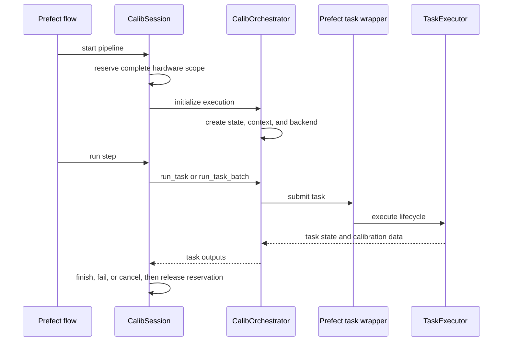

# Workflow Engine Architecture

The workflow engine turns a calibration task name and target into a tracked hardware operation.
It owns task execution and persistence; Prefect-facing session composition belongs to the service
layer described in [Workflow Services](./services.md).

## Responsibility Boundaries

| Component | Responsibility | Does not own |
| --- | --- | --- |
| `CalibService` | The author contract: checked context, run metadata, and `run(targets, steps)` | Lifecycle, reservations, or workers |
| `CalibSession` | Pipeline and Execution lifecycle, hardware reservation, worker settings, and terminal cleanup | Task internals or project authorization |
| `CalibOrchestrator` | One execution's backend, task context, and execution record | Cross-step scheduling or resource reservation |
| `ExecutionService` | Execution state transitions and repository persistence | Task-result state |
| `TaskContext` | In-memory task state, artifacts, and the configured `TaskExecutor` | Execution-level status |
| `TaskExecutor` | Preprocess, run, postprocess, validation, and result persistence | Prefect flow structure |
| Backend | Hardware-specific operations and calibration-note updates | QDash lifecycle policy |

`CalibService` is the entry point for flow authors; see
[Workflow Author Contract](./services.md#workflow-author-contract). It builds one typed
`SessionSettings` and hands it to an internal `CalibSession`, which owns everything below. Direct
use of `CalibOrchestrator` is useful in engine tests and low-level integrations, but callers then
own initialization and terminal handling themselves.

## Execution Identity

Execution IDs use a daily sequence shared by every chip and user in a project.
For example, allocations for two chips can produce `20261027-000` and
`20261027-001`. Different projects and dates have independent sequences. This matches
the `(project_id, execution_id)` identity used by execution history and task queries.

`ProjectExecutionCounterDocument` in `src/qdash/dbmodel/project_execution_counter.py`
allocates numbers atomically in `project_execution_counter`. On the first allocation
for a project and date, it starts above the largest retained legacy counter or numeric
execution ID in execution and task history. The legacy `execution_counter` collection
remains available for chip date lookups; new counters track participating chips.

Deploy all API services and workflow workers that allocate IDs together, with ID
creation paused during the switch. Older processes still allocate chip-local IDs and
cannot safely run alongside the shared allocator. The switch preserves existing
records; it does not repair IDs that previously collided or reconstruct overwritten
execution history.

## Execution Path



The Prefect wrappers in `engine/task_runner.py` are intentionally thin. They invoke the executor
and save `TaskContext`; task semantics remain testable without a running Prefect server.

## State and Persistence

QDash keeps execution state and task state separate.

- `ExecutionStateManager` holds the execution status, note, timing, and in-memory calibration
  data. `ExecutionService` persists state changes through `ExecutionRepository` and uses
  optimistic locking for concurrent note updates.
- `TaskStateManager` is the source of truth for per-target task status, parameters, messages,
  figures, and raw-data paths. Task results keep the raw output names; its in-memory `calib_data`
  is keyed by the published parameter names declared through `publish_targets`, so it mirrors the
  calibration database and the finish-time params YAML selection sees the same names.
- `TaskHistoryRecorder` writes task-result history and optional provenance records.
- `BackendSaver` decides which validated outputs update the backend and accepted calibration
  state. The orchestrator passes it the call's resolved `update_calibration_parameters`; when
  that is `False`, the task is recorded without promoting its outputs.
- `FilesystemCalibDataSaver` writes artifacts beneath the execution's project- and chip-scoped
  calibration directory.

`ExecutionService.merge_calib_data()` updates only its in-memory model. Task and chip repositories
own durable calibration results; do not assume that saving an execution document persists its
`calib_data` field.

## Task Lifecycle

For a single target, `TaskExecutor.execute()` performs these phases:

1. Resolve database or snapshot inputs and apply user overrides.
2. Validate effective inputs and mark the task as running.
3. Run optional preprocessing, prepare the hardware call, and execute the task.
4. Save raw data before task-specific postprocessing.
5. Validate R² and fidelity and process output parameters.
6. Save figures, history, provenance, and permitted backend updates.
7. Mark the task completed or failed and return `TaskExecutionResult`.

<Diagram name="task-lifecycle" caption="Which component writes what during each TaskExecutor phase, and where it lands. Execution state is saved on a separate path." />

Batch execution follows the same policy through `execute_batch()`, but calls the task's
`batch_run()` once and then distributes results to individual target records. Use a batch task
only when one backend experiment genuinely covers all supplied qubits.

Parameter precedence and snapshot behavior are documented in
[Parameter Resolution](./parameter-resolution.md). The promotion of measured values into accepted
state is documented in [Calibration Data Lifecycle](./calibration-data-lifecycle.md).

## Hardware Reservations

`CalibSession` resolves qubit or MUX inputs into an `ExecutionResourceScope` before hardware work.
A pipeline reserves the union of all step scopes before its first step and retains the same owner
until the pipeline reaches a terminal path. The single-task executor reserves its one target the
same way. Isolated workers borrow the owner's Execution and reservation; they never acquire or
release the reservation.

Repository implementations compare the requested chip, resource keys, and `exclusive` flag
atomically. A task whose requested scope exceeds the pipeline reservation is rejected before the
backend call.

## Isolated Workers

`SessionSettings` in `service/_internal/settings.py` is the one record of how a run measures and
publishes. Every session of a run is built from it: the owner session of each pipeline step, the
single-task executor's session, and every isolated worker. `CalibSession.worker_spec()` is the
only place that derives worker settings, as a frozen, picklable `WorkerSpec` that Prefect and
Dask pass to worker processes; `borrowed_session()` opens the worker and releases only its
backend when the block ends.

| Setting | Worker policy |
| --- | --- |
| Context, backend, run metadata, `default_run_parameters`, per-task defaults | Inherited unchanged |
| Configuration mode | Inherited as resolved by the owner, including the layout a `ConfigureAll` step selected |
| Snapshot source (`source_execution_id`, `source_task_id`, exempt tasks) | Inherited, so a re-execution restores the same snapshot in every worker |
| `force_update_params` | Inherited |
| GitHub pull and push | Disabled; the owner pulls before and pushes after its Execution |
| Execution and reservation | Borrowed through `WorkerLease`; never claimed, created, finished, locked, or unlocked |
| MUX mapping | Inherited as the owner resolved it (`MuxMappingSnapshot`); the worker never rereads the chip topology, so an edit during the run changes neither representatives nor MUX result fan-out. An owner that cannot resolve its mapping creates no worker; it does not retry the lookup later |

MUX result fan-out reads only the mapping pinned on the Execution's `CalibConfig.mux_mapping`. A
chip without a topology is pinned as the legacy `qid // 4` mapping. A fake-backend owner whose
topology fails to resolve pins no mapping: system and global tasks still run, but `TaskExecutor`
rejects every MUX-level task with `MuxMappingError` before the task runs. Both `execute()` and
`execute_batch()` apply this check, so a batch call fails every qid before `batch_run()` and saves
no result. `MuxDistributor` never
reads the chip topology itself, so a topology repaired or edited during the run cannot receive
fanned-out results.

Serial and batch strategies run in the owner's session, which an in-process Prefect task reads
through `session_context.get_session()`.

## Cancellation

Cancellation has two paths because a running worker can observe either a Prefect cancellation
exception or a process termination signal.

- A `CancelledRun` or `CancelledError` raised inside an Execution that a session owns cancels it
  through `CalibSession.owned_execution()`, which also completes it on success and fails it on
  any other exception.
- A Prefect-installed termination signal leaves the execution open. The registered
  `on_flow_cancellation` or `on_flow_crashed` hook finds executions by `flow_run_id`, assigns the
  correct terminal status, finalizes unfinished tasks, and releases the reservation.

Top-level flows that own a reservation, including `single-task-executor`, use the ordinary terminal
hooks. The `*_keep_lock` variants are for nested flows that borrow another run's reservation. If
`project_id` was resolved from the user's default project, terminal hooks recover it from the
execution history recorded for the same `flow_run_id`. Initialization also releases its
reservation on signals or cancellation before the run holds an Execution. The helpers in
`service/_internal/lifecycle.py` implement the exception classification and terminal hooks, and
`service/calib_service.py` re-exports the hooks for flows; flow templates should not reproduce
that policy independently.

<Diagram name="execution-reservation" caption="The pipeline owner reserves hardware once; borrowers are checked against that reservation, and only the owner's terminal paths release it." />

## Extension Points

### Add a calibration task

Implement the task contract under `workflow/calibtasks/`, register the class in the backend's task
configuration, and test preprocessing, effective parameter resolution, result validation, and
failure behavior. Keep backend calls inside the task's run phase and persistence policy inside the
engine.

### Document a calibration task

A task class declares what it does for operators and agents in `documentation`, a
`TaskDocumentation` from `qdash.datamodel.task`:

```python
class CheckT1(QubexTask):
    name: str = "CheckT1"
    documentation: ClassVar[TaskDocumentation] = TaskDocumentation(
        description="Measures the energy relaxation time T1 ...",
        when_to_use="Run it to characterize or track the T1 coherence ...",
        prerequisites=(
            "Rabi parameters from a CheckRabi run under the current readout_duration ...",
        ),
        references=(
            TaskReference(
                title="A quantum engineer's guide to superconducting qubits",
                url="https://doi.org/10.1063/1.5089550",
                relevance="T1 measurement by excitation and delayed readout.",
            ),
        ),
    )
```

`description` is required; `when_to_use`, `prerequisites`, and `references` are optional.
`prerequisites` explains the calibration state the task expects and is never enforced:
`input_spec` alone decides which inputs must resolve, and pipeline validation reports what is
actually missing. Describe only what the task's code and the Qubex functions it calls do, and do
not use these fields to plan the next task.

`references` cites published sources for the general method, as `TaskReference` entries with
the work's exact `title`, an `https://` `url` (prefer a DOI or arXiv link), and an optional
`relevance` that says which part of the method the source supports. A reference does not
describe the QDash or Qubex implementation, so keep implementation facts such as sweep ranges,
fit models, and stored outputs in `description` and `when_to_use`, and note in `relevance` when
a protocol differs from the paper or was demonstrated on another qubit type. Configuration and
software utility tasks such as `ConfigureAll` cite no papers. Use the same title for a URL in
every task; `tests/scripts/test_generate_task_catalog.py` checks it.

`TaskFileService` reads the declaration from the source with `ast` and never imports the module,
so the call must take keyword arguments whose values are string literals, a tuple or list of
string literals for `prerequisites`, or a tuple or list of `TaskReference(...)` calls with
string-literal keyword arguments for `references`. When it is present, `documentation.description` replaces the
class docstring as the task's `description`; a class without `documentation` keeps the docstring.
A declaration that cannot be read statically is ignored with a warning in the API, and
`scripts/generate_task_catalog.py` fails with the file and class names. After editing a
declaration, run `task generate-task-catalog` to refresh
`src/qdash/workflow/calibtasks/task_catalog.json`.

The catalog publishes the declaration as `documentation` on each task in `GET /task-files/tasks`
and, for the backend's enabled tasks, as `task_documentation` in
[`GET /calibration-pipelines/catalog`](./calibration-pipeline.md#endpoints). The Copilot reads it
through `qdash_get_pipeline_catalog` ([pi-qdash tools](../../reference/pi-qdash.md#pipeline-and-flow-operations)).
`tests/qdash/api/services/test_task_file_service.py` covers static parsing.
`tests/scripts/test_generate_task_catalog.py` checks that the catalog matches each class's runtime
declaration and that every task named by a workflow template, a step's default task list, or a
pi-qdash skill is documented in the packaged catalog, so a task added to any of them needs a
declaration. [Task method sources](../../reference/task-method-sources.md) groups the cited
sources by method.

### Add a backend

Implement `BaseBackend`, add construction logic to `engine/backend/factory.py`, and provide tests
for connection lifecycle and the task operations it supports. Avoid branching on backend names in
the orchestrator or executor.

### Keep the fake backend in step with qubex

The fake backend runs the qubex task classes against `FakeExperiment`
(`engine/backend/fake_qubex/simulation.py`), a QUBEX-compatible simulator. Its task set is the
`fake` section of `config/app/backend.yaml`: `calibtasks/fake/__init__.py` routes every listed
name that the fake package does not implement to the qubex class of the same name, and
`scripts/generate_task_catalog.py` publishes the qubex declarations under the fake backend. The
only fake-only task is `FakeBringUp`, which seeds a fresh project with the simulator's device
parameters in place of the hardware bring-up tasks. `BackendSaver` persists fake outputs through
the same path as qubex outputs, so a routed task finds what the task before it published.

To support another Qubex task, add it to `backend.yaml` and run the fake template. Implement
missing `FakeExperiment` operations in `simulation.py` at the measurement level; reuse Qubex
analysis and figures rather than copying the task or analysis.

`tests/qdash/workflow/calibtasks/test_fake_backend_sync.py` checks task availability, prevents
fake classes from shadowing Qubex tasks, and verifies the template's required-input chain.

### Add persistence behavior

Depend on repository protocols and inject an in-memory implementation in tests. State-transition
rules belong in a state manager or service; database-specific query logic belongs in the repository
implementation.

### Change scheduling

Schedulers return execution groups but do not execute them. See the
[1-Qubit Scheduler](../architecture/one-qubit-scheduler.md),
[1-Qubit Ordering Strategies](../architecture/one-qubit-ordering-strategies.md), and
[CR Gate Scheduler](../architecture/cr-scheduler.md) before changing parallelism.

## Source and Tests

| Concern | Source | Focused tests |
| --- | --- | --- |
| Session composition | `engine/orchestrator.py` | `tests/qdash/workflow/engine/test_orchestrator_*.py` |
| Execution lifecycle | `engine/execution/` | `tests/qdash/workflow/engine/execution/` |
| Task lifecycle | `engine/task/` and `engine/task_runner.py` | `tests/qdash/workflow/engine/task/` |
| Author contract | `service/calib_service.py`, `service/context.py` | `tests/qdash/workflow/service/test_calib_service.py`, `test_calib_context.py` |
| Lifecycle, reservations, and worker settings | `service/_internal/session.py`, `_internal/settings.py`, `_internal/lifecycle.py` | `tests/qdash/workflow/service/test_calib_session.py` |
| Scheduling | `engine/scheduler/` | `tests/qdash/workflow/engine/scheduler/` |

Run `task test-workflow` after engine changes. Also run the repository or API test suites when a
change crosses those boundaries.
