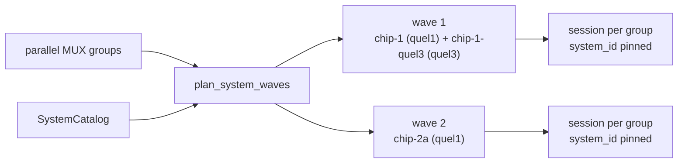

# Multi-System Execution

A run whose targets lie on more than one System of a chip is split into one isolated session
per System, and sessions of Systems that share no hardware run at the same time. This page
covers how the split is planned, what a run refuses, and how results and notes stay
consistent while two Systems calibrate one chip. The catalog that names the Systems is
described in [Chips and Systems](../architecture/qubex-systems.md).

## Responsibility

`src/qdash/workflow/service/system_groups.py` decides which MUX groups run together. The
strategies (`strategy.py`, `one_qubit_stage_runner.py`) ask it for **waves** and run each wave
with the existing parallel task runners. The API refuses runs that cannot be split
(`src/qdash/api/services/system_split.py`), the schedulers drop couplings that cross a System
boundary, and the calibration note merges into one chip-scoped document so concurrent sessions
cannot overwrite each other.



## Waves

`plan_system_waves(groups, catalog)` tags every MUX group with its System
(`system_of_group`) and merges Systems into waves:

| Situation | Result |
| --- | --- |
| One System on the chip, or the catalog cannot read the tree | One wave, groups untagged; sessions derive the System from their targets as before |
| Systems with different backends (`quel1` and `quel3`) | One wave; their sessions run concurrently |
| Systems with the same backend | Separate waves, run one after another |
| `systems.parallel_same_backend: true` in `config/app/workflow.yaml` | Same-backend Systems share a wave |
| A MUX group spanning two Systems | `ValueError`; the scheduler must never produce one |

Same-backend Systems are serialized by default because quel1 boxes of one chip usually share a
clock master; set the flag only when the hardware is known to be independent.

`SystemWave.worker_kwargs("group_system_ids")` returns the per-group System list for
`run_mux_calibrations_parallel` (and `qid_system_ids` for `run_qubit_calibrations_parallel`).
Each isolated session is created with `session_config["system_id"]` set, so
`CalibConfig.system_id` is explicit and `CalibOrchestrator` resolves to that System without
re-deriving it. When every group is untagged the kwarg is omitted, which keeps older callers
and test doubles working.

The `SimultaneousSpectroscopy` strategy plans every step the same way: a step whose qids sit on
several Systems runs as one isolated worker per System, and when the owner session spans
Systems (`CalibService.session_system_ids`) every step runs on isolated workers.

## Owner session

The pipeline's owner session (the one that holds the lock and writes the Execution) may span
Systems because its stages fan out into per-System sessions. `CalibOrchestrator.initialize()`
skips `backend.connect()` when the session resolves to more than one System; steps that drive
hardware directly from the owner session (`BoxSetup`, single-task runs) therefore must target
one System. A direct step with targets on two Systems fails at task time with
`SystemSplitRequired`, not at submission.

## Refusing runs that cannot be split

Entry points that run one session (the **Execute Flow** dialog, scheduled flows, single-task
runs from a result) reject targets on more than one System before claiming the lock:

```json
HTTP 400
{
  "message": "Targets on chip 144Qv3 span 2 Systems (144Qv3: 1, 2; 144Qv3-quel3: 9); run one session per System",
  "code": "system_split_required",
  "chip_id": "144Qv3",
  "systems": {"144Qv3": ["1", "2"], "144Qv3-quel3": ["9"]}
}
```

`ensure_single_system(chip_id, qids, mux_ids=...)` raises this for `qid`, `qids` and `mux_ids`
parameters and for a coupling whose two qubits sit on different Systems. A flow that declares
`system_id` in its parameters is trusted to stay inside that System and skips the check; its
execution lock then covers only that System's resources
(`resolve_workflow_resource_scope(chip_id, system_id)`), so flows declaring different Systems
of one chip run concurrently. A flow without `system_id` still locks the whole chip.

## Couplings across Systems

A coupling whose qubits are driven by different Systems cannot be calibrated: there is no
Experiment that holds both. `CRScheduler.split_cross_system_pairs` removes such pairs before
filtering, records them in `CRScheduleResult.cross_system_pairs`,
`metadata["cross_system_excluded"]` and `filtering_stats["cross_system_excluded_pairs"]`. The
two-qubit steps (`GenerateCRSchedule`, `CustomTwoQubit`, `TwoQubitCalibration`) apply the same
rule to pre-set schedules and write the list to the Execution note under
`cross_system_couplings`, next to `system_ids`.

Design-based CR direction uses the chip's MUX size (`chip.yaml` `topology.mux_size`) through
`FilterContext.mux_size` and `OrderingContext.mux_size`; `qid_to_coords(qid, grid_size,
mux_size)` lays a MUX out as a square when its size is a perfect square and as one row
otherwise.

## Calibration note

Master notes used to be one document per execution, copied from the latest one at the start
of the next run. Two sessions running at once on different Systems would then each copy and
each overwrite. The master is now chip-scoped:

- `calibration_note` holds one live master per project and chip with
  `execution_id == "master"` (`CHIP_MASTER_EXECUTION_ID`).
- `QubexBackend.save_note` creates it from the newest legacy master when it does not exist,
  writes a per-execution snapshot (`execution_id == <execution>`) for history, and loads the
  chip master into the session.
- `QubexBackend.update_note` merges the session's note into the chip master with
  `merge_note_fields`; sessions of different Systems touch disjoint qubit paths of the same
  document, so nothing is lost.
- `find_latest_master` prefers the chip master and falls back to the newest snapshot, so
  reads before the migration ran still work.

The `create-chip-calibration-note-master-v1` migration creates the chip master from each
chip's newest snapshot where it is missing. Run it with the other pending migrations
(`python -m qdash.dbmodel.migration`).

## Per-System views

Chip and metrics endpoints accept `system_id` and narrow to that System, returning 404 for a
System that does not drive the chip:

| Endpoint | Filter |
| --- | --- |
| `GET /chips/{chip_id}/qubits`, `/couplings`, `/muxes` | Qubits, couplings and MUXes wired by the System (via the catalog) |
| `GET /chips/{chip_id}/metrics/summary`, `/metrics/heatmap/{metric}` | Aggregates over the System's qubits and couplings |
| `GET /metrics/chips/{chip_id}`, `/qubits/{qid}/history/{metric}`, `/couplings/{id}/history/{metric}` | Task results recorded with that `system_id` |

`src/qdash/api/services/system_scope.py` resolves the query into a `SystemScope` (qubits and
MUX IDs). Current-value endpoints filter by wiring membership; history endpoints filter by the
`system_id` stamped on each task result, so a qubit that moved between Systems shows the
history of the System it was measured on.

## Tests

- `tests/qdash/workflow/service/test_system_groups.py`: wave planning, backend rules, the
  `parallel_same_backend` flag, untagged waves for unknown chips.
- `tests/qdash/api/services/test_system_split.py`, `test_system_scope.py`,
  `test_flow_service.py`: the 400 payload, the `system_id` bypass, 404 on unknown Systems.
- `tests/qdash/workflow/engine/scheduler/test_cr_scheduler.py`,
  `tests/qdash/workflow/service/test_two_qubit_cross_system.py`: cross-System couplings and
  the note entry.
- `tests/qdash/workflow/engine/repository/test_calibration_note_repository.py`,
  `tests/qdash/dbmodel/test_migration.py`: chip master precedence and the migration.
- `tests/qdash/common/test_execution_resources.py`: System-scoped workflow locks.

## Implementation files

- `src/qdash/workflow/service/system_groups.py`
- `src/qdash/workflow/service/strategy.py`, `one_qubit_stage_runner.py`,
  `_internal/scheduling_tasks.py`
- `src/qdash/workflow/engine/orchestrator.py`, `engine/config.py`
- `src/qdash/workflow/engine/scheduler/cr_scheduler.py`, `cr_utils.py`, `plugins/base.py`,
  `one_qubit_plugins.py`
- `src/qdash/workflow/service/steps/two_qubit.py`, `steps/box_setup.py`
- `src/qdash/api/services/system_split.py`, `system_scope.py`, `flow_service.py`
- `src/qdash/workflow/engine/backend/qubex.py`, `src/qdash/repository/calibration_note.py`,
  `src/qdash/dbmodel/migration.py`
