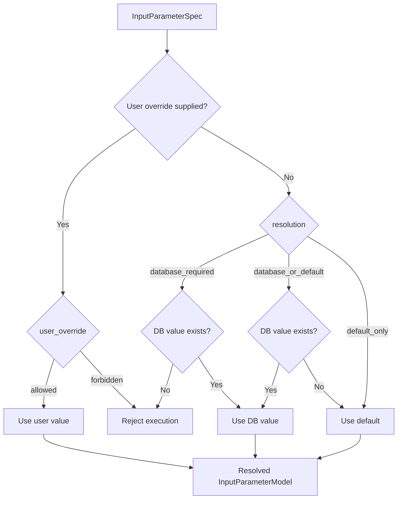
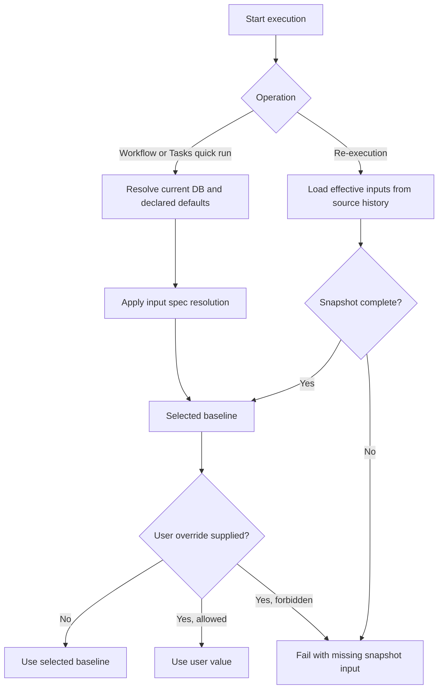
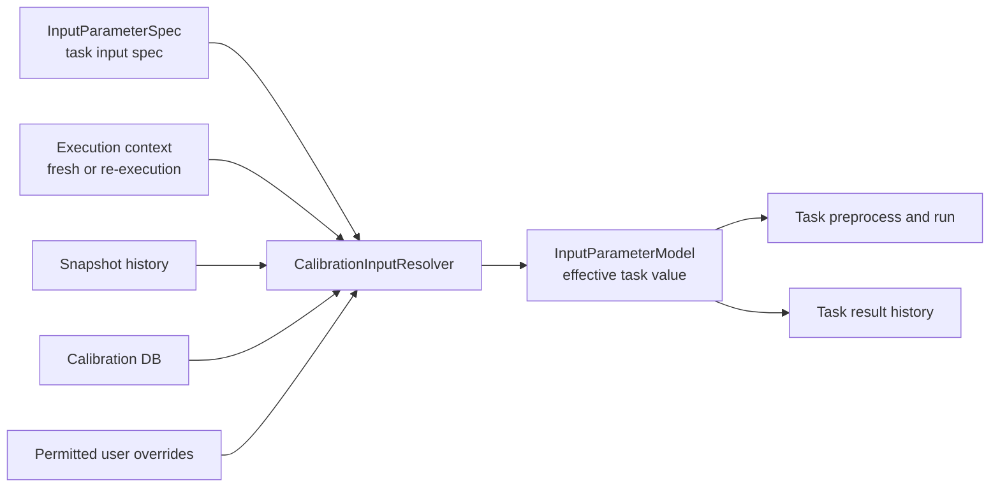
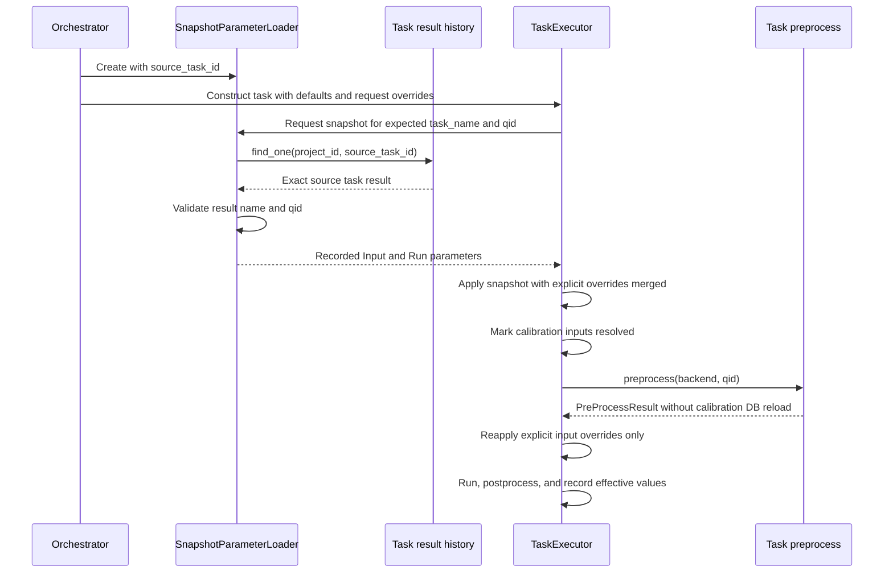

# Parameter Resolution

The workflow engine resolves task inputs, experiment configuration, snapshots, user overrides, and output persistence at different lifecycle stages.

The [Frequency Parameter Policy](./frequency-parameter-policy.md) specifies frequency roles,
task-specific fallbacks, multi-target publication, YAML export, and update UX.
[Calibration Data Lifecycle](./calibration-data-lifecycle.md) shows how accepted calibration
values, task history, active workflow state, and Qubex parameter files differ.

## Parameter model contracts

`BaseTask` defines three symmetric declaration/runtime pairs:

| Collection | Model | Meaning |
| --- | --- | --- |
| `input_spec` | `InputParameterSpec` | Resolution and override policy declared by the task class |
| `input_parameters` | `InputParameterModel` | Values resolved for one task instance |
| `run_spec` | `RunParameterSpec` | Experiment configuration specified by the task class |
| `run_parameters` | `RunParameterModel` | Effective experiment configuration for one run |
| `output_spec` | `OutputParameterSpec` | Calibration outputs declared by the task class |
| `output_parameters` | `OutputParameterModel` | Calibration values produced by one task instance |

Every calibration input spec explicitly states its resolution and override policies through a named constructor:

```python
input_spec = {
    "control_frequency": InputParameterSpec.required_database(
        fallback_parameter_names=("qubit_frequency",),
        unit="GHz",
    ),
    "readout_amplitude": InputParameterSpec.database_or_default(
        default=DEFAULT_READOUT_AMPLITUDE,
        unit="a.u.",
    ),
}
```

`resolution` has three explicit values:

- `database_required`: use the database value and fail when it is absent.
- `database_or_default`: prefer the database value and otherwise use `default`.
- `default_only`: do not read this parameter from the database.

The constructors default to allowing user overrides; pass `user_override="forbidden"` when a task must prohibit them. A permitted user override has higher precedence than the selected baseline. The constructor's `default` is spec-time fallback data; the effective runtime value is stored separately in `input_parameters` as an `InputParameterModel`.

For coupling tasks, `InputParameterSpec.parameter_name` selects the database key and `InputParameterSpec.qid_role` selects `control`, `target`, or `coupling` data. Qubit tasks read from the selected qubit record. `parameter_aliases` lists legacy names with identical semantics. `fallback_parameter_names` lists lower-priority parameters with different semantics, such as resolving `control_frequency` from `qubit_frequency` only when the operational value is absent.

## Normal workflow execution

A workflow sets the parameters of each call on its `TaskCall` (see
[Task Calls](./task-calls.md#settings)). The settings of one call have up to three keys:

```python
from qdash.workflow import TaskCall, sweep

TaskCall(
    name="CheckAdaptiveChevron",
    run={"shots": 256},
    input={"coarse_control_amplitude": 0.05},
    update_calibration_parameters=False,
)
TaskCall(name="CheckChevron", run={"detuning_range": sweep.linspace(-0.08, 0.08, 81)})
```

| Key | Holds | Declared by |
| --- | --- | --- |
| `run` | Run parameter overrides as plain values or `sweep` declarations | `run_spec` |
| `input` | Calibration input overrides as plain values | `input_spec` |
| `update_calibration_parameters` | Output persistence policy for the task (see [Output persistence](#output-persistence)) | — |

Use `sweep.linspace`, `sweep.logspace`, `sweep.arange`, or `sweep.range` when a run parameter
declares a generated range, and `sweep.values(...)` for explicit points. The helper keeps the
constructor and its arguments explicit and normalizes them to the task parameter's serializable
`value` and `value_type` fields without materializing an array. A parameter that declares one
sweep constructor takes any of the five forms: Qubex consumes the generated points, so a
`time_range` declared as `range` runs with `sweep.logspace(2, 5, 11)` and records `np.logspace` as
the `value_type` it ran with. The declared type is the form the task uses when the workflow sets
none. Use plain values for other `run` values and for `input` values. QDash continues to accept
three-element lists or tuples and `{"value": ...}` mappings in existing workflows.

Internally, QDash carries per-task defaults as a `task_parameters` mapping from a task name to an
entry with the same three keys, held as `SessionSettings.task_defaults`. A pipeline spec's
deprecated `task_parameters` and the single-task run API's overrides arrive in this form, and
isolated worker sessions inherit it through their `WorkerSpec`. `CalibService` takes no per-task
defaults. `SessionSettings` normalizes the mapping when it is built. The
orchestrator validates it against the task class when it creates the task: a name under `run`
that the task declares in `input_spec` fails with a message pointing to `input`, the reverse
fails the same way, and an undeclared name fails. A misplaced value therefore stops the run
instead of being ignored. `CalibSession` also rejects a task name that no task registered for its
backend uses, and suggests the closest registered name, so a misspelled entry fails before the
session starts.

`CalibService(task_parameters=...)` and the older flat `CalibService(task_run_parameters=...)`
raise a `TypeError`. To migrate, see [Task Calls](./task-calls.md#migrate-per-task-defaults).

Task construction resolves Run parameters in this order, from highest to lowest precedence:

1. `run` in the call-level `parameters` of `CalibSession.execute_task()`; a step passes each
   `TaskCall`'s own settings here, see [Task Calls](./task-calls.md#settings)
2. `task_parameters[task_name]["run"]`, the per-task defaults described above
3. Legacy per-task entries in `CalibConfig.default_run_parameters`
4. Shared entries in `CalibConfig.default_run_parameters`
5. `run_spec` specified on the task class

A shared default reaches a task only when the task declares that name in its `run_spec`; any
other name is ignored and logged at debug level, so a shared default meant for one task (a pulse
duration for the pulse tasks) is neither used nor recorded by the others.

Use `default_run_parameters` only for values intentionally shared by every declaring task.
A shared value overrides task-specific defaults, including Qubex optimized defaults: qubit
spectroscopy normally uses a 1024 ns interval and resonator spectroscopy uses 0 ns. Use
the `TaskCall` of one named task when a template should preserve or configure that task. Nested entries
in `default_run_parameters` remain readable only for existing flow documents. Shared defaults use
the same plain-value and `sweep` declaration forms as `TaskCall.run`; wrapped
`{"value": ...}` mappings remain compatible. A value must fit the declared type of every task it
reaches: a sweep form for a parameter that declares a sweep, a scalar for a scalar. A shared
`sweep.linspace` for `shots`, or a shared `{"value": 100, "value_type": "float"}` for a
`time_range` declared as `range`, fails when that task is created, unless the call sets
that task's own value. `qdash.datamodel.task.compatible_value_type` holds the rule; the workflow
validator, the task, and the catalog run API apply it. The `sweep` helpers also reject a zero step or a
non-positive count when the workflow is defined.

`readout_duration` is session-scoped in Qubex. QDash passes the shared value when constructing the
Experiment, records the effective value on each task that uses the session readout pulse, and rejects
a per-task value that differs from the session. When no shared value is set, the session starts
from `DEFAULT_READOUT_DURATION` (1024 ns), the same default every declaring task uses, rather than
from the Qubex default or the chip's `measurement_defaults.yaml`; a pipeline spec or flow therefore
only needs a shared `readout_duration` to run with a different value. Qubex spectroscopy is an intentional exception:
qubit/control spectroscopy uses its dedicated 1024 ns pulse and resonator spectroscopy uses its
dedicated 8192 ns pulse, so those tasks do not expose the shared `readout_duration` parameter.

`QubexTask.preprocess()` then resolves each declared Input parameter by following the input
spec's resolution policy and produces an effective `InputParameterModel` for the task instance.
After preprocess, `TaskExecutor._apply_input_overrides()` replaces that baseline with every
explicit input override, so an override wins over the database value even in a normal workflow.

`CalibSession.execute_task()` and `execute_task_batch()` take call-level `parameters` in the
form of one `task_parameters` entry. They take precedence over the session's per-task defaults
for that call only, which suits values computed at run time, such as the MUX IDs that
the `ConfigureAll` step adds to its call's settings before it runs the `ConfigureAll` task:

```python
service.execute_task("CheckRabi", "0", parameters={"input": {"control_amplitude": 0.05}})
```

The task records the merged explicit values when it is created: input overrides in
`BaseTask.input_overrides` and run values in `BaseTask.run_overrides`. Creation fails for an
undeclared name or when the input spec sets `user_override="forbidden"`; scalar values are
converted to the declared `value_type`, and a sweep parameter takes the `value_type` of the sweep
it was given. Batch execution has no preprocess step, so
`TaskExecutor.execute_batch()` rejects a task that carries input overrides.

`execute_task` no longer accepts the call-level `task_details` form keyed by task name; pass
`parameters`. `task_settings_from_task_details()` still converts its keys for stored data: `run`,
`run_parameters`, and the older `input_parameters` become `run`; `input` and
`calibration_inputs` become `input`.



The effective Input and Run parameter models are recorded in task result history for provenance and later snapshot re-execution.

## Execution-level parameter policy

The operation itself determines the baseline; no additional source selector is needed:

| Operation | Calibration input baseline | Run parameter baseline | Output persistence default |
| --- | --- | --- | --- |
| Normal workflow | Current DB, following task input specs | Task/workflow specs | Enabled |
| Tasks quick run | Current DB, following task input specs | Task specs and submitted overrides | Disabled |
| Task re-execution | Source task snapshot | Source task snapshot | Existing re-execution setting |

This gives `re-execution` one stable meaning: reproduce the recorded execution conditions, optionally with explicit parameter overrides. Running the same task against current calibration state is a new Tasks quick run, not a re-execution mode.

`user_override` and `update_calibration_parameters` remain independent policies. A permitted override has the highest precedence; choosing to update calibration values does not change how inputs were selected.



A re-execution must not silently fall back to current database values. Such fallback would make it non-reproducible. Missing required snapshot data should fail with an actionable error; the operator can then start a new Tasks quick run against current state.

### Model boundaries

Task classes declare immutable intent with `InputParameterSpec`, `RunParameterSpec`, and `OutputParameterSpec`. Each task instance receives the matching mutable runtime model: `InputParameterModel`, `RunParameterModel`, and `OutputParameterModel`. All three specs use `default` for their initial value and expose `create_model()` for the conversion.

The three runtime models may share persisted calibration metadata internally, but their distinct types keep input, run, and output roles visible at API boundaries and in type checking.



## Snapshot re-execution

### Re-execution behavior

For a single-task re-execution, the session passes `source_task_id` from its `SessionSettings.snapshot` to `SnapshotParameterLoader`, which loads that exact task result. `task_name` and `qid` then validate that the selected history record matches the requested task. This avoids resolving an already identified task indirectly through its execution.

A workflow re-executes from an execution when its flow declares a `source_execution_id` parameter. The snapshot source, including the tasks exempt from it, is part of the run's settings, so every step session and every isolated worker restores from the same source; see [Isolated Workers](./engine-architecture.md#isolated-workers).

For an execution re-execution (`source_execution_id`), the loader keeps every source result and matches each new call by task name, qid, and the `step_id` and `call_id` of its `invocation`, so repeated calls of one task restore their own records. A source result without `invocation`, written before task calls existed, is used when it is the only one for its task and qid; several raise `SnapshotAmbiguityError`, and the task fails rather than restore an arbitrary record.

`TaskExecutor` applies parameters in this sequence:

1. Construct the task from class defaults and the request's overrides.
2. Require a matching source snapshot and validate its declared Input coverage.
3. Replace Input and Run collections with the snapshot, with the task's `input_overrides` and
   `run_overrides` merged on top.
4. Mark calibration Inputs as resolved, so `preprocess()` cannot refresh them from the database.
5. Reapply only explicit input overrides.
6. Run the experiment and record the resulting effective parameters.



The second override application preserves values computed during preprocessing while guaranteeing that explicit user input remains authoritative. The snapshot marker prevents preprocessing from replacing calibration inputs with current database values.

Calibration inputs are resolved before task preprocessing and passed as `InputParameterModel` values:

```text
Execution request
  -> CalibrationInputResolver(operation context)
  -> Apply permitted user overrides
  -> Task.preprocess(resolved inputs)
  -> Task.run()
```

Task preprocessing may compute derived runtime values, but it must not independently change the selected point-in-time source. Database access for declared calibration inputs belongs to `CalibrationInputResolver`.

### Effective-input validation

Numeric constraints such as `greater_than` and `less_than` belong to `InputParameterSpec`. The executor validates them after database or snapshot resolution and after user overrides, but before `run()`.

Concrete task `preprocess()` and `run()` methods must treat Input and Run parameters as read-only. They must not repair an invalid value, replace it with a default, or otherwise change the effective parameter collections. A missing database value may select the specified default only when the input spec uses `database_or_default()`; a present but invalid database, snapshot, or override value fails execution.

For a single-task re-execution, a missing `source_task_id`, a mismatch between the selected result and the requested task, or incomplete declared snapshot inputs causes execution to fail instead of silently changing its baseline.

### Single-task result re-execution

`POST /task-results/{task_id}/re-execute` invokes the system `single-task-executor` with the source execution and source task IDs. It accepts task-level overrides in this shape:

```json
{
  "parameter_overrides": {
    "input": {"qubit_frequency": 5.1},
    "run": {"shots": 2000}
  }
}
```

`single-task-executor` turns `parameter_overrides` into the requested task's entry in
`task_parameters`, so the overrides apply to that task only and not to a `Configure` step run
before it. The source task ID both selects the recorded parameter snapshot and links the child
result to its parent. The source execution ID remains execution context; it is not used to re-identify the single source task.

This endpoint is available for API clients that require exact snapshot re-execution. The Tasks UI instead offers **Run again**, which uses the current task definition and prefills compatible values from the selected historical result.

## Tasks page quick run

`POST /tasks/{task_name}/execute` also uses `single-task-executor`, but sets `source_execution_id` to `None`.

- `input_parameter_overrides` becomes `parameter_overrides.input` and then the selected task's
  `input` entry in `task_parameters`.
- `run_parameter_overrides` becomes the `task_run_parameters` flow parameter of
  `single-task-executor`, which converts it to the selected task's `run` entry. This internal
  flow parameter is not the removed `CalibService` argument and does not warn.
- No `SnapshotParameterLoader` is needed for the overrides: the task carries them and
  `TaskExecutor` reapplies the input overrides after preprocessing.
- When `source_task_id` is supplied by **Run again**, it records provenance without restoring the source snapshot; the submitted form values and current task definition remain authoritative.
- With no Input override, Qubex preprocessing loads current database values normally.

The Tasks page **Reload** action is client-side preparation only. It reads the selected qubit or coupling record and fills the form. The server treats every non-empty submitted field as an explicit override; it does not distinguish a typed value from a value inserted by Reload.

## Output persistence

`update_calibration_parameters` controls authoritative write-back for one task call. When the resolved value is false, task history, execution state, figures, raw data, and in-memory output processing still occur, but `BackendSaver` skips calibration database and backend parameter writes.

Normal workflows apply validated task outputs by default. A workflow template can make one call
measurement-only by setting `update_calibration_parameters` on its `TaskCall`:

```python
TaskCall(name="CheckChevron", update_calibration_parameters=False)
```

The key is an execution policy and is not passed to the task or recorded as a Run parameter. A
direct `execute_task` call can also put the key in its `parameters`. The value resolves in this
order:

1. The call's own value, from `TaskCall` or `execute_task(parameters=...)`
2. The task's per-task default: a pipeline spec's `task_parameters`, or a single-task run's
   control
3. `True`

No session-wide value exists. Isolated workers receive each call's settings with the plan and the
per-task defaults with their `WorkerSpec`, so a worker resolves the same value as the parent
session. `CalibService` no longer accepts `persist_output_parameters`; passing it raises a
`TypeError`. [Task Calls](./task-calls.md#migrate-session-write-back) shows the migration.

Tasks quick runs, agent actions, and task re-executions run through `single-task-executor`, which
takes one top-level `update_calibration_parameters` field. Its value applies to the requested task
and to the optional `Configure` call, and `false` also disables GitHub push. Omitting it keeps the
surface's default: `false` for the `quickRunTask` request, `true` for the flow and task
re-execution. Agent actions always send `false`.

The flow normalizes two migration inputs before it opens a calibration session, so an invalid
request never reaches hardware:

| Input | Accepted | Rejected |
| --- | --- | --- |
| Deprecated `persist_output_parameters` on the `quickRunTask` request or the flow | Alone, or equal to `update_calibration_parameters`; logs a deprecation warning | A value that differs from `update_calibration_parameters`: HTTP 422, or a `ValueError` in the flow |
| `update_calibration_parameters` nested in `parameter_overrides` or in the `task_run_parameters` entry of the requested task or `Configure` | Equal to the top-level value, or without a top-level value when all nested values agree; warns, then is removed from the settings | A value that differs from the top-level value or from another nested value |

The deprecated name and the nested form will be removed in a later release. A run queued with
`persist_output_parameters` before an upgrade still applies its value, `false` included.

A successful measurement-only task keeps its outputs in task history and metrics but does not
replace current calibration values, update the workflow's in-memory calibration state, or update
mapped backend files. Its output parameters explicitly record `database_updated: false`, allowing
Task Result views to label it as measurement-only. Persisted outputs record `database_updated:
true` with `previous_database_value`, which the UI presents as a Previous/New comparison.
Validation-rejected outputs are still cleared before history aggregation;
figures, raw data, quality metrics, and the validation message remain available for diagnosis
without introducing rejected values into Metrics.

When persistence is enabled:

- Qubit outputs update the qubit calibration repository.
- Coupling outputs update the coupling calibration repository.
- Successful qubit outputs are synchronized through the backend parameter updater.
- Failed validation skips backend parameter updates unless `force_update_params` is true.

The API field `update_params` is passed to `single-task-executor` as `force_update_params`. It does not replace `update_calibration_parameters`; updates must be enabled before output values can be written.

## Implementation files

- `src/qdash/workflow/calibtasks/base.py`
- `src/qdash/workflow/calibtasks/qubex/base.py`
- `src/qdash/workflow/engine/orchestrator.py`
- `src/qdash/workflow/engine/task_parameters.py`
- `src/qdash/workflow/engine/task/snapshot_loader.py`
- `src/qdash/workflow/engine/task/executor.py`
- `src/qdash/workflow/engine/task/backend_saver.py`
- `src/qdash/workflow/service/_internal/settings.py`
- `src/qdash/workflow/service/_internal/session.py`
- `src/qdash/workflow/service/single_task_flow.py`
