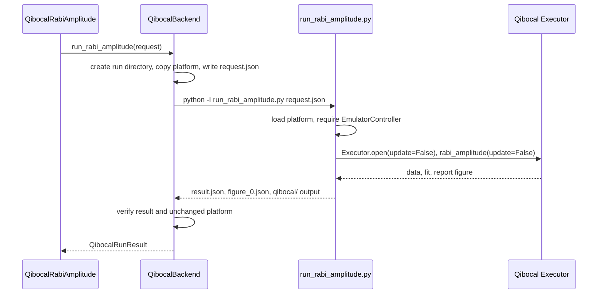

# Qibocal Emulator Backend

The `qibocal` backend runs upstream Qibocal protocols on a Qibolab emulator and records the
results in QDash as measurement-only, synthetic data. Qibocal owns acquisition, fit, and figure;
QDash owns scheduling, execution history, artifacts, and the rule that these results never become
accepted calibration state. The backend currently provides one task, `QibocalRabiAmplitude`,
which runs Qibocal's one-qubit `rabi_amplitude` protocol.

## Process Boundary

QDash never imports Qibocal or Qibolab. Qibocal 0.2.6 requires `cma<4` and qubex requires
`cma>=4`, so the two cannot share an environment. The runner has its own project and lock in
`tools/qibocal-runner/` (Python 3.11, `qibocal==0.2.6`, `qibolab[emulator]==0.2.16`,
`qibo==0.3.3`), and `QibocalBackend` starts it as a subprocess.



`QibocalBackend.run_rabi_amplitude()` in `src/qdash/workflow/engine/backend/qibocal.py` owns
the subprocess:

- Each run gets its own directory, `<execution calib dir>/qibocal/<task>_q<qid>_<random>/`,
  holding the request, a copy of the platform, the runner logs, `result.json`, the report
  figure, and Qibocal's own output folder. Concurrent runs never share a file.
- The runner sees only its copy of the platform. `QIBOLAB_PLATFORMS` points at that copy, and the
  configured platform is hashed before and after the run; a change fails the task.
- The command is a fixed argument list started without a shell, with `-I` and a minimal
  environment, in a new process group. On timeout, cancellation, or any other exception the
  backend sends `SIGTERM` to the group and `SIGKILL` after the grace period. The runner also
  exits when its parent process disappears.
- Runner exit code 3 means the platform was rejected and raises
  `QibocalPlatformRejectedError`; exit code 4 means an invalid request, including a qubit that
  `platform.qubits` does not contain, and raises `QibocalRunnerError` before acquisition; a
  timeout raises `QibocalRunnerTimeoutError`; every other failure raises `QibocalRunnerError`
  with the end of the runner's stderr.
- If the workflow process is killed with `SIGKILL` and cannot run that cleanup, the runner's
  watchdog (`_exit_with_parent()`) sees its parent change and exits within a second. The run
  directory keeps the request, the platform copy, and both logs, with no `result.json`.

## Invariants

| Invariant | Where it is enforced |
| --- | --- |
| Emulator only | The runner rejects the instantiated platform before acquisition unless every instrument is exactly `qibolab` `EmulatorController`; `DummyInstrument` and hardware controllers fail. The backend rejects a result whose reported controllers are not all emulators. |
| Qibocal never updates the platform | The runner calls `Executor.open(..., update=False)` and the protocol with `update=False`, and never reads Qibocal's `new_platform` output. The backend rejects a result without `executor_update: false` and matching platform hashes. |
| Results are measurement-only | `QibocalTask.measurement_only_reason` makes `CalibOrchestrator._should_update_calibration_parameters()` return `False` and `BackendSaver` skip the calibration database, backend parameter files, and calibration notes for every combination of `update_calibration_parameters`, `force_update_params`, and `DEFAULT_BACKEND`. |
| History says why | Every output is stored with `database_updated: false`, `measurement_only_reason`, and `provenance` (source `qibolab-emulator`, controllers, platform hashes, seed, distribution versions, runner lock hash, run directory). |
| No other write path | `GitHubPolicy.from_deployment()` disables GitHub pull and push for every backend other than `qubex`, and `AgentSessionService.list_action_candidates()` rejects outputs that carry `measurement_only_reason`, so an agent session cannot commit them. |

Output names start with `qibocal_` (`qibocal_pi_amplitude`, `qibocal_rabi_chi2`) and declare no
publish targets, so they never collide with qubex parameters such as `control_amplitude`. The
general measurement-only flow is described in
[Calibration Data Lifecycle](./calibration-data-lifecycle.md).

## Rabi Amplitude Task

`QibocalRabiAmplitude` in `src/qdash/workflow/calibtasks/qibocal/rabi_amplitude.py` has no
calibration inputs; the emulator platform carries its own qubit parameters.

| Run parameter | Default | Rule |
| --- | --- | --- |
| `min_amp` | `0.01` | Must be greater than 0. At amplitude 0 the excited-state probability and its binomial error are 0, and Qibocal's weighted fit fails. |
| `max_amp` | `0.5` | Must be greater than `min_amp`. |
| `step_amp` | `0.01` | Must give at least five sweep points. |
| `nshots` | `1024` | Must be positive. |
| `relaxation_time` | `0.0` | Must not be negative. |
| `seed` | `1234` | NumPy seed; the same seed and runner lock give the same fit. |

The task fails, keeping the figure and both raw-data files, when Qibocal reports no fit, when the
amplitude, its error, chi-squared, or a fitted parameter is not finite, or when the amplitude lies
outside `[min_amp, max_amp]`. The figure is Qibocal's report figure with a title marking it as
synthetic emulator data. The raw data holds the excited-state probability and its error against
amplitude.

## Configuration

| File | Owner and content |
| --- | --- |
| `config/app/backend.yaml` | Registers the `qibocal` backend, its task list, and `requires_wiring: false` |
| `config/app/qibocal.yaml` | QDash connection settings: runner interpreter and script, runner timeout and termination grace, platform directory and name. Runner paths are relative to the parent of the config directory: the repository root on a host, `/app` in the worker image. Platform paths are relative to the config directory. |
| `config/domain/qibocal/platforms/qubit/` | The Qibolab platform in its native format, copied unchanged from upstream |
| `config/domain/qibocal/UPSTREAM.md` and `LICENSE` | Source commit, file hashes, and the Apache 2.0 license of the copied platform |

The platform comes from
[qiboteam/qibocal@52450c1](https://github.com/qiboteam/qibocal/tree/52450c1737ca811bc1a2facd4bc1bb24d6e53f3f/platforms/qubit),
which adds the acquisition channel that the platform in the Qibocal 0.2.6 release lacks. Ruff
excludes the platform directory so that formatting never changes it, and
`test_platform_files_match_the_recorded_upstream_commit` fails when a file differs from the
recorded hash.

## Deployment

The runner environment exists only where it is installed: `tools/qibocal-runner/.venv` on a host,
or the `qibocal` target of `src/qdash/workflow/Dockerfile` in a container. Without it,
`QibocalBackend.connect()` fails with "Qibocal backend is not installed".

| File | Role |
| --- | --- |
| `src/qdash/workflow/Dockerfile` | Stage `qibocal-runner-builder` runs `uv sync --frozen` on the runner's own lock into `/app/tools/qibocal-runner/.venv` and copies the runner script and the platform `LICENSE` and `UPSTREAM.md`; target `qibocal` adds that directory to the worker. The last stage, `default`, has no runner, so a build without a target never builds the runner stages. |
| `compose.qibocal.yaml` | Overlay that builds `user-flow-worker` with `target: qibocal` and `init: true`, so PID 1 reaps a runner whose flow process was killed. No other service changes. |
| `Taskfile.yaml` | `deploy-local-qibocal` and `deploy-local-qibocal-down` set `ENV=dev-qibocal`, `DEFAULT_BACKEND=qibocal`, and `COMPOSE_FILE=compose.yaml:compose.qibocal.yaml` |

Only the Prefect worker needs the runner: flow runs execute in processes it starts. The worker
image keeps every distribution's license and notice files, such as the dynamiqs `NOTICE`, in
`.dist-info` inside the copied environment. The procedure for users is
[Qibocal Emulator Backend](../../user-guide/setup/qibocal-backend.md).

## Chips and Workflows

The emulator platform has one qubit, `0`, so a qibocal deployment never presents a larger device:

- The `qibocal` preset of `ChipConfigScaffolder` (`QIBOCAL_PRESET` in
  `src/qdash/api/services/chip/config_scaffold.py`) is listed only when `DEFAULT_BACKEND` is
  `qibocal`. It uses the topology `config/domain/topologies/qibocal-emulator-1.yaml` (one qubit,
  no couplings) and has `requires_config_tree: false`: creating a chip writes nothing into the
  Qubex configuration tree and returns status `skipped` with the preset. The Create Chip dialog
  and the first calibration guide (`resolveChipSetupMode()` in
  `ui/src/components/features/chip/chipSetupMode.ts`) treat it like the fake preset and open its
  `workflow_template_id`.
- The flow template `qibocal_rabi_amplitude` (`src/qdash/workflow/templates/qibocal_emulator.py`,
  backend `qibocal` in `templates.json`) runs `CustomOneQubit` on `QubitTargets(["0"])`.
- `requires_wiring: false` in `config/app/backend.yaml` (`backend_requires_wiring()` in
  `src/qdash/common/config/backend.py`) tells `CustomOneQubit` and the other one-qubit steps to
  run explicit qubit targets with `_execute_direct_one_qubit()` instead of the wiring-based
  scheduler, and to reject MUX targets. The flag defaults to true, so qubex and fake keep the
  scheduler. Without wiring, the execution lock claims the whole chip.
- The single-task executor and the Task Workbench need no wiring and run the task as on any other
  backend.

## Reproduce a Run

Create the runner environment from its lock and run the end-to-end tests:

```bash
cd tools/qibocal-runner
uv sync --frozen
cd ../..
QDASH_QIBOCAL_INTEGRATION=1 uv run pytest -m qibocal_emulator
```

The tests run the task through `TaskExecutor` and `CalibOrchestrator.run_task()` with in-memory
or mongomock storage, check the measurement-only history, figure, and raw data, rerun with the
same seed for an identical amplitude, and confirm that a `DummyInstrument` platform is rejected
before acquisition. On macOS, wrapping the command in `sandbox-exec` with a profile that denies
`network-outbound` confirms that a run needs no network once the environment exists.

To run the runner alone, write a request and pass it as the only argument:

```bash
tools/qibocal-runner/.venv/bin/python -I tools/qibocal-runner/run_rabi_amplitude.py request.json
```

The request needs `platform`, `platforms_dir`, `output_dir`, `qubit`, `min_amp`, `max_amp`,
`step_amp`, `nshots`, `relaxation_time`, and `seed`. Use a copy of the platform directory as
`platforms_dir`, as `QibocalBackend` does.

## Licenses

QDash redistributes only the platform files, with Qibocal's Apache 2.0 `LICENSE` beside them.
The runner environment installs Qibocal, Qibolab, and Qibo (Apache 2.0), QuTiP (BSD-3-Clause),
dynamiqs (Apache 2.0 with a `NOTICE` for code derived from QuTiP), and JAX (Apache 2.0) from the
lock; each distribution keeps its license and notice files in its installed metadata. The
`qibocal` worker target copies the environment whole, so the image keeps those files, and adds the
platform `LICENSE` and `UPSTREAM.md` under `/app/tools/qibocal-runner/licenses/qibocal-platform/`.

## Extend and Test

To add another Qibocal protocol, add a `QibocalTask` subclass under
`src/qdash/workflow/calibtasks/qibocal/`, a runner script or entry point that calls the upstream
protocol through `Executor` with `update=False`, a backend method that reuses
`_run_subprocess()`, and the task name in the `qibocal` section of `config/app/backend.yaml`.
Run `task generate-task-catalog` afterwards.

| Concern | Tests |
| --- | --- |
| Subprocess, isolation, timeout, cancellation, result checks, platform hash | `tests/qdash/workflow/engine/backend/test_qibocal_backend.py` |
| Task request validation, outputs, failures, every write-back setting, orchestrator run | `tests/qdash/workflow/calibtasks/test_qibocal_rabi_amplitude.py` |
| Real Qibocal and Qibolab emulator | `tests/qdash/workflow/calibtasks/test_qibocal_emulator_integration.py` (`qibocal_emulator` marker) |
| GitHub policy, agent candidates | `tests/qdash/workflow/service/test_single_task_flow.py`, `tests/qdash/api/services/test_agent_session_service.py` |
| Parent `SIGKILL` and the runner watchdog | `test_runner_exits_when_its_parent_is_killed` in `test_qibocal_backend.py` |
| Chip preset and topology | `tests/qdash/api/services/chip/test_config_scaffold.py`, `tests/qdash/api/routers/test_chip.py` |
| Template catalog, wiring-free step routing | `tests/qdash/api/routers/test_flow.py`, `tests/qdash/workflow/service/test_one_qubit_steps.py` |
| Create Chip dialog and setup mode | `ui/src/components/features/chip/modals/CreateChipModal.test.tsx`, `ui/src/components/features/chip/__tests__/chipSetupMode.test.ts` |

The unit tests replace the runner with a script under the test interpreter
(`tests/qdash/workflow/qibocal_helpers.py`), so they run without the runner environment; the
integration tests skip unless `QDASH_QIBOCAL_INTEGRATION=1` is set.
