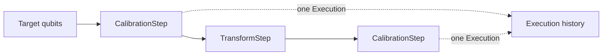

# Workflow Authoring Quickstart

Use a QDash flow template to define targets, an explicit sequence of calibration steps, and the
parameters those steps need.

## Start from an Existing Template

Copy the closest file under `src/qdash/workflow/templates/` before writing a flow from scratch.
Templates contain the terminal hooks, target validation, task order, and defaults required by the
current runtime. Their matching tests under `tests/qdash/workflow/` protect those decisions.

The smallest useful flow has four parts:

1. A Prefect `@flow` with QDash terminal hooks.
2. A `Target` selected from MUX IDs or explicit qubit IDs.
3. An explicit list of task names inside one or more `Step` objects.
4. A `CalibService` that runs those steps.

## Define a Flow

This example follows the structure of `templates/coherence_check.py`. It assumes the selected
qubits already have the calibration inputs required by `CheckT1` and `CheckRamsey`.

```python
from typing import Any

from prefect import flow

from qdash.workflow.service import CalibService
from qdash.workflow.service.calib_service import (
    on_flow_cancellation,
    on_flow_crashed,
    on_flow_failure,
)
from qdash.workflow.service.steps import CustomOneQubit
from qdash.workflow.service.targets import MuxTargets, QubitTargets, Target

TASKS = ["Configure", "CheckT1", "CheckRamsey"]


@flow(
    on_cancellation=[on_flow_cancellation],
    on_failure=[on_flow_failure],
    on_crashed=[on_flow_crashed],
)
def coherence_sample(
    username: str,
    chip_id: str,
    mux_ids: list[int] | None = None,
    exclude_qids: list[str] | None = None,
    qids: list[str] | None = None,
    tags: list[str] | None = None,
    flow_name: str | None = None,
    project_id: str | None = None,
) -> Any:
    targets: Target
    if mux_ids is not None:
        targets = MuxTargets(mux_ids=mux_ids, exclude_qids=exclude_qids or [])
    elif qids is not None:
        targets = QubitTargets(qids=qids)
    else:
        raise ValueError("mux_ids or qids is required; select targets before running this flow")

    steps = [
        CustomOneQubit(
            step_name="coherence_sample",
            tasks=TASKS,
            mode="synchronized",
        )
    ]
    service = CalibService(
        username,
        chip_id,
        flow_name=flow_name,
        tags=tags,
        project_id=project_id,
    )
    return service.run(targets, steps)
```

Keep `username`, `chip_id`, `flow_name`, and `project_id` in the signature. QDash injects them when
it starts a saved flow. Target parameters remain optional in the signature so the same flow can
accept a MUX selection or an explicit qubit selection, but the function must reject a run with
neither.

## Choose Targets

| Target | Use when | Resolution |
| --- | --- | --- |
| `MuxTargets` | Hardware scheduling starts from MUX IDs | Expands each MUX to four qubits and removes `exclude_qids` |
| `QubitTargets` | The caller selected individual qubits | Uses the supplied qubit IDs |
| `CouplingTargets` | The flow starts from directed two-qubit pairs | Exposes both coupling IDs and their endpoint qubits |
| `AllMuxTargets` | The flow targets a 64-qubit layout's MUX IDs 0–15 | Expands that fixed MUX set and applies exclusions |

When both `mux_ids` and `qids` are supplied, standard templates prefer `mux_ids`. Preserve that
rule across templates so UI and scheduled executions resolve the same request consistently.

## Compose Steps

`CalibrationStep` performs hardware work and receives its own QDash execution record.
`TransformStep` filters or schedules existing context without creating an execution record.
`Pipeline` validates each step's `requires` and `provides` fields before the first step runs.



Keep task lists in the template rather than importing them from another template or relying on a
step's default list. The visible order is part of the flow contract: repeated measurements and
configuration checkpoints must remain reviewable in the saved source. If two templates must stay
aligned, compare their lists in template tests.

## Set Run Parameters

Pass shared fallbacks through `default_run_parameters` and task-specific values through
`task_run_parameters`:

```python
service = CalibService(
    username,
    chip_id,
    project_id=project_id,
    default_run_parameters={
        "interval": {"value": 150 * 1024, "value_type": "int"},
    },
    task_run_parameters={
        "CheckRamsey": {
            "shots": {"value": 1024, "value_type": "int"},
            "update_calibration_parameters": False,
        },
    },
)
```

Explicit task settings override shared defaults. Setting
`update_calibration_parameters=False` retains task history without promoting validated outputs to
the current calibration state. The complete precedence rules are in
[Parameter Resolution](./parameter-resolution.md).

## Preserve Terminal Handling

Every top-level flow that owns hardware reservations must register `on_flow_cancellation`,
`on_flow_failure`, and `on_flow_crashed`. Do not reproduce their exception-classification logic in
the template. Nested single-task flows use the `*_keep_lock` hooks supplied by the service layer.

The hooks finalize execution and task records that the worker cannot close itself and release only
reservations owned by that flow. [Workflow Engine Architecture](./engine-architecture.md#cancellation)
explains the two cancellation paths.

## Test the Template

Template tests replace `CalibService` with a recording fake and call the flow function directly.
Assert target precedence, required-target errors, step types, task order, and parameter dictionaries.
This catches authoring errors without Prefect infrastructure or laboratory hardware.

Run the matching test first, then the workflow suite:

```bash
uv run pytest tests/qdash/workflow/test_coherence_check_template.py -v
task test-workflow
```

Use [Workflow Testing](./testing.md) to choose broader checks. Saving, registering, and dispatching
the finished flow crosses the boundaries described in [Workflow Services](./services.md).
