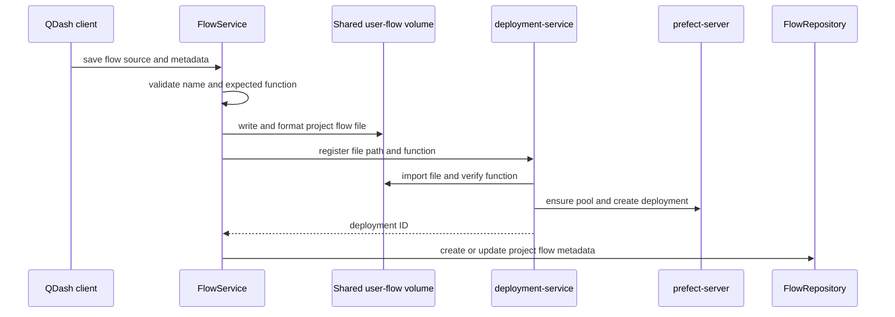
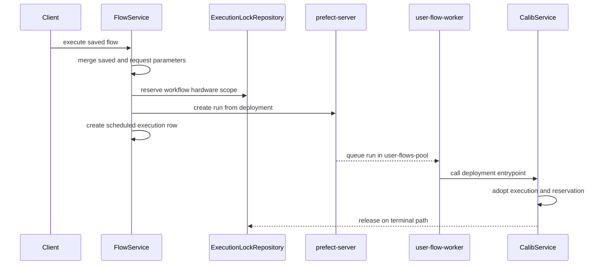

# Workflow Services

The workflow service layer turns project-scoped Python flow files into Prefect deployments and
connects dispatched flow runs to QDash execution history, hardware reservations, and artifacts.

## Responsibility Boundaries

| Component | Owns | Does not own |
| --- | --- | --- |
| API `FlowService` | Flow CRUD, project metadata, dispatch admission, and scheduled execution rows | Importing or running user code |
| API `FlowScheduleService` | Project-scoped cron and one-time schedule operations | Worker execution |
| `deployment-service` | Import validation and Prefect deployment or schedule mutations | QDash project authorization |
| `prefect-server` | Prefect flows, deployments, schedules, run states, and queues | QDash calibration records |
| `user-flow-worker` | Polling `user-flows-pool` and running deployment entrypoints | Flow persistence or API authorization |
| `CalibService` | In-process pipeline, execution, reservation, and terminal lifecycle | Deployment registration |

The API is the authority for project context and QDash metadata. Prefect is the orchestration
authority. MongoDB execution documents remain the QDash-facing history even though each record can
carry a Prefect `flow_run_id`.

## Save and Register a Flow

Saving a flow crosses the API and deployment containers because the deployment service imports the
source for registration and owns Prefect deployment mutations.

`FlowService.save_flow()` writes `<project_id>/<flow_name>.py`, formats it with Ruff, and maps the
API-visible path to the deployment container's shared volume. Registration fails when the file
cannot be imported or the expected function is absent.

Updating a registered flow replaces its Prefect deployment. Before deletion, the deployment
service reads its schedules and default parameters and applies them to the replacement. The
read-delete-create sequence is not transactional; a concurrent Prefect edit in that interval can
be lost, so deployment changes should continue to enter through QDash.

## Dispatch a Run

An API-triggered run is admitted before Prefect receives it:

Parameter merging uses saved defaults first and request parameters second. The API then injects the
authenticated `username`, saved `flow_name`, and current `project_id`, so a request cannot replace
those values. Saved tags are used only when the merged parameters do not already contain `tags`.

The API atomically claims the workflow resource scope before it creates the Prefect run. It then
pre-creates a `scheduled` execution record so the run appears in QDash before a worker starts. If
dispatch fails, the API releases its claim. If scheduled-row creation fails after dispatch, the
flow can still create its own execution when it starts.

Cron-triggered runs do not pass through `FlowService.execute_flow()`. Their `CalibService` instance
creates an execution ID and acquires the planned reservation at worker start. This difference is
why the runtime supports both adopting an API claim and claiming resources itself.

## Manage Schedules

`FlowScheduleService` resolves the saved deployment within the current project. It accepts either a
cron expression or one `scheduled_time`, never both.

- Cron schedules are stored on the Prefect deployment and can be activated, updated, or removed.
- One-time schedules are Prefect flow runs placed directly in the `Scheduled` state.
- Listing combines cron schedules from deployments with scheduled one-time flow runs.
- Resaving a flow preserves deployment schedules and their parameters.

Use QDash APIs for mutations. Direct Prefect edits bypass project metadata checks and can race with
deployment replacement.

## Resolve Files and Artifacts

The API, deployment service, and worker share the user-flow directory at different container
paths. `common/config/path_resolver.py` owns these conversions; do not construct container paths in
routers or flow templates.

Calibration figures, raw data, notes, and exported parameters live beneath `CALIB_DATA_PATH`. In
Docker, the API and workers mount the same host directory at `/app/calib_data`. Stored execution
paths use the container layout, while API reads map them back to the configured local mount.

Configuration repository synchronization is separate from flow registration. `GitHubIntegration`
pulls the configuration root before a session when enabled and publishes the session's parameter
and calibration-note files during successful finalization; see
[Configuration Repository](./config-repository.md).

## Handle Terminal States

Top-level flow hooks reconcile cancellations, failures, and crashes that interrupt normal runtime
cleanup. They find QDash executions by `flow_run_id`, finalize unfinished tasks, and release the
owning reservation. Nested worker flows use keep-lock variants because the parent pipeline owns
the reservation. See [Workflow Engine Architecture](./engine-architecture.md#cancellation) for the
in-process rules.

## Source and Tests

| Concern | Source | Focused tests |
| --- | --- | --- |
| Flow CRUD and dispatch | `src/qdash/api/services/flow_service.py` | `tests/qdash/api/services/test_flow_service.py` |
| Schedule API policy | `src/qdash/api/services/flow_schedule_service.py` | `tests/qdash/api/services/test_flow_schedule_service.py` |
| Prefect registration service | `src/qdash/workflow/deployment_service.py` | `tests/qdash/workflow/test_deployment_service.py` |
| Runtime lifecycle | `src/qdash/workflow/service/calib_service.py` | `tests/qdash/workflow/service/test_calib_service.py` |
| Shared path mapping | `src/qdash/common/config/path_resolver.py` | `tests/qdash/common/config/test_path_resolver.py` |

Run API tests when flow persistence or dispatch changes, workflow tests when deployment or runtime
behavior changes, and both when a change crosses the HTTP boundary.
