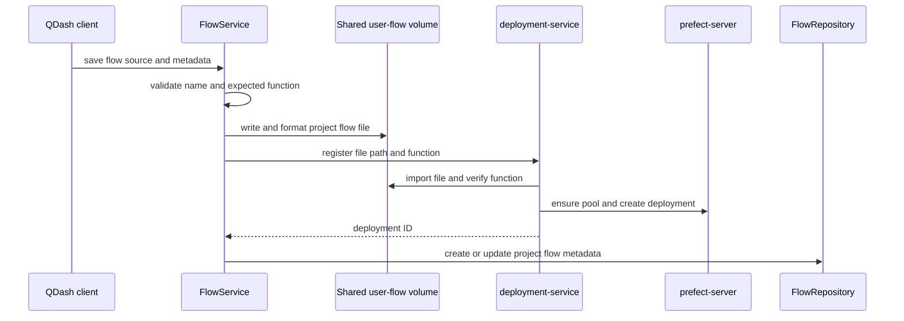
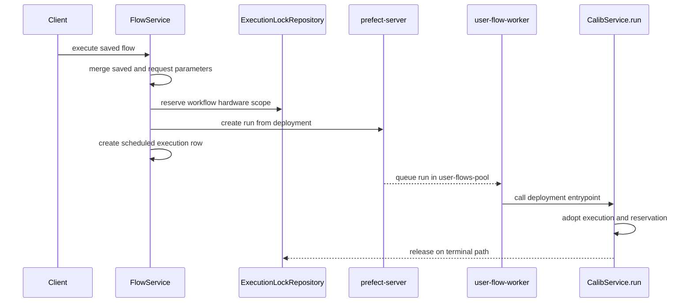

# Workflow Services

The workflow service layer turns project-scoped Python flow files into Prefect deployments and
connects dispatched flow runs to QDash execution history, hardware reservations, and artifacts.

## Responsibility Boundaries

| Component | Owns | Does not own |
| --- | --- | --- |
| API `FlowService` | Flow CRUD, project metadata, dispatch admission, and scheduled execution rows | Importing or running user code |
| API `FlowScheduleService` | Project-scoped cron and one-time schedule operations | Worker execution |
| `deployment-service` | Import validation and Prefect deployment or schedule mutations | QDash project authorization |
| `prefect-server` | Prefect flows, deployments, schedules, run states, and queues | QDash calibration records |
| `user-flow-worker` | Polling `user-flows-pool` and running deployment entrypoints | Flow persistence or API authorization |
| `CalibService` | The workflow author's contract: a checked context, run metadata, and `run(targets, steps)` | Execution IDs, reservations, workers, or cleanup |
| `CalibSession` | In-process pipeline, execution, reservation, worker, and terminal lifecycle | Deployment registration or project authorization |

The API is the authority for project context and QDash metadata. Prefect is the orchestration
authority. MongoDB execution documents remain the QDash-facing history even though each record can
carry a Prefect `flow_run_id`.

## Workflow Author Contract

`CalibService` takes only what a workflow author decides: a checked execution context, run
metadata (`flow_name`, `tags`, `note`), and `default_run_parameters`. Targets go to
`run(targets, steps)`; per-call settings go to each `TaskCall`. QDash owns everything else:
execution IDs, hardware reservations, worker sessions, snapshot restoration, GitHub
synchronization, and closing every Execution on success, failure, or cancellation. There is no
`finish_calibration()` to call, and one service can run several times.

A context names the user, chip, project, and backend of a run. `resolve_calib_context()` in
`service/context.py` builds it and applies the API's project rule: the user must exist, be
enabled, and hold an active `owner` or `editor` membership, or own the project. Without
`project_id` it uses the user's `default_project_id`. `CalibContext` cannot be constructed
directly, so an unchecked project ID never reaches a session.

| Entry | Use | Context |
| --- | --- | --- |
| `CalibService(username, chip_id, project_id=..., flow_name=...)` | Prefect flows that QDash starts; the API injects these parameters | Resolved by the constructor on the configured default backend |
| `CalibService.from_context(resolve_calib_context(username, chip_id, project_id=..., backend="fake"), ...)` | Direct Python, and flows that choose a backend, such as `templates/fake_backend.py` | Resolved by the caller |

The worker re-checks the injected context, so a schedule created by a user who later lost
write access fails before any session opens. A flow that declares a `source_execution_id`
parameter restores snapshot parameters from that execution; see
[Parameter Resolution](./parameter-resolution.md#snapshot-re-execution).

The constructor rejects every removed argument with a `TypeError` that names its migration:

| Removed argument | Migration |
| --- | --- |
| `qids`, `muxes` (also positional) | `cal.run(QubitTargets(qids), steps)` or `cal.run(MuxTargets(mux_ids), steps)` |
| `task_parameters`, `task_run_parameters` | Set `run`, `input`, and `update_calibration_parameters` on each `TaskCall`; see [Task Calls](./task-calls.md#migrate-per-task-defaults) |
| `name` | `flow_name` |
| `backend_name` | `resolve_calib_context(..., backend=...)` with `CalibService.from_context()` |
| `configuration_mode` | Put a `ConfigureAll` step whose call sets `run={"configuration_mode": ...}` first; see [Configuration mode and GitHub policy](#configuration-mode-and-github-policy) |
| `execution_id`, `use_lock`, `skip_execution`, `resource_scope` | Remove; each calibration step owns one Execution inside the run's reservation |
| `enable_github`, `enable_github_pull`, `github_push_config` | Remove; pull and push follow `github` in `config/app/workflow.yaml`. A run that must not synchronize uses the internal path in [Configuration mode and GitHub policy](#configuration-mode-and-github-policy) |
| `source_execution_id`, `source_task_id`, `snapshot_exempt_tasks`, `force_update_params` | Re-execute through `single-task-executor`, or declare a `source_execution_id` flow parameter |
| `user_repo`, `lock_repo`, `counter_repo` | Remove; resolve the context with `resolve_calib_context()` |

### Configuration mode and GitHub policy

The removed `configuration_mode` argument and the public `ConfigureAll` step set the Qubex
layout at different points. `SessionSettings.configuration_mode` is the initial layout: every
session of the run, and every worker, initializes its backend with it, from the first step on.
When it is `None`, the session uses `QUBEX_CONFIGURATION_MODE`. A `ConfigureAll` step whose call
sets `configuration_mode` switches the layout when that step starts; that step, later steps, and
their workers use it, while earlier steps keep the initial layout. A `ConfigureAll` placed first,
as `templates/characterization.py` does, therefore runs the whole pipeline in its layout.

GitHub pull and push follow the deployment. `GitHubPolicy.from_deployment()` in
`service/_internal/settings.py` reads `github.enabled` (default `true`) and `github.branch`
(default `main`) from `config/app/workflow.yaml`, and returns `GitHubPolicy.disabled()` when
`enabled` is not `true` or the backend is not `qubex`. Credentials alone never enable
synchronization. `TaskCall(..., update_calibration_parameters=False)` only stops that call's
outputs from replacing calibration values; it does not stop the step's pull or push.

QDash-internal code that needs a different initial layout, or no synchronization for one run,
builds the settings itself and calls the internal runner with a checked context.
`SessionSettings` built without `github` is disabled, so only `GitHubPolicy.from_deployment()` or
`GitHubPolicy.pull_and_push()` turns synchronization on:

```python
from qdash.workflow.service import ConfigureAll, CustomOneQubit, QubitTargets, TaskCall
from qdash.workflow.service import resolve_calib_context
from qdash.workflow.service._internal.runs import run_calibration, workflow_settings
from qdash.workflow.service._internal.settings import GitHubPolicy

context = resolve_calib_context("alice", "64Qv3", project_id="project-1")
settings = workflow_settings(
    context, flow_name="maintenance", tags=None, note=None, default_run_parameters=None
).model_copy(update={"configuration_mode": "ge-ef-cr", "github": GitHubPolicy.disabled()})
results = run_calibration(
    settings,
    QubitTargets(["0", "1"]),
    [ConfigureAll(), CustomOneQubit(tasks=[TaskCall(name="CheckRabi")])],
)
```

`workflow_settings()` adds the saved flow defaults and snapshot source a workflow run would use,
and `run_calibration()` runs the settings it receives without reapplying the deployment policy.
Workers still never pull or push.

## Save and Register a Flow

Saving a flow crosses the API and deployment containers because the deployment service imports the
source for registration and owns Prefect deployment mutations.



`FlowService.save_flow()` writes `<project_id>/<flow_name>.py`, formats it with Ruff, and maps the
API-visible path to the deployment container's shared volume. Registration fails when the file
cannot be imported or the expected function is absent.

A save creates the flow or replaces an existing one, which is what the flow editor's **Save**
expects. With `create_only` in `SaveFlowRequest`, as **New Flow** sends it, the save only creates:
an existing flow record or flow file with that name returns 409, and the stored source, metadata
and deployment stay untouched. Saves of one flow name run one at a time:
`FlowSourceStore.lock()` holds the `filelock` lock `.<flow_name>.py.lock` beside the source
file, so the lookup and the write cannot interleave across API processes on the host. A
create-only save also opens the source file exclusively, and the unique `(project_id, name)`
index turns a concurrent metadata insert into 409, so a writer that bypasses the lock still
cannot overwrite the flow. A save waits up to 120 seconds for the lock, then returns 503.

Updating a registered flow replaces its Prefect deployment. Before deletion, the deployment
service reads its schedules and default parameters and applies them to the replacement. The
read-delete-create sequence is not transactional; a concurrent Prefect edit in that interval can
be lost, so deployment changes should continue to enter through QDash.

## Dispatch a Run

An API-triggered run is admitted before Prefect receives it:



Parameter merging uses saved defaults first and request parameters second. The API then injects the
authenticated `username`, saved `flow_name`, and current `project_id`, so a request cannot replace
those values. Saved tags are used only when the merged parameters do not already contain `tags`.

The API atomically claims the workflow resource scope before it creates the Prefect run. It then
pre-creates a `scheduled` execution record so the run appears in QDash before a worker starts. If
dispatch fails, the API releases its claim. If scheduled-row creation fails after dispatch, the
flow can still create its own execution when it starts.

Cron-triggered runs do not pass through `FlowService.execute_flow()`. Their run creates an execution
ID and acquires the planned reservation at worker start. This difference is why the runtime
supports both adopting an API claim and claiming resources itself.

### Per-run Target Overrides

`GetFlowResponse.target_defaults` exposes literal targets found in the saved entrypoint by
`flow_service/target_defaults.py`, using the saved default parameters. Inspection does not
import or execute user code. It follows `if` branches only when the test reads a known value.
Unresolved expressions, possible mutations, other target types, targets built in other module
functions, and differing targets return no default.

`ExecuteFlowRequest.target_override` (`FlowTargetOverride` in `datamodel/flow_targets.py`) selects
exactly one non-empty mode: `mux_ids` with optional `exclude_qids`, `qids`, or `coupling_pairs`.
`coupling_pairs` is a list of directed `[control, target]` string pairs such as `["63", "85"]`;
`["85", "63"]` is a different pair, and a pair with equal qubits or a repeated pair is invalid.

`GetFlowResponse.target_modes` lists the modes a saved source accepts, computed by
`supported_target_modes()` from the entrypoint's syntax tree without executing the source. It is
`["coupling_pairs"]` only when every `CalibService` `.run()` call in the entrypoint receives
`CouplingTargets(...)` and a step list that always contains `SetCRSchedule`; otherwise it is
`["mux_ids", "qids"]`. The step list must be a list literal or a name assigned only list literals
with `SetCRSchedule` and changed only by `append`, `extend`, `insert`, or `+=` with step calls.
Pipeline construction the check cannot prove keeps `["mux_ids", "qids"]`: no `.run()` call, a run
inside a loop, comprehension, or lambda, targets or services from parameters, nested functions,
any reference to a function or class defined in the module, other `*Targets` or
`GenerateCRSchedule` calls in the entrypoint, and services or targets built at module level.
Unused module functions do not affect the result, and calls into other modules are not followed.
`target_defaults` can then report literal `CouplingTargets` pairs as `coupling_pairs`. The execute
dialog offers only the listed modes and ignores defaults of a mode it does not offer. `execute_flow()` rejects a mode outside `target_modes` with
HTTP 400, and for `coupling_pairs` it also rejects, before dispatch, any pair whose exact
`control-target` coupling ID is missing from the run chip's topology.

The API always stores the override in Prefect's run context under `qdash_target_override`,
omitting unselected modes so workers that predate a mode can still parse it. When the entrypoint
declares the argument for the selected mode, the API also passes the declared target arguments and
sets the other mode's argument to `None`, so templates that validate targets before creating
`CalibService` accept the selection. Otherwise the saved parameters stay unchanged. Workflows that
pass literal targets directly to `CalibService.run()` keep their source and function signature
unchanged. The API never derives other arguments, such as a `schedule`, from the override. The
`two_qubit_scheduled` template therefore declares `coupling_pairs` beside an optional `schedule`:
`coupling_pairs` takes precedence, a call with neither fails before calibrating, and a direct call
with `coupling_pairs` and no override runs each pair in its own group. Deploy the API and workflow
workers together to enable this behavior.

`CalibService.run()` applies the override through `override_pipeline()` in
`service/flow_targets.py`. A MUX or qubit override replaces the initial `MuxTargets` or
`QubitTargets`; a pair override replaces the initial `CouplingTargets`. Other target types, such as
`AllMuxTargets`, fail with an error instead of running unchanged. A pair override also replaces the
`schedule` of every `SetCRSchedule` step with groups that `CRScheduler.schedule_pairs()` builds from
the selected pairs, so the saved schedule can neither add nor reverse pairs. Pipelines with
`GenerateCRSchedule`, which rebuilds pairs from qubits, or without `SetCRSchedule` fail with an
error. Every service in the current flow uses the
selection; later pipeline filters and isolated workers retain their derived subsets. Separate
nested Prefect flows do not inherit this context, and explicit task-level IDs are not rewritten.
Omitting the override preserves code behavior. The complete workflow still reserves its chip.

## Manage Schedules

`FlowScheduleService` resolves the saved deployment within the current project. It accepts either a
cron expression or one `scheduled_time`, never both.

- Cron schedules are stored on the Prefect deployment and can be activated, updated, or removed.
- One-time schedules are Prefect flow runs placed directly in the `Scheduled` state.
- Listing combines cron schedules from deployments with scheduled one-time flow runs.
- Resaving a flow preserves deployment schedules and their parameters.

Use QDash APIs for mutations. Direct Prefect edits bypass project metadata checks and can race with
deployment replacement.

## Resolve Files and Artifacts

The API, deployment service, and worker share the user-flow directory at different container
paths. `common/config/path_resolver.py` owns these conversions; do not construct container paths in
routers or flow templates.

Calibration figures, raw data, notes, and exported parameters live beneath `CALIB_DATA_PATH`. In
Docker, the API and workers mount the same host directory at `/app/calib_data`. Stored execution
paths use the container layout, while API reads map them back to the configured local mount.

GitHub configuration synchronization is separate from flow registration. When the run's
`GitHubPolicy` enables it, `GitHubIntegration` pulls configuration before each step's Execution
and pushes the calibration note and parameter files when the step completes; see
[Configuration mode and GitHub policy](#configuration-mode-and-github-policy). Isolated workers
never pull or push.

## Handle Terminal States

Top-level flow hooks reconcile cancellations, failures, and crashes that interrupt normal runtime
cleanup. They find QDash executions by `flow_run_id`, finalize unfinished tasks, and release the
owning reservation. Nested worker flows use keep-lock variants because the parent pipeline owns
the reservation. See [Workflow Engine Architecture](./engine-architecture.md#cancellation) for the
in-process rules.

## Source and Tests

| Concern | Source | Focused tests |
| --- | --- | --- |
| Flow CRUD and dispatch | `src/qdash/api/services/flow_service/` | `tests/qdash/api/services/test_flow_service.py`, `tests/qdash/api/services/flow_service/` |
| Schedule API policy | `src/qdash/api/services/flow_schedule_service.py` | `tests/qdash/api/services/test_flow_schedule_service.py` |
| Prefect registration service | `src/qdash/workflow/deployment_service.py` | `tests/qdash/workflow/test_deployment_service.py` |
| Author contract and migration errors | `src/qdash/workflow/service/calib_service.py` | `tests/qdash/workflow/service/test_calib_service.py` |
| Context resolution and authorization | `src/qdash/workflow/service/context.py` | `tests/qdash/workflow/service/test_calib_context.py` |
| Runtime lifecycle and worker settings | `src/qdash/workflow/service/_internal/session.py`, `_internal/settings.py`, `_internal/runs.py` | `tests/qdash/workflow/service/test_calib_session.py` |
| Shared path mapping | `src/qdash/common/config/path_resolver.py` | `tests/qdash/common/config/test_path_resolver.py` |

Run API tests when flow persistence or dispatch changes, workflow tests when deployment or runtime
behavior changes, and both when a change crosses the HTTP boundary.
