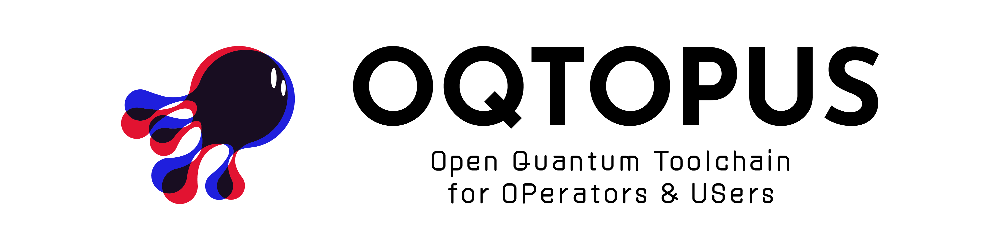

<!-- markdownlint-disable MD041 -->


# pi-qcaleval

[](https://github.com/oqtopus-team/qdash/actions/workflows/publish-typescript-packages.yml)
[](https://www.npmjs.com/package/@oqtopus-team/pi-qcaleval)
[](https://opensource.org/licenses/Apache-2.0)
[](https://join.slack.com/t/oqtopus/shared_invite/zt-3bpjb7yc3-Vg8IYSMY1m5wV3DR~TMSnw)

`@oqtopus-team/pi-qcaleval`: Evaluate calibration figures with a vision model and return structured diagnoses. No QDash dependency is required.

## Installation

```bash
npm install -g --ignore-scripts @earendil-works/pi-coding-agent
pi install npm:@oqtopus-team/pi-qcaleval
```

Requires Node.js 20 or later. Append `@beta` to the extension package for a prerelease.

## Quick Start

Configure an image-capable evaluation model in pi's `models.json`, then ask pi to evaluate a
calibration figure. `qcal_evaluate` asks the six [QCalEval](https://arxiv.org/abs/2604.25884)
questions and parses the answers. Use `QCALEVAL_MODEL` to select a model explicitly.

Remove the old `@orangekame3/pi-qcaleval` package before installing this one to avoid loading
both extensions.

See the [tool reference](https://oqtopus-team.github.io/qdash/reference/pi-qcaleval) for inputs,
outputs, commands, and configuration.

## Development

Develop in the QDash monorepo. Follow the
[package guide](https://oqtopus-team.github.io/qdash/developer-guide/agent/packages) for setup,
checks, and releases, and the
[extension guide](https://oqtopus-team.github.io/qdash/developer-guide/agent/extensions) for code boundaries.

Report bugs in [QDash issues](https://github.com/oqtopus-team/qdash/issues).
Licensed under [Apache 2.0](./LICENSE).
