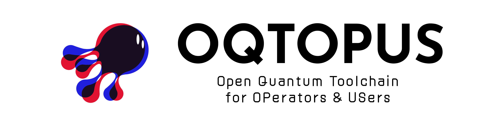

<!-- markdownlint-disable MD041 -->


# pi-qdash

[](https://github.com/oqtopus-team/pi-qdash/actions/workflows/ci.yaml)
[](https://www.npmjs.com/package/@oqtopus-team/pi-qdash)
[](https://opensource.org/licenses/Apache-2.0)
[](https://join.slack.com/t/oqtopus/shared_invite/zt-3bpjb7yc3-Vg8IYSMY1m5wV3DR~TMSnw)

## Overview

**pi-qdash** is a [pi](https://github.com/badlogic/pi-mono) extension for querying [QDash](https://github.com/oqtopus-team/qdash), the large-scale QPU calibration platform in the OQTOPUS ecosystem, directly from the pi coding agent.

It uses [`@oqtopus-team/qdash-client`](https://www.npmjs.com/package/@oqtopus-team/qdash-client) and reuses existing `QDASH_*` environment variables or profiles from `~/.config/qdash/config.ini` / `$XDG_CONFIG_HOME/qdash/config.ini`.

## Key Features

- **Read-only investigation**: dedicated tools to inspect chips, qubits, couplings, calibration task results, task knowledge (`qdash_get_task_knowledge`), executions, and Forum posts. Secrets are redacted from tool output.
- **Dashboards and insights**: compact dashboards, triage overviews, target-level incident reports, degradation reports, and wiring insights.
- **Agent calibration workflow**: create agent sessions, submit and track agent actions, and commit/apply calibration candidates. Write operations are approval-gated.
- **Calibration pipelines**: compose a declarative pipeline spec from QDash's step catalog (`qdash_get_pipeline_catalog`), validate it (`qdash_plan_pipeline`), and run it as one execution (`qdash_run_pipeline`, approval-gated).
- **Figures**: fetch calibration PNG/JSON figures and render them in the interactive TUI.
- **Generic timeseries comparison**: inspect and align arbitrary QDash parameters/targets with explicitly mapped local CSV sensor columns, reuse schema-validated investigation presets, and report correlations plus optional shared-period/phase evidence without hard-coded metrics or schemas.
- **Forum integration**: read Forum posts, publish task-result evidence, and upload locally generated analysis images to replies.

## Installation

Install pi first if needed:

```bash
npm install -g --ignore-scripts @earendil-works/pi-coding-agent
```

Install the published extension:

```bash
pi install npm:@oqtopus-team/pi-qdash
```

Or try it without installing:

```bash
pi -e npm:@oqtopus-team/pi-qdash
```

Requires Node.js 20 or later and pi v0.74.0 or later. The extension tracks
`@oqtopus-team/qdash-client` 1.9.x and uses its authenticated high-level and
generated API clients.

Changes to the pi packages on QDash’s `develop` branch publish a prerelease under the `beta` dist-tag
(the next patch version with a `-beta.<build>` suffix, for example
`0.1.10-beta.42`). Use it to try tools that are merged but not yet released:

```bash
pi install npm:@oqtopus-team/pi-qdash@beta
```

## Quick Start

In interactive pi, set up the session context first:

```text
/qdash-setup <profile> <chip_id>
/qdash-dashboard
```

See the documentation below for the full tool and command reference.

## Developing from a Fork

For local development, clone your QDash fork and use the root Bun workspace:

```bash
git clone https://github.com/<your-user>/qdash.git
cd qdash
bun install --frozen-lockfile
task ci-pi-packages
pi -e ./packages/pi-qdash
```

See [Development Guide](./docs/DEVELOPMENT.md) for the fork workflow, local testing, PR expectations, and the extension-vs-skill design policy.

## Documentation

- [Architecture](./docs/ARCHITECTURE.md)
- [Tool Reference](./docs/tools.md)
- [Commands & Skills](./docs/commands.md)
- [Development Guide](./docs/DEVELOPMENT.md)
- [Contributing](./docs/CONTRIBUTING.md)

## Citation

Citation information is available in the [CITATION](./CITATION.cff) file.

## Contact

You can contact us by creating an issue in this repository or by email:

- [oqtopus-team[at]googlegroups.com](mailto:oqtopus-team[at]googlegroups.com)

## License

pi-qdash is released under the [Apache License 2.0](./LICENSE).
