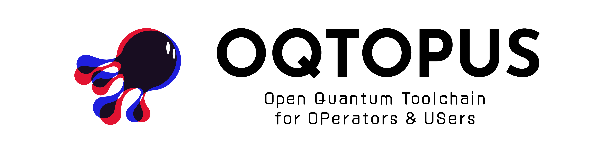

<!-- markdownlint-disable MD041 -->


# pi-qdash

[](https://github.com/oqtopus-team/qdash/actions/workflows/publish-typescript-packages.yml)
[](https://www.npmjs.com/package/@oqtopus-team/pi-qdash)
[](https://opensource.org/licenses/Apache-2.0)
[](https://join.slack.com/t/oqtopus/shared_invite/zt-3bpjb7yc3-Vg8IYSMY1m5wV3DR~TMSnw)

`@oqtopus-team/pi-qdash`: Query calibration data and run approved operations from pi CLI or QDash Agent.

## Installation

```bash
npm install -g --ignore-scripts @earendil-works/pi-coding-agent
pi install npm:@oqtopus-team/pi-qdash
```

Requires Node.js 20 or later. Append `@beta` to the extension package for a prerelease.

## Quick Start

Configure a [QDash client profile](https://oqtopus-team.github.io/qdash/reference/clients/python#connect-to-a-deployment), then in pi:

```text
/qdash-setup <profile> <chip_id>
/qdash-dashboard
```

Writes require approval. An approved `auto` session permits only the operations in its grant.
Read-only tools can inspect results, figures, history, and Forum discussions.

See the [tool reference](https://oqtopus-team.github.io/qdash/reference/pi-qdash) for inputs,
outputs, commands, and configuration.

## Development

Develop in the QDash monorepo. Follow the
[package guide](https://oqtopus-team.github.io/qdash/developer-guide/agent/packages) for setup,
checks, and releases, and the
[extension guide](https://oqtopus-team.github.io/qdash/developer-guide/agent/extensions) for code boundaries.

Report bugs in [QDash issues](https://github.com/oqtopus-team/qdash/issues).
Licensed under [Apache 2.0](./LICENSE).
